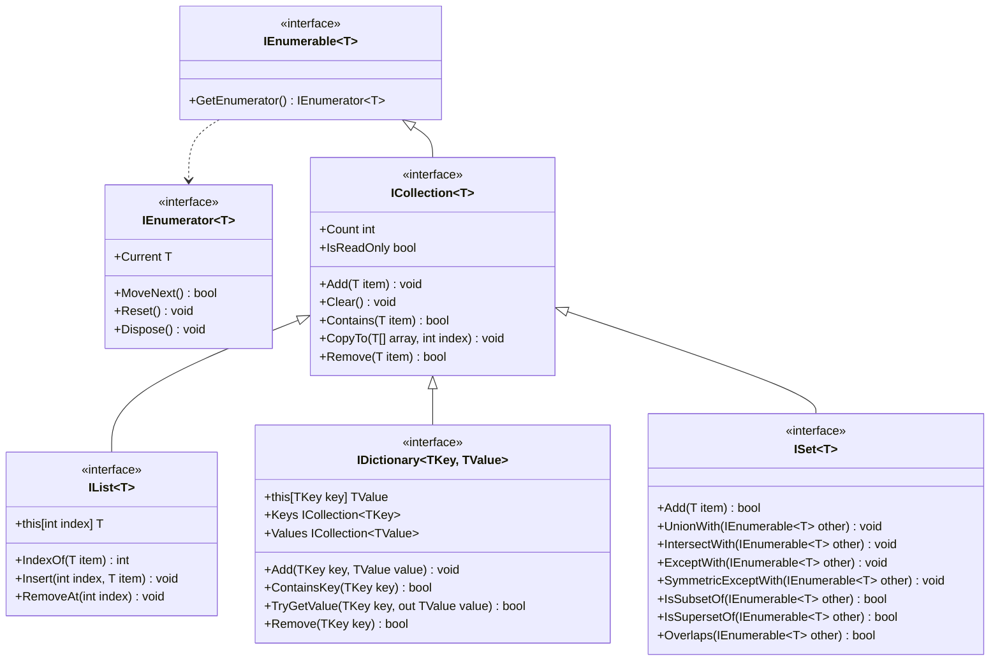

# Quick lecture revision

## Generics 

Generics let you write type-safe, reusable code without committing to a specific type until the code is used. Despite some differences, they serve the same purpose templates do in C++. For instance, the following method from C++:
```cpp
template <typename T>
T Max(T a, T b) { return a > b ? a : b; }
```

would look like this in C#:
```csharp
T Max<T>(T a, T b) where T : IComparable<T> => a.CompareTo(b) > 0 ? a : b;
```

### Why do we use generics?
Consider another example:
1. Elimination of boxing/unboxing and runtime casting:

Without generics:
```csharp
ArrayList list = new ArrayList();
list.Add(1);
int x = (int)list.Get(0); // unboxing, runtime cast
```
With generics:

```csharp
List<int> list = new List<int>();
list.Add(1);
int x = list[0];
```

2. Universal and reusable code:
```csharp
public class Box<T> {
    public T value;
    public Box(T val) { value = val; } 
}

var intBox = new Box<int>(1);
var strBox = new Box<string>("hi");
```
Without generics you would need two separate box classes for integers and strings.

### Generics in context of inheritance
The rules of the inheritance will be best explained with an example:
```csharp
class A {}
class B<T> {}

class C1 : B {}         // error
class C2 : B<T> {}      // error
class C3<T> : B<T> {}   // correct
class C4 : B<int> {}    // correct
class C5<S> : B<T> {}   // error
class C6<S> : A {}      // correct
class C7<S> : B<int> {} // correct
class C8<S,T> : B<T> {} // correct
```
Try to analayze it yourself.

## Constraints
Constraints restrict what types can be used as type parameter.

| Constraint | Meaning |
|---|---|
| `where T : struct` | Non-nullable value type
| `where T : class` | Reference type; in nullable context, must be non-nullable
| `where T : class?` | Nullable reference type
| `where T : notnull`	| Non-nullable
| `where T : unmanaged` |	Non-nullable unmanaged value type
| `where T : new()` |	Has public parameterless constructor
| `where T : BaseClass` |	Is or derives from BaseClass
| `where T : IInterface` | Implements said interface
| `where T : U` |	Is or derives from another type parameter
| `where T : default` | Used for overrides, when you need to specify an unconstrained type
| `where T : allows ref struct` |	Allows `ref` structs

> [!NOTE]
> If you don't know or forgot what nullability is and means in C# you may head [here](https://csharp.mini.pw.edu.pl/en/lectures/05.csharp-features/nullable/) and [here](https://learn.microsoft.com/en-us/dotnet/csharp/fundamentals/null-safety/).

While similar to C++ templates, generics have two key differences:
1. During compile time, only one version of the generic is created in CIL. The concrete instantiation is created in runtime (JIT), at first use. Meanwhile templates are already created during compile time, with one machine-code copy per used type.
2. They are strongly checked at the generic definition, while templates are mostly checked with first usage (with some differences depending on the compiler).

Hence why, in the first example at the top of the page we had to use `where T : IComparable<T>`, while in C++ we could use a concept like `requires std::totally_ordered<T>`, but we don't need to.


### Constraints can be combined:
```csharp
public class Box<T> where T : class, IEntity, new() {}
```

## Covariance and contravariance
Variance rules restric how generic parameters can be used and tell you whether you can substitute a `Generic<Derived>` for a `Generic<Base>` (covariance) or vice versa (contravariance). They are mostly used with interfaces and delegates.

### Covariance (`out`)
`out T` means `T` only appears as an output (return type, `out` parameter or get-only property).
```csharp
public interface IProducer<out T>
{
    T Produce();
    void Consume(T t); // not allowed, because T would be in input position
}
```
You can use a more derived type where a less derived one is expected. Consider example with covariant interface `IEnumerable<out T>`:

```csharp
IEnumerable<string> strings = new List<string>();
IEnumerable<object> objects = strings;
```

### Contravariance (`in`)
`in T` means `T` only appears as an input (a parameter, `in` parameter, or set-only property).
```csharp
public interface IConsumer<in T>
{
    void Consume(T item);
    T Produce(); // not allowed, because T would be in output position
}
```
You can use a less derived type where a more derived one is expected. Consider example with contravariant interface `IComparer<in T>`:
```csharp
IComparer<object> objComparer = Comparer<object>.Default;
IComparer<string> strComparer = objComparer; 
```
#### Other built-in examples

|Type|Variance|
|---|---|
| `IReadOnlyList<out T>` | Covariant |
| `Action<in T>` | Contravariant |
| `Func<in T1, in T2, out TResult>` | Args are contravariant, result is covariant |

> [!NOTE]
> `Action<T>` or `Func<T, TResult>` are system generic delegates. If you don't know or forgot what delegate is and means in C# you may head [here](https://csharp.mini.pw.edu.pl/en/lectures/05.csharp-features/delegates/) and [here](https://learn.microsoft.com/en-us/dotnet/csharp/programming-guide/delegates/).

Most classes, like `List<T>`, are by default invariant:
```csharp
List<string> strings = new();
List<object> objects = strings; // compile error
```
```csharp
List<object> objects = new();
List<string> strings = objects; // compile error
```
> [!IMPORTANT]
> ## Generics example task

> ### TODO 1 - Implement generic NumBox class
> The class should derieve from `Box` class and work on any number type
> It should contain a constructor and additon operator:
> 
> `public static NumBox<T> operator+(NumBox<T> a, NumBox<T> b)` that returns a sum of values (a.Value + b.Value)
> 
> ### TODO 2 - Implement StringBox class
> The class should derieve from `Box` class, that will work only on strings
> The class should contain a constructor and additon operator:
> 
> `public static StringBox operator +(StringBox a, StringBox b)` that return concatanated string (a.Value + ";" + b.Value)
> 
> ### TODO 3 - Finish implementing Shelf class
> The class should implement `IAdder<T>` and `ITaker<T>` interfaces:
> - `public bool Add(T val)` - if shelf is full returns `false`, otherwise adds box at the end of `_items` and returns `true`
> - `public T? Take()` - takes and returns last box from shelf if possible, otherwise returns `null`
> 
> 

## Read more:
- [Boxing and Unboxing](https://learn.microsoft.com/en-us/dotnet/csharp/programming-guide/types/boxing-and-unboxing)
- [Covariance and Contravariance](https://learn.microsoft.com/en-us/dotnet/csharp/programming-guide/concepts/covariance-contravariance/)
- [Generic types and methods](https://learn.microsoft.com/en-us/dotnet/csharp/fundamentals/types/generics#covariance-and-contravariance)
- [Generics C# Programming Guide](https://learn.microsoft.com/en-us/dotnet/csharp/programming-guide/generics/generic-type-parameters)

## Collections
Before introducing generics in C# 2, the `System.Collections` provided a couple of data structures such as: `ArrayList`, `HashTable`, `SortedList`, `Queue`, `Stack` and `BitArray`. Because they can only store `objects`, they cause problems such as boxing and runtime casting, shown in the beginning of this tutorial. Therefore, with introduction of generics, they became obsolete (excluding the last one). Because of that, we will only focus on collections found in `System.Collections.Generic`, which ensure better type control and provide higher performance.

### General collections hierarchy

By analogy there is also `IReadyOnlyList<T>` and `IReadOnlyDictionary<TKey, TValue>`, that both inherit from `IReadOnlyCollection<T>`. There is no `IReadOnlySet<T>`.

### Standard collections

| Generic collection | Interface | Non-generic collection | STL |
|---|---|---|---|
| `List<T>` | `IList<T>` | `ArrayList` | `vector<T>` |
| `Dictionary<K,V>` | `IDictionary<K,V>` | `Hashtable` | `unordered_map<K,V>` |
| `OrderedDictionary<K,V>` | `IDictionary<K,V>` | `OrderedDictionary` | — |
| `SortedList<K,V>`| `IDictionary<K,V>` | `SortedList` | — |
| `SortedDictionary<K,V>`| `IDictionary<K,V>` | — | `map<K,V>` |
| `HashSet<T>`| `ISet<T>` | — | `unordered_set<T>` |
| `SortedSet<T>`| `ISet<T>` | — | `set<T>` |
| `LinkedList<T>`| `ICollection<T>` | — | `list<T>` |  
| `Queue<T>` | `ICollection<T>` | `Queue` | `queue<T>` |
| `Stack<T>` |`ICollection<T>` | `Stack` | `stack<T>` |
| `PriorityQueue<E,P>` | — | — | `priority_queue<T>` |
| — | `ICollection` | `BitArray` | `bitset` |

#### Notes:
- `BitArray` is an only non-geneneric collection without more modern generic equivalent;
- `OrderedDictionary<K,V>` has no direct STL-equivalent - it is a hashtable with additional array keeping the insertion order;
- `SortedList<K,V>` has no direct STL-equivalent - it is a key-ordered array, that uses binary search for lookup;
- `PriorityQueue<E,P>` is not enumerable, hence it doesn't implement any interface. It is however, like any reference type in C#, an `object`.

## Enumerables and `foreach` loops
Enumerators in C# are an equivalent of C++ iterators. If you look at the collections hierarchy graph, you can see that they expose one property and three methods, used for traversing collections, getting values and returning them to inital state. 

> [!NOTE]
> If you don't know or forgot what IDisposable is and means in C# you may head [here](https://csharp.mini.pw.edu.pl/en/lectures/05.csharp-features/disposable/).

Every collection in C# (besides `PriorityQueue`) is enumerable and implements `IEnumerable<T>` interface. This means they all must implement one method - `GetEnumerator()`. If collection has an enumerator, it can use a `foreach` loop:
```csharp
foreach (T item in collection) {
    // operation on the item
}
```
`foreach` loop in a syntactic sugar. Internally, it takes the enumerator and traverses the collection using `while` loop until `MoveNext()` method returns `false`. Important note - because `foreach` loop uses enumerators, the elements of the collection are **read-only**! 
```csharp
int sum = 0;
IEnumerable<int> collection = [1, 2, 3];

foreach (int item in collection) {
    sum += item;    // correct: we only read the collection element without modifying it
    item += 1;      // error: we cannot change variable because it is a read-only copy
}
```
```csharp
class Value {
    public int Val { get; set; }
}
IEnumerable<Value> collection = [new Value { Val = 1 }, new Value { Val = 2 }, new Value { Val = 3 }];

foreach (Value item in collection) {
    item.Val += 1;                  // correct: we can change the internal properties of the reference types
    item = new Value { Val = 4 };   // error: we cannot replace an object reference with a new object
}
```

### Tuple deconstruction
> [!NOTE]
> If you don't know or forgot what tuples are and mean in C# you may head [here](https://csharp.mini.pw.edu.pl/en/lectures/05.csharp-features/tuples/) and [here](https://learn.microsoft.com/en-us/dotnet/csharp/language-reference/builtin-types/value-tuples).

Tuple deconstruction can be used in `foreach` loops:
```csharp
    var dict = Dictionary<int, string> {{ 1, "1" }};
    string one = "";

    // without deconstruction
    foreach (var item in dict) {
        if (item.Key == 1) {
            one = item.Value;
        }    
    }
    // with deconstruction
    foreach (var (k, v) in dict) {
        if (k == 1) {
            one = v;
        }
    }
```

## `yield` statement
C# has a syntactic sugar feature called `yield` statement that allows us to create our own enumerating methods that use *lazy evaluation*:
```csharp
IEnumerable<int> TakeWhileEven(IEnumerable<int> numbers) {
    foreach (int n in numbers) {
        if (n % 2 == 0) {
            yield return n; // sets Current to n, advances with MoveNext and suspends execution until next call
        } else {
            yield break; // sets MoveNext return value to false
        }
    }
}
```
This also allows us to create factories, without any underlying data or collections - just values generated on the fly:
```csharp
IEnumerable<int> ProduceEvenNumbers(int upto) {
    for (int i = 0; i <= upto; i += 2) {
        yield return i; // sets Current to i, advances with MoveNext and suspends execution until next call
    }
}
```
Internally, calling a method that uses `yield` statement creates a state machine, which remembers the state of the iteration. This is why we talk about *lazy evaluation* - the next value is retrieved or generated only with the next call. Until that, the execution is simply suspended.

You can also use `yield` statement to implement enumerators:
```csharp
public readonly record struct Point3D(int X, int Y, int Z) {
    public IEnumerator<int> GetEnumerator() {
        yield return X;
        yield return Y;
        yield return Z;
    }
}
```
> [!NOTE]
> If you don't know or forgot what records are and mean in C# you may head [here](https://csharp.mini.pw.edu.pl/en/lectures/05.csharp-features/records/) and [here](https://learn.microsoft.com/en-us/dotnet/csharp/language-reference/builtin-types/record).


## Additonal features
### `params` modifier
Instead of passing a collection as an argument, you can use `params` keyword to have the collection created automatically. You can use array `T[]`, `Span<T>`, any interface that derives from `IEnumerable<T>` or any object that implements it and has both parameterless constructor and `Add(T element)` method.
```csharp
public void ParamsPrinter(params IEnumerable<int> ints) {
    foreach (int n in ints) {
        System.Console.WriteLine($"{n} ");
    }
}

ParamsPrinter(1, 2, 3);
// prints: 1 2 3
```

You can only use one `params` keyword in a method declaration and the parameter with the `params` keyword must be the last one.

### Collection expressions
Spread element `..` introduced C# 12 allows you to easily concatanate any **enumerable** collection:
```csharp
List<int> a = [1, 2, 3, 4, 5];
int[] b = [4, 5, 6, 7, 8];
SortedSet<int> combined = [10, ..a, ..b, 9];
// combined = { 1, 2, 3, 4, 5, 6, 7, 8, 9, 10 } 
```

### List and slice patterns
List and slice patterns introduced in C# 11 let you match the shape of a sequence with a pattern. They work on any type that has a countable length and an indexer, so array `T[]`, `string`, `Span<T>`, `List<T>` or any object implementing `IList<T>` interface.

```csharp
List<int> a = [ 1, 2, 3, 4, 5 ];

bool a1 = a is [1, 2, 3, 4, 5];         // true - exact match
bool a2 = a is [1, .., 5];              // true - starts with 1, ends with 5
bool a3 = a is [.., 5];                 // true - ends with 5
bool a4 = a is [1, ..];                 // true - starts with 1
bool a5 = a is [_, ..];                 // true - at least 1 element
bool a6 = a is [_, _, ..];              // true - at least 2 elements
bool a7 = a is [1, .. var mid, 5];      // true - and also mid = List<int> { 2, 3, 4 } 
bool a8 = a is [1, 2, .. var rest];     // true - and also rest = List<int> { 3, 4, 5 }  
```
> [!WARNING]
> Even though looking similar, don't confuse collection expressions or list and slice patterns with ranges, which will be discussed later.

## Comparing elements of collections
Several collection operations require a way to order elements:
- `List<T>.Sort()`
- `SortedDictionary<TKey, TValue>`, `SortedSet<T>`, `SortedList<TKey, TValue>`
- `Array.BinarySearch`, `List<T>.BinarySearch`
- `PriorityQueue<TElement, TPriority>`

For these, the type either needs to implement `IComparable<T>` or you must supply an `IComparer<T>`.
```csharp
public interface IComparable<in T> {
    int CompareTo(T? other);
}

public interface IComparer<in T> where T : allows ref struct {
    int Compare(T? x, T? y);
}
```
Regarding return value:
- `< 0` - `this` comes before `other` / `x` comes before `y`;
- `0` - `this` and `other` are equal / `x` and `y` are equal (for ordering);
- `> 0` - `this` comes after `other` / `x` comes after `y`.

Primitive types, `string` and `enum` implement `IComparable<T>` by default.

```csharp
// if I own Person and want them to be ordered by age
public class Person : IComparable<Person> {
    public string Name { get; }
    public int Age { get; }
    public Person(string name, int age) => (Name, Age) = (name, age);

    public int CompareTo(Person? other) {
        if (other is null) return 1;
        return Age.CompareTo(other.Age);
    }
}

List<Person> people = [ new("A", 30), new("B", 20) ];
people.Sort(); 
```
```csharp
// if I don't own Person, but still need to order them by age in some collection
public class PersonByAgeAscending : IComparer<Person> {
    public int Compare(Person? a, Person? b) {
        if (a is null) return -1;
        if (b is null) return 1;
        return a.Age.CompareTo(b.Age);
}

List<Person> people = [ new("A", 30), new("B", 20) ];
people.Sort(new PersonByAgeAscending());
```

Instead of implementing `IComparer<T>` you can also just derive from `Comparer<T>` and override the `int Compare(T? x, T? y)` method, which is usually advised.

> [!IMPORTANT]
> # Collections example tasks

> ## Working with sensor data
> ### TODO 1 — Write a lazy-evaluated method
> Return every reading whose `Value` is within [min, max] inclusive.
> Use `yield` keyword.
> 
> ### TODO 2 — Write a lazy-evaluated factory
> Produce readings from a single sensor, starting at `value`
> and increasing by 0.1/minute, timestamped 2 minute apart starting at `start`.
> Use `yield` keyword.
> 
> ### TODO 3 — Implement comparer derieved from `Comparer<Reading>`
> Order readings by:
> 1. Sensor name (ascending)
> 2. Then by recorded value (descending)
> 3. Then by time recorded (ascending)
>
> ### TODO 4 — Summarize sensor data
> Return:
> - `double HighestValue`                     - highest recorded value across all sensors
> - `double LowestTemp`                       - lowest recorded temperature
> - `string MostReadings`                     - name of the sensor with most readings
> - `TimeSpan TotalDuration`                  - difference between first and last recorded reading
> - `IList<string> UniqueSensors`             - list of all sensor names without duplicates
> - `IList<(string, double)> AverageReadings` - average reading per sensor
> - `IList<(string, TimeSpan)> LargestGaps`   - a largest timespan between two consecutive readings (time order) per sensor
> - `IList<(Reading, Reading)> SignChanges`   - two consecutive readings (time order) having two differnet signs (first < second) 
>
> ### TODO 5 — Pattern matching
> Inspect a list of readings and return a short label:
> - "empty"        if there are 0 readings
> - "single"       if there is 1 reading
> - "pair-asc"     if there are exactly 2 and values are ascending (v1 < v2)
> - "pair-desc"    if there are exactly 2 and values are descending (v1 > v2)
> - "pair-eq"      if there are exactly 2 and values are equal
> - "starts-high"  if it starts with a value > 100
> - "ends-low"     if it ends with a value < 0
> - "other"        otherwise
> 
> Use slice patterns. Do not use `Count` / `IndexOf` / if-chains / indices etc.
> 
> Hint: use [switch expression](https://csharp.mini.pw.edu.pl/en/lectures/03.basics/statements/)
> 
> 

> ## Implementing matrix library
> ### 1. Familiarize yourself with `Matrix<T>` class from `Matrix.cs`
> ### 2. In `DenseMatrix.cs` implement following methods of `DenseMatrix<T>` class:
> - `public DenseMatrix(int rows, int columns, T[]? values = null)`
> - `public static DenseMatrix<T> Identity(int size)`
> - `public static DenseMatrix<T> operator +(DenseMatrix<T> a, DenseMatrix<T> b)`
> - `public static DenseMatrix<T> operator -(DenseMatrix<T> a, DenseMatrix<T> b)`
> - `public static DenseMatrix<T> operator *(DenseMatrix<T> a, T scalar)`
> - `public static DenseMatrix<T> operator *(T scalar, DenseMatrix<T> a)`
> - `public static DenseMatrix<T> operator *(DenseMatrix<T> a, DenseMatrix<T> b)`
> - `public DenseMatrix<T> Clone()`
> 
> **and any other required methods.**
> ### 3. In `SparseMatrix.cs` implement following methods fo `SparseMatrix<T>` class:
> - `public SparseMatrix(int rows, int columns, T[]? values = null)`
> - `public static SparseMatrix<T> Identity(int size)`
> - `public static SparseMatrix<T> operator +(SparseMatrix<T> a, SparseMatrix<T> b)`
> - `public static SparseMatrix<T> operator -(SparseMatrix<T> a, SparseMatrix<T> b)`
> - `public static SparseMatrix<T> operator *(SparseMatrix<T> a, T scalar)`
> - `public static SparseMatrix<T> operator *(T scalar, SparseMatrix<T> a)`
> - `public static SparseMatrix<T> operator *(SparseMatrix<T> a, SparseMatrix<T> b)`
> - `public SparseMatrix<T> Clone()`
> 
> **and any other required methods.**
> 
> Student: 
> Solution: 

## Read more:
- [Iterators](https://learn.microsoft.com/en-us/dotnet/csharp/iterators)
- [`yield` statement](https://learn.microsoft.com/en-us/dotnet/csharp/language-reference/statements/yield)
- [Collection expressions](https://learn.microsoft.com/en-us/dotnet/csharp/whats-new/csharp-12#collection-expressions)
- [`Comparer<T>` Class](https://learn.microsoft.com/en-us/dotnet/api/system.collections.generic.comparer-1?view=net-10.0)
- [System.Collection.Generic Namespace](https://learn.microsoft.com/en-us/dotnet/api/system.collections.generic?view=net-10.0)

> [!IMPORTANT]
> # Additonal materials for workshop
> Materials: 
> Solutions: 


