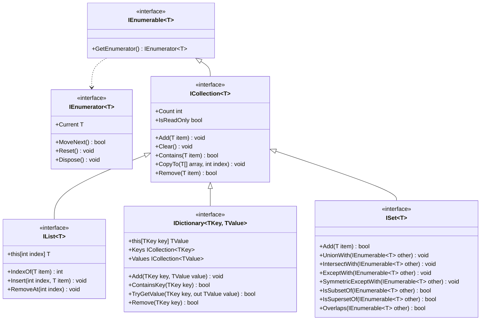

# Szybka powtórka wykładu

## Generyki 

Typy generyczne pozwalają pisać bezpieczny, statycznie typowany, reużywalny kod, bez wiązania się z konkretnym typem aż do momentu użycia. Pomimo pewnych różnic, pełnią one tę samą funkcję co szablony w C++. Na przykład następująca metoda z C++:
```cpp
template <typename T>
T Max(T a, T b) { return a > b ? a : b; }
```

wyglądałaby tak w C#:
```csharp
T Max<T>(T a, T b) where T : IComparable<T> => a.CompareTo(b) > 0 ? a : b;
```

### Dlaczego używamy generyków?
Rozważmy inny przykład:
1. Eliminacja pakowania oraz rzutowania w czasie wykonywania programu:

Bez generyków:
```csharp
ArrayList list = new ArrayList();
list.Add(1);
int x = (int)list.Get(0); // unboxing, runtime cast
```
Z generykami:

```csharp
List<int> list = new List<int>();
list.Add(1);
int x = list[0];
```

2. Uniwersalny kod wielokrotnego użytku:
```csharp
public class Box<T> {
    public T value;
    public Box(T val) { value = val; } 
}

var intBox = new Box<int>(1);
var strBox = new Box<string>("hi");
```
Bez typów generycznych należałoby stworzyć dwie osobne klasy - jedną dla liczb całkowitych, a drugą dla stringów.

### Typy generyczne a dziedziczenie
Zasady dziedziczenia najlepiej wyjaśni przykład:
```csharp
class A {}
class B<T> {}

class C1 : B {}         // error
class C2 : B<T> {}      // error
class C3<T> : B<T> {}   // correct
class C4 : B<int> {}    // correct
class C5<S> : B<T> {}   // error
class C6<S> : A {}      // correct
class C7<S> : B<int> {} // correct
class C8<S,T> : B<T> {} // correct
```
Spróbuj przeanalizować go samodzielnie.

## Ograniczenia
Ograniczenia określają, jakie typy mogą być użyte jako parametr typu.

| Constraint | Meaning |
|---|---|
| `where T : struct` | Typ wartościowy niebędący nullem
| `where T : class` | Typ referencyjny; w kontekście nullable musi być nie-nullowalny
| `where T : class?` | Nullowalny typ referencyjny
| `where T : notnull`	| Nie może być nullem
| `where T : unmanaged` | Nie-nullowalny typ wartościowy typu `unmanaged`
| `where T : new()` | Ma publiczny konstruktor bezparametrowy
| `where T : BaseClass` | Jest lub dziedziczy z BaseClass
| `where T : IInterface` | Implementuje wskazany interfejs
| `where T : U` | Jest lub dziedziczy z innego parametru typu
| `where T : default` | Stosowane przy przesłonięciach, gdy konieczne jest określenie nieograniczonego typu
| `where T : allows ref struct` | Pozwala na użycie struktur typu `ref`

> [!NOTE]
> Jeśli nie wiesz lub nie pamiętasz, czym jest nullowalność i co oznacza w języku C#, możesz sprawdzić [tutaj](https://csharp.mini.pw.edu.pl/pl/lectures/05.csharp-features/nullable/) oraz [tutaj](https://learn.microsoft.com/en-us/dotnet/csharp/fundamentals/null-safety/).

Choć podobne do szablonów z C++, typy generyczne różnią się w dwóch kluczowych kwestiach:
1. Podczas kompilacji, w CIL tworzona jest tylko jedna wersja typu generycznego. Konkretna instancja jest tworzona w czasie wykonywania (JIT), przy pierwszym użyciu. Szablony są natomiast tworzone w trakcie kompilacji, z jedną kopią kodu maszynowego na każdy użyty typ.
2. Są one ściśle sprawdzane już przy definicji typu generycznego, podczas gdy szablony są weryfikowane głównie podczas pierwszego użycia (z pewnymi różnicami zależnymi od kompilatora).

Dlatego w pierwszym przykładzie na górze strony musieliśmy użyć `where T : IComparable<T>`, podczas gdy w C++, choć moglibyśmy użyć konceptu takiego jak `requires std::totally_order<T>`, nie jest to konieczne.


### Ograniczenia można łączyć:
```csharp
public class Box<T> where T : class, IEntity, new() {}
```

## Kowariancja i kontrawariancja
Reguły wariancji ograniczają sposób używania parametrów generycznych i informują, czy można zastąpić `Generic<Derived>` przy pomocy `Generic<Base>` (kowariancja) lub odwrotnie (kontrawariancja). Są one głównie używane przy interfejsach i delegatach.

### Kowariancja (`out`)
`out T` oznacza, że ​​`T` pojawia się tylko jako wynik (typ zwracany, parametr `out` lub właściwość tylko do odczytu).
```csharp
public interface IProducer<out T>
{
    T Produce();
    void Consume(T t); // not allowed, because T would be in input position
}
```
Możesz użyć bardziej pochodnego typu tam, gdzie oczekiwany jest typ mniej pochodny. Rozważmy przykład z kowariantnym interfejsem `IEnumerable<out T>`:

```csharp
IEnumerable<string> strings = new List<string>();
IEnumerable<object> objects = strings;
```

### Kontrawariancja (`in`)
`in T` oznacza, że `T` występuje wyłącznie jako wejście (parametr, parametr `in` lub właściwość tylko do zapisu).
```csharp
public interface IConsumer<in T>
{
    void Consume(T item);
    T Produce(); // not allowed, because T would be in output position
}
```
Możesz użyć typu mniej pochodnego tam, gdzie oczekiwany jest typ bardziej pochodny. Rozważ przykład z kontrawariantnym interfejsem `IComparer<in T>`:
```csharp
IComparer<object> objComparer = Comparer<object>.Default;
IComparer<string> strComparer = objComparer; 
```
#### Inne systemowe przykłady

|Typ|Wariancja|
|---|---|
| `IReadOnlyList<out T>` | Kowariantny |
| `Action<in T>` | Kontrawariantny |
| `Func<in T1, in T2, out TResult>` | Argumenty są kontrawariantne, wynik jest kowariantny |

> [!NOTE]
> `Action<T>` lub `Func<T, TResult>` to generyczne systemowe delegaty. Jeśli nie wiesz lub zapomniałeś, czym jest delegata i co oznacza w C#, możesz sprawdzić [tutaj](https://csharp.mini.pw.edu.pl/pl/lectures/05.csharp-features/delegates/) oraz [tutaj](https://learn.microsoft.com/en-us/dotnet/csharp/programming-guide/delegates/).

Większość klas, tak jak `List<T>`, jest domyślnie niezmiennicza (inwariantna):
```csharp
List<string> strings = new();
List<object> objects = strings; // compile error
```
```csharp
List<object> objects = new();
List<string> strings = objects; // compile error
```
> [!IMPORTANT]
> ## Przykładowe zadanie z generyków

> ### TODO 1 — Zaimplementuj generyczną klasę NumBox
> Klasa powinna dziedziczyć po klasie `Box` i działać na dowolnym typie liczbowym.
> Powinna zawierać konstruktor i operator dodawania:
> 
> `public static NumBox<T> operator+(NumBox<T> a, NumBox<T> b)`, który zwraca sumę wartości (a.Value + b.Value)
> 
> ### TODO 2 — Zaimplementuj klasę StringBox
> Klasa powinna dziedziczyć po klasie `Box` i działać tylko na ciągach znaków.
> Klasa powinna zawierać konstruktor i operator dodawania:
> 
> `public static StringBox operator +(StringBox a, StringBox b)`, który zwraca połączony ciąg znaków (a.Value + ";" + b.Value)
> 
> ### TODO 3 — Dokończ implementację klasy Shelf
> Klasa powinna implementować interfejsy `IAdder<T>` i `ITaker<T>`:
> 
> `public bool Add(T val)` — jeśli półka jest pełna, zwraca `false`; w przeciwnym razie dodaje pudełko na końcu `_items` i zwraca `true`
> 
> `public T? Take()` — pobiera i zwraca ostatnie pudełko z półki, jeśli to możliwe; w przeciwnym razie zwraca `null`
> 
> 

## Więcej na ten temat:
- [Boxing and Unboxing](https://learn.microsoft.com/en-us/dotnet/csharp/programming-guide/types/boxing-and-unboxing)
- [Covariance and Contravariance](https://learn.microsoft.com/en-us/dotnet/csharp/programming-guide/concepts/covariance-contravariance/)
- [Generic types and methods](https://learn.microsoft.com/en-us/dotnet/csharp/fundamentals/types/generics#covariance-and-contravariance)
- [Generics C# Programming Guide](https://learn.microsoft.com/en-us/dotnet/csharp/programming-guide/generics/generic-type-parameters)

## Kolekcje
Zanim wprowadzono generyki wraz z C# 2, przestrzeń nazw `System.Collections` oferowała szereg struktur danych, takich jak: `ArrayList`, `HashTable`, `SortedList`, `Queue`, `Stack` oraz `BitArray`. Ponieważ mogły one przechowywać jedynie obiekty typu `object`, wiązało się to z problemami takimi jak pakowanie (boxing) oraz rzutowanie typów w czasie wykonywania programu – o czym wspomniano na początku tego powtórzenia. Wraz z wprowadzeniem typów generycznych struktury te stały się przestarzałe (z wyjątkiem ostatniej z wymienionych). Z tego powodu skupimy się wyłącznie na kolekcjach dostępnych w przestrzeni nazw `System.Collections.Generic`, które zapewniają lepszą kontrolę typów oraz wyższą wydajność.

### Ogólna hierarchia kolekcji

Analogicznie istnieją również `IReadOnlyList<T>` oraz `IReadOnlyDictionary<TKey, TValue>`, które dziedziczą po `IReadOnlyCollection<T>`. Nie istnieje natomiast `IReadOnlySet<T>`.

### Kolekcje standardowe

| Kolekcja generyczna | Interfejs | Kolekcja niegeneryczna | STL |
|---|---|---|---|
| `List<T>` | `IList<T>` | `ArrayList` | `vector<T>` |
| `Dictionary<K,V>` | `IDictionary<K,V>` | `Hashtable` | `unordered_map<K,V>` |
| `OrderedDictionary<K,V>` | `IDictionary<K,V>` | `OrderedDictionary` | — |
| `SortedList<K,V>`| `IDictionary<K,V>` | `SortedList` | — |
| `SortedDictionary<K,V>`| `IDictionary<K,V>` | — | `map<K,V>` |
| `HashSet<T>`| `ISet<T>` | — | `unordered_set<T>` |
| `SortedSet<T>`| `ISet<T>` | — | `set<T>` |
| `LinkedList<T>`| `ICollection<T>` | — | `list<T>` |  
| `Queue<T>` | `ICollection<T>` | `Queue` | `queue<T>` |
| `Stack<T>` |`ICollection<T>` | `Stack` | `stack<T>` |
| `PriorityQueue<E,P>` | — | — | `priority_queue<T>` |
| — | `ICollection` | `BitArray` | `bitset` |

#### Uwagi:
- `BitArray` to jedyna kolekcja niegeneryczna, która nie posiada nowszego, generycznego odpowiednika;
- `OrderedDictionary<K,V>` nie ma bezpośredniego odpowiednika w STL – jest to tablica haszująca z dodatkową tablicą przechowującą kolejność dodawania elementów;
- `SortedList<K,V>` nie ma bezpośredniego odpowiednika w STL – jest to uporządkowana według kluczy tablica, która do wyszukiwania elementów wykorzystuje algorytm wyszukiwania binarnego;
- `PriorityQueue<E,P>` nie jest kolekcją iterowalną, więc nie implementuje żadnego interfejsu. Niemniej jednak, podobnie jak każdy typ referencyjny w języku C#, jest ona obiektem.

## Kolekcje iterowalne i pętle `foreach`
Enumeratory to odpowiedniki iteratorów z C++ w języku C#. Jeśli spojrzymy na diagram hierarchii kolekcji, widać, że udostępniają one jedną właściwość oraz trzy metody, które służą do przeglądania kolekcji, pobierania wartości oraz przywracania stanu początkowego.

> [!NOTE]
> Jeśli nie wiesz lub nie pamiętasz, czym jest `IDisposable` i co oznacza w języku C#, możesz sprawdzić [tutaj](https://csharp.mini.pw.edu.pl/pl/lectures/05.csharp-features/disposable/).

Każda kolekcja w C# (z wyjątkiem `PriorityQueue`) jest iterowalna i implementuje interfejs `IEnumerable<T>`. Oznacza to, że każda z nich musi implementować jedną metodę – `GetEnumerator()`. Jeśli kolekcja posiada enumerator, można w niej zastosować pętlę `foreach`:
```csharp
foreach (T item in collection) {
    // operation on the item
}
```
Pętla `foreach` to tzw. cukierek składniowy. Wewnętrznie pobiera enumerator i przechodzi po kolekcji pętlą `while`, aż metoda `MoveNext()` zwróci `false`. Ważne - ponieważ pętla `foreach` używa enumeratorów, elementy kolekcji są **tylko do odczytu**!
```csharp
int sum = 0;
IEnumerable<int> collection = [1, 2, 3];

foreach (int item in collection) {
    sum += item;    // correct: we only read the collection element without modifying it
    item += 1;      // error: we cannot change variable because it is a read-only copy
}
```
```csharp
class Value {
    public int Val { get; set; }
}
IEnumerable<Value> collection = [new Value { Val = 1 }, new Value { Val = 2 }, new Value { Val = 3 }];

foreach (Value item in collection) {
    item.Val += 1;                  // correct: we can change the internal properties of the reference types
    item = new Value { Val = 4 };   // error: we cannot replace an object reference with a new object
}
```

### Dekonstrukcja krotek
> [!NOTE]
> Jeśli nie wiesz lub nie pamiętasz, czym są krotki i co oznaczają w języku C#, możesz sprawdzić [tutaj](https://csharp.mini.pw.edu.pl/pl/lectures/05.csharp-features/tuples/) oraz [tutaj](https://learn.microsoft.com/en-us/dotnet/csharp/language-reference/builtin-types/value-tuples).

Dekonstrukcja krotek może być wykorzystywana bezpośrednio w pętlach `foreach`:
```csharp
    var dict = Dictionary<int, string> {{ 1, "1" }};
    string one = "";

    // without deconstruction
    foreach (var item in dict) {
        if (item.Key == 1) {
            one = item.Value;
        }    
    }
    // with deconstruction
    foreach (var (k, v) in dict) {
        if (k == 1) {
            one = v;
        }
    }
```

## Instrukcja `yield`
Kolejny cukierek składniowy w języku C# to tzw. instrukcja `yield`, która pozwala tworzyć własne metody enumerujące z wykorzystaniem mechanizmu *leniwego obliczania* (ang. *lazy evaluation*):
```csharp
IEnumerable<int> TakeWhileEven(IEnumerable<int> numbers) {
    foreach (int n in numbers) {
        if (n % 2 == 0) {
            yield return n; // sets Current to n, advances with MoveNext and suspends execution until next call
        } else {
            yield break; // sets MoveNext return value to false
        }
    }
}
```
Pozwala to również na tworzenie generatorów, które nie wymagają istnienia bazowych danych czy kolekcji – wartości są tworzone na bieżąco:
```csharp
IEnumerable<int> ProduceEvenNumbers(int upto) {
    for (int i = 0; i <= upto; i += 2) {
        yield return i; // sets Current to i, advances with MoveNext and suspends execution until next call
    }
}
```
Wewnętrznie, wywołanie metody korzystającej z instrukcji `yield` tworzy maszynę stanów, który przechowuje stan iteracji. Dlatego mówimy o *leniwym obliczaniu* – kolejna wartość jest pobierana lub generowana dopiero w momencie kolejnego wywołania. Do tego czasu wykonywanie kodu pozostaje wstrzymane.

Instrukcji `yield` można również użyć do implementacji enumeratorów:
```csharp
public readonly record struct Point3D(int X, int Y, int Z) {
    public IEnumerator<int> GetEnumerator() {
        yield return X;
        yield return Y;
        yield return Z;
    }
}
```
> [!NOTE]
> Jeśli nie wiesz lub nie pamiętasz, czym są obiekty typu `record` i co oznaczają w języku C#, możesz sprawdzić [tutaj](https://csharp.mini.pw.edu.pl/en/lectures/05.csharp-features/records/) oraz [tutaj](https://learn.microsoft.com/en-us/dotnet/csharp/language-reference/builtin-types/record).


## Dodatkowe funkcjonalności
### Modyfikator `params`
Zamiast przekazywać kolekcję jako argument, możesz użyć słowa kluczowego `params`, dzięki czemu kolekcja zostanie utworzona automatycznie. Możesz użyć tablicy `T[]`, struktur `Span<T>`, dowolnego interfejsu dziedziczącego po `IEnumerable<T>` lub obiektu, który implementuje ten interfejs, posiada konstruktor bezparametrowy oraz metodę `Add(T element)`.
```csharp
public void ParamsPrinter(params IEnumerable<int> ints) {
    foreach (int n in ints) {
        System.Console.WriteLine($"{n} ");
    }
}

ParamsPrinter(1, 2, 3);
// prints: 1 2 3
```

W deklaracji metody można użyć słowa kluczowego `params` tylko raz, a parametr z tym modyfikatorem musi znajdować się na ostatniej pozycji.

### Wyrażenia kolekcji
*Spread element* `..` wprowadzony w C# 12 umożliwia łatwe łączenie dowolnych **iterowalnych** kolekcji:
```csharp
List<int> a = [1, 2, 3, 4, 5];
int[] b = [4, 5, 6, 7, 8];
SortedSet<int> combined = [10, ..a, ..b, 9];
// combined = { 1, 2, 3, 4, 5, 6, 7, 8, 9, 10 } 
```

### Wzorce list i wycinków
Wzorce list i wycinków, wprowadzone w C# 11, pozwalają na dopasowywanie struktury sekwencji do wzorca (tzw. *pattern matching*). Działają one w przypadku każdego typu, który posiada określoną długość oraz indeksator, czyli w przypadku tablic `T[]`, ciągów znaków `string`, struktur `Span<T>`, kolekcji `List<T>` oraz każdego obiektu implementującego interfejs `IList<T>`.

```csharp
List<int> a = [ 1, 2, 3, 4, 5 ];

bool a1 = a is [1, 2, 3, 4, 5];         // true - exact match
bool a2 = a is [1, .., 5];              // true - starts with 1, ends with 5
bool a3 = a is [.., 5];                 // true - ends with 5
bool a4 = a is [1, ..];                 // true - starts with 1
bool a5 = a is [_, ..];                 // true - at least 1 element
bool a6 = a is [_, _, ..];              // true - at least 2 elements
bool a7 = a is [1, .. var mid, 5];      // true - and also mid = List<int> { 2, 3, 4 } 
bool a8 = a is [1, 2, .. var rest];     // true - and also rest = List<int> { 3, 4, 5 }  
```
> [!WARNING]
> Choć wyglądają podobnie, nie należy mylić wyrażenia kolekcji czy wzorców list i wycinków z zakresami (`Range`), które zostaną omówione później.

## Porównywanie elementów kolekcji
Wiele operacji na kolekcjach wymaga określenia porządku elementów:
- `List<T>.Sort()`
- `SortedDictionary<TKey, TValue>`, `SortedSet<T>`, `SortedList<TKey, TValue>`
- `Array.BinarySearch`, `List<T>.BinarySearch`
- `PriorityQueue<TElement, TPriority>`

W takich przypadkach typ musi albo implementować interfejs `IComparable<T>`, albo musimy dostarczyć obiekt z kategorii `IComparer<T>`.
```csharp
public interface IComparable<in T> {
    int CompareTo(T? other);
}

public interface IComparer<in T> where T : allows ref struct {
    int Compare(T? x, T? y);
}
```
Jeśli chodzi o zwracaną wartość:
- `< 0` - `this` znajduje się przed `other` / `x` znajduje się przed `y`;
- `0` – `this` i `other` są równe / `x` i `y` są równe (w kontekście porządkowania);
- `> 0` – `this` znajduje się po `other` / `x` znajduje się po `y`.

Typy proste, `string` oraz `enum` implementują interfejs `IComparable<T>` domyślnie.

```csharp
// if I own Person and want them to be ordered by age
public class Person : IComparable<Person> {
    public string Name { get; }
    public int Age { get; }
    public Person(string name, int age) => (Name, Age) = (name, age);

    public int CompareTo(Person? other) {
        if (other is null) return 1;
        return Age.CompareTo(other.Age);
    }
}

List<Person> people = [ new("A", 30), new("B", 20) ];
people.Sort(); 
```
```csharp
// if I don't own Person, but still need to order them by age in some collection
public class PersonByAgeAscending : IComparer<Person> {
    public int Compare(Person? a, Person? b) {
        if (a is null) return -1;
        if (b is null) return 1;
        return a.Age.CompareTo(b.Age);
}

List<Person> people = [ new("A", 30), new("B", 20) ];
people.Sort(new PersonByAgeAscending());
```

Zamiast implementować interfejs `IComparer<T>`, można również dziedziczyć po klasie `Comparer<T>` i nadpisać metodę `int Compare(T? x, T? y)`, co zwykle jest zalecane.

> [!IMPORTANT]
> # Przykładowe zadania z kolekcji

> ## Praca na danych z sensorów
> ### TODO 1 — Napisz metodę z wykonującą *leniwe obliczenia*
> Zwróć wszystkie odczyty, których wartość (`Value`) mieści się w przedziale [min, max] (włącznie).
> Użyj słowa kluczowego `yield`.
>
> ### TODO 2 — Napisz generator wykorzystujący *leniwe obliczanie*
> Wygeneruj odczyty z pojedynczego sensora, zaczynając od wartości `value`.
> Wartość powinna wzrastać o 0,1 na minutę, a punkty czasowe powinny być oddalone od siebie o 2 minuty, począwszy od momentu `start`.
> Użyj słowa kluczowego `yield`.
> 
> ### TODO 3 — Zaimplementuj klasę porównującą dziedziczącą po `Comparer<Reading>`
> Uporządkuj odczyty według:
> 1. Nazwy czujnika (rosnąco)
> 2. Następnie według zarejestrowanej wartości (malejąco)
> 3. Następnie według czasu rejestracji (rosnąco)
>
> ### TODO 4 — Podsumuj dane z czujników
> Zwróć:
> - `double HighestValue`                     - najwyższa wartość zarejestrowana spośród wszystkich czujników
> - `double LowestTemp`                       - najniższa zarejestrowana temperatura
> - `string MostReadings`                     - nazwa czujnika, z którego pochodzi najwięcej odczytów
> - `TimeSpan TotalDuration`                  - różnica czasu między pierwszym a ostatnim zarejestrowanym odczytem wogóle
> - `IList<string> UniqueSensors`             - lista wszystkich nazw czujników bez duplikatów
> - `IList<(string, double)> AverageReadings` - średnia wartość odczytów dla każdego czujnika
> - `IList<(string, TimeSpan)> LargestGaps`   - największy odstęp czasowy między dwoma kolejnymi odczytami (w porządku chronologicznym) dla każdego czujnika
> - `IList<(Reading, Reading)> SignChanges`   - pary kolejnych odczytów (w porządku chronologicznym), które mają różne znaki (pierwszy < drugi)
>
> ### TODO 5 — Dopasowywanie wzorców (pattern matching)
> Przeanalizuj listę odczytów i zwróć odpowiednią etykietę:
> - "empty"        jeśli liczba odczytów wynosi 0
> - "single"       jeśli jest dokładnie 1 odczyt
> - "pair-asc"     jeśli są dokładnie 2 odczyty, a wartości są rosnące (v1 < v2)
> - "pair-desc"    jeśli są dokładnie 2 odczyty, a wartości są malejące (v1 > v2)
> - "pair-eq"      jeśli są dokładnie 2 odczyty, a wartości są równe
> - "starts-high"  jeśli pierwszy odczyt ma wartość > 100
> - "ends-low"     jeśli ostatni odczyt ma wartość < 0
> - "other"        w pozostałych przypadkach
>
> Użyj wzorców list i wycinków. Nie używaj `Count`, `IndexOf`, łańcuchów instrukcji `if`, indeksów itp.
>
> Wskazówka: użyj [wyrażenia `switch`](https://csharp.mini.pw.edu.pl/pl/lectures/03.basics/statements/).
> 

> ## Zaimplementuj bibliotekę macierzową
> ### 1. Zapoznaj się z klasą `Matrix<T>` w pliku `Matrix.cs`
> ### 2. W pliku `DenseMatrix.cs` zaimplementuj metody klasy `DenseMatrix<T>`:
> - `public DenseMatrix(int rows, int columns, T[]? values = null)`
> - `public static DenseMatrix<T> Identity(int size)`
> - `public static DenseMatrix<T> operator +(DenseMatrix<T> a, DenseMatrix<T> b)`
> - `public static DenseMatrix<T> operator -(DenseMatrix<T> a, DenseMatrix<T> b)`
> - `public static DenseMatrix<T> operator *(DenseMatrix<T> a, T scalar)`
> - `public static DenseMatrix<T> operator *(T scalar, DenseMatrix<T> a)`
> - `public static DenseMatrix<T> operator *(DenseMatrix<T> a, DenseMatrix<T> b)`
> - `public DenseMatrix<T> Clone()`
> 
> **oraz wszelkie inne wymagane metody.**
> ### 3. W pliku `SparseMatrix.cs` zaimplementuj metody klasy `SparseMatrix<T>`:
> - `public SparseMatrix(int rows, int columns, T[]? values = null)`
> - `public static SparseMatrix<T> Identity(int size)`
> - `public static SparseMatrix<T> operator +(SparseMatrix<T> a, SparseMatrix<T> b)`
> - `public static SparseMatrix<T> operator -(SparseMatrix<T> a, SparseMatrix<T> b)`
> - `public static SparseMatrix<T> operator *(SparseMatrix<T> a, T scalar)`
> - `public static SparseMatrix<T> operator *(T scalar, SparseMatrix<T> a)`
> - `public static SparseMatrix<T> operator *(SparseMatrix<T> a, SparseMatrix<T> b)`
> - `public SparseMatrix<T> Clone()`
> 
> **oraz wszelkie inne wymagane metody.**
> 
> Student: 
> Solution: 

## Więcej na ten temat:
- [Iterators](https://learn.microsoft.com/en-us/dotnet/csharp/iterators)
- [`yield` statement](https://learn.microsoft.com/en-us/dotnet/csharp/language-reference/statements/yield)
- [Collection expressions](https://learn.microsoft.com/en-us/dotnet/csharp/whats-new/csharp-12#collection-expressions)
- [`Comparer<T>` Class](https://learn.microsoft.com/en-us/dotnet/api/system.collections.generic.comparer-1?view=net-10.0)
- [System.Collection.Generic Namespace](https://learn.microsoft.com/en-us/dotnet/api/system.collections.generic?view=net-10.0)

> [!IMPORTANT]
> # Dodatkowe materiały na warsztaty
> Materiały: 
> Rozwiązania: 


