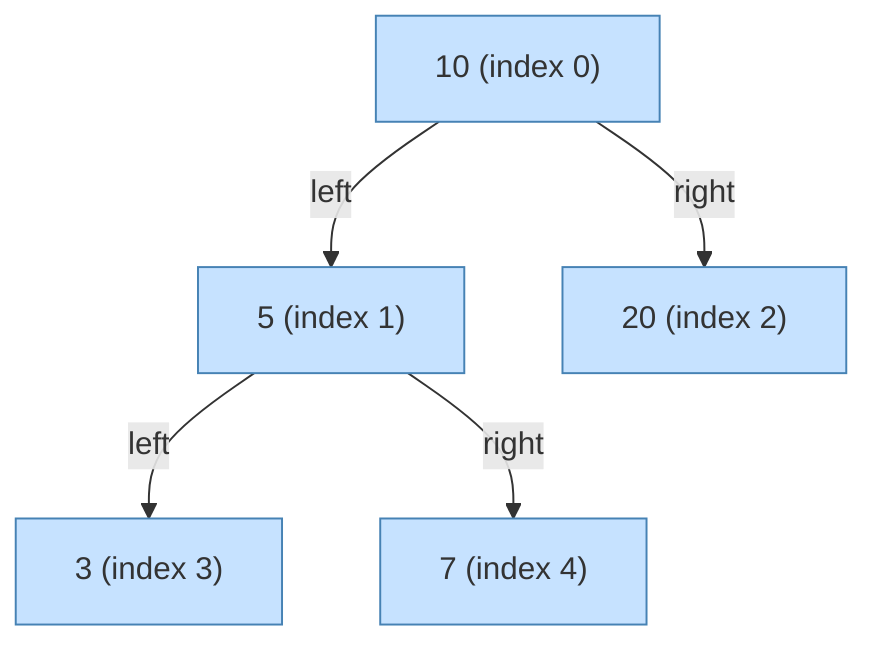

# Zadanie laboratoryjne - Enumerable, LINQ i metody rozszerzające

## Kod początkowy

> [!NOTE] 
> **Student** 
> 

## Metody rozszerzające dla istniejących typów

{}
**Reguły i konwencje nazewnictwa identyfikatorów**

Jednym z podstawowych elementów pisania czytelnego i spójnego kodu jest trzymanie się konwencji. Różne języki programowania mają swoje własne preferencje w zakresie nadawania nazw identyfikatorom - zmiennym, metodom, właściwościom czy klasom.

**Najpopularniejsze style**

- `PascalCase`:
  - Pierwsza litera każdego wyrazu jest duża, bez użycia separatorów (np. `UserProfileId`, `HttpRequestHeaders`).
  - Stosowany głównie w: **C#**, **Java** (dla nazw klas, metod, właściwości).
- `camelCase`:
  - Pierwsza litera pierwszego wyrazu jest mała, a kolejne wyrazy zaczynają się wielką literą (np. `startDateTime`, `xmlParserSettings`).
  - Popularny w: **JavaScript** (dla zmiennych i funkcji), **Java** (dla zmiennych i metod).
- `snake_case`:
  - Wszystkie litery są małe, a słowa oddzielone znakiem podkreślenia (np. `user_profile_id`, `json_response_data`).
  - Często używany w: **Python**, **Rust**, bazy danych, nazwy pól w obiektach JSON.
- `kebab-case`:
  - Słowa oddzielane są myślnikiem (np. `html-element-id`).
  - Spotykany głównie w: URL, atrybuty HTML, nazwy plików (np. w projektach opartych o **JavaScript**/**Node.js**).

W projektach, które łączą różne warstwy technologiczne (np. backend w C#, frontend w JavaScript, komunikacja poprzez JSON), często zachodzi potrzeba konwersji nazw między stylami. Przykładowo, właściwość klasy C# może nazywać się `EmailAddress`, ale gdy serializujemy ją do JSON-a, powinna zostać zapisana jako `email_address`.

**Czego się nauczysz?**

- Tworzenia i stosowania metod rozszerzających (_extension methods_) dla typu `string` w języku `C#`.
- Implementacji konwersji między stylami nazewnictwa `PascalCase` i `snake_case`.

{}

### Opis zadania

Twoim zadaniem jest zaimplementowanie dwóch metod rozszerzających dla klasy `string`:

- `PascalToSnakeCase`, która dla poprawnego identyfikatora zapisanego w stylu `PascalCase` zwróci jego odpowiednik w stylu `snake_case`,
- `SnakeToPascalCase`, która dla poprawnego identyfikatora zapisanego w stylu `snake_case` zwróci jego odpowiednik w stylu `PascalCase`.

Przykładowe użycie powinno wyglądać następująco:

```csharp
var pascal = "HtmlElementId";
var snake = pascal.PascalToSnakeCase();

Console.WriteLine(snake); // "html_element_id"
```

{}
**Materiały pomocnicze:**

- [Microsoft Learn: C# identifier naming rules and conventions](https://learn.microsoft.com/en-us/dotnet/csharp/fundamentals/coding-style/identifier-names)
- [Microsoft Learn: Common C# code conventions](https://learn.microsoft.com/en-us/dotnet/csharp/fundamentals/coding-style/coding-conventions)
- [Microsoft Learn: How to implement and call a custom extension method](https://learn.microsoft.com/en-us/dotnet/csharp/programming-guide/classes-and-structs/how-to-implement-and-call-a-custom-extension-method)
- [Microsoft Learn: Using the StringBuilder Class in .NET](https://learn.microsoft.com/en-us/dotnet/standard/base-types/stringbuilder)

{}

### Przykładowe rozwiązanie

Przykładowe rozwiązanie można znaleźć w pliku [StringExtensions.cs](/labs/lab05/solution/tasks/StringExtensions.cs).

W pliku [StringExtensionsTests.cs](/labs/lab05/solution/tests/StringExtensionsTests.cs) dostępne są również testy jednostkowe.

## Iteratory, `yield` i generowanie liczb pierwszych

{}
**Iteratory w praktyce**

W wielu przypadkach potrzebujemy generować sekwencje danych, których długość nie jest znana z góry albo których stworzenie "na raz" byłoby zbyt kosztowne. Zamiast budować całą kolekcję w pamięci i zwracać ją jako całość, możemy wykorzystać iteratory — mechanizm pozwalający zwracać elementy na żądanie.

W języku C# iteratory tworzymy przy użyciu dwóch słów kluczowych:

- `yield return` — zwraca pojedynczy element i zawiesza wykonanie metody do czasu, aż kolejny element zostanie zażądany,

- `yield break` — natychmiast przerywa działanie iteratora i kończy sekwencję.

Zaletą tego podejścia jest to, że nie musimy pisać własnych klas implementujących `IEnumerator`, ponieważ kompilator robi to za nas automatycznie. Dodatkowo iterator zachowuje swój stan pomiędzy kolejnymi wywołaniami, dzięki czemu kod jest bardziej zwięzły i czytelny.

**Generowanie liczb pierwszych**

Sito Eratostenesa to klasyczny algorytm pozwalający na wyznaczenie wszystkich liczb pierwszych mniejszych od danej liczby `n`, czyli z zadanego przedziału `[2, n]`. Algorytm ten opiera się na eliminacji liczb złożonych.

**Czego się nauczysz?**

- Tworzenia iteratorów w C# z użyciem `yield return` i `yield break`.
- Zachowania stanu metody między kolejnymi wywołaniami iteratora.
- Optymalizacji pamięciowej i wydajnościowej przy przetwarzaniu dużych zbiorów danych.

{}

### Opis zadania

Twoim zadaniem jest zaimplementowanie metody:

```csharp
public static class PrimeFinder
{
  public static IEnumerable<int> SieveOfEratosthenes(int upperBound);
}
```

wykorzystującej `yield break` oraz `yield return` do generowania liczb pierwszych na żądanie.

Przykładowe użycie powinno wyglądać następująco:

```csharp
foreach (var prime in SieveOfEratosthenes(1000))
{
    if (prime > 850) break;
    Console.WriteLine(prime);
}
```

{}
**Materiały pomocnicze:**

- [Sieve of Eratosthenes](https://en.wikipedia.org/wiki/Sieve_of_Eratosthenes)
- [Microsoft Learn: yield statement - provide the next element](https://learn.microsoft.com/en-us/dotnet/csharp/language-reference/statements/yield)

{}

### Przykładowe rozwiązanie

Przykładowe rozwiązanie można znaleźć w pliku [PrimeFinder.cs](/labs/lab05/solution/tasks/PrimeFinder.cs).

W pliku [PrimeFinderTests.cs](/labs/lab05/solution/tests/PrimeFinderTests.cs) dostępne są również testy jednostkowe.

## Implementacja interfejsu `IEnumerable<T>`

{}
**Reprezentacja drzewa w tablicy**

Drzewa binarne to fundamentalna struktura danych służąca do przechowywania danych w porządku hierarchicznym. Choć najczęściej implementuje się je przy użyciu wskaźników (lub referencji) do poszczególnych węzłów, istnieje alternatywne i bardzo wydajne podejście: **reprezentacja tablicowa**.

W tym modelu korzeń drzewa (`root`) umieszczamy w tablicy pod indeksem `0`. Następnie, dla dowolnego węzła-rodzica znajdującego się pod indeksem `i`:

- Jego lewe dziecko znajdzie się pod indeksem `2 * i + 1`.
- Jego prawe dziecko znajdzie się pod indeksem `2 * i + 2`.

Takie podejście eliminuje potrzebę przechowywania referencji w każdym węźle, oszczędzając pamięć. Wyzwaniem staje się jednak dynamiczne zarządzanie rozmiarem tablicy, gdy drzewo się rozrasta i musimy dodać element pod indeksem, który wykracza poza jej aktualne granice.

**Przykład**



**Przechodzenie po strukturze (`IEnumerable`)**

Aby nasza klasa drzewa była użyteczna, powinna udostępniać sposób na iterowanie po jej elementach. Standardem w .NET jest implementacja interfejsu `IEnumerable<T>`. W przypadku drzewa binarnego najczęściej implementuje się przechodzenie `In-Order` (lewostronne), które w przypadku drzewa BST zwraca posortowane elementy. Wykorzystanie `yield return` pozwala zaimplementować tę logikę rekurencyjnie w bardzo elegancki sposób.

**Czego się nauczysz?**

- Implementacji struktury drzewa binarnego przy użyciu płaskiej tablicy.
- Mapowania relacji rodzic-dziecko na indeksy tablicy.
- Dynamicznego powiększania tablicy (`Array.Resize`) w miarę potrzeb.
- Implementacji interfejsu `IEnumerable<T>` dla niestandardowej kolekcji.
- Rekurencyjnego tworzenia iteratora `In-Order` przy użyciu `yield return`.

{}

### Opis zadania

Twoim zadaniem jest zaimplementowanie klasy `ArrayBinaryTree<T>`, która realizuje interfejs `IArrayBinaryTree<T>`. Klasa ta ma reprezentować drzewo binarne liczb całkowitych, wykorzystując do ich przechowywania wewnętrzną tablicę.

Należy zaimplementować podany interfejs:

```csharp
public interface IArrayBinaryTree<T> : IEnumerable<T>
{
    int Count { get; }
    int RootIndex { get; }
    void SetRoot(T value);
    (int leftIndex, int rightIndex) GetChildrenIndices(int parentIndex);
    void SetLeftChild(int parentIndex, T value);
    void SetRightChild(int parentIndex, T value);
    T this[int index] { get; }
    bool Exists(int index);
    void Clear();
}
```

Oraz klasę, która go implementuje, dbając o logikę `Count`, obsługę wyjątków (np. próba dodania dziecka do nieistniejącego rodzica) oraz dynamiczne rozszerzanie tablicy, gdy indeks dziecka wykracza poza jej rozmiar.

Przykładowe użycie powinno wyglądać następująco:

```csharp
var tree = new ArrayBinaryTree<int>();
tree.SetRoot(10);
tree.SetLeftChild(0, 5);
tree.SetRightChild(0, 20);
tree.SetLeftChild(1, 3);
tree.SetRightChild(1, 7);

// Expected output (In-Order traversal): 3, 5, 7, 10, 20
foreach (var value in tree)
{
    Console.WriteLine(value);
}
```

{}
**Materiały pomocnicze:**

- [Binary Tree (Array implementation)](https://en.wikipedia.org/wiki/Binary_tree#Arrays)
- [Microsoft Learn: IEnumerable<T> Interface](https://learn.microsoft.com/en-us/dotnet/api/system.collections.generic.ienumerable-1?view=net-9.0)
- [Microsoft Learn: Array.Resize Method](https://learn.microsoft.com/en-us/dotnet/api/system.array.resize?view=net-9.0)

{}

### Przykładowe rozwiązanie

Przykładowe rozwiązanie można znaleźć w pliku [ArrayBinaryTree.cs](/labs/lab05/solution/tasks/ArrayBinaryTree.cs).

W pliku [ArrayBinaryTreeTests.cs](/labs/lab05/solution/tests/ArrayBinaryTreeTests.cs) dostępne są również testy jednostkowe.

## `IEnumerable`, typy generyczne i LINQ

{}
**LINQ w praktyce**

W C# mechanizm LINQ (_Language Integrated Query_) pozwala nam wygodnie zapisywać zapytania i operacje na sekwencjach danych (`IEnumerable<T>`) w spójny, deklaratywny sposób. Dzięki metodom rozszerzającym możemy natomiast dopisać do `IEnumerable<T>` własne operatory, które rozszerzają możliwości LINQ o często powtarzające się schematy przetwarzania, takie jak:

- `Fold(seed, func, resultSelector)` – uogólnia operację agregacji (redukcji), pozwalając na zachowanie stanu akumulatora między kolejnymi elementami i zwrócenie dowolnego wyniku końcowego.
- `Batch(size)` – dzieli sekwencję na kolejne porcje o zadanym rozmiarze `size`, przydatne np. przy wsadowym przesyłaniu danych do serwera.
- `SlidingWindow(size)` – tworzy nakładające się okna przesuwne o zadanym rozmiarze `size`, wykorzystywane np. przy wykrywaniu trendów.

Dzięki leniwej ewaluacji LINQ i metodom rozszerzającym, przetwarzanie może być zarówno czytelne, jak i wydajne – elementy są generowane i filtrowane dopiero wtedy, gdy są potrzebne.

**Czego się nauczysz?**

- Tworzenia własnych generycznych metod rozszerzających w stylu LINQ.
- Pracy z jawnym obiektem enumeratora sekwencji (`MoveNext`, `Current`).
- Rozwiązywania praktycznych problemów przetwarzania danych za pomocą zaimplementowanych operacji.

{}

### Opis zadania

Zadanie podzielone jest na trzy części. Każda część rozpoczyna się od implementacji własnej operacji, przypominającej istniejące metody biblioteki LINQ, a następnie rozwiązania kilku praktycznych problemów z wykorzystaniem danej operacji.

**Fold**

Zaimplementuj generyczną metodę rozszerzającą `Fold`, dla dowolnej sekwencji (`IEnumerable<T>`), która:

- Przyjmuje początkową wartość akumulatora `seed` (o typie potencjalnie innym niż elementy sekwencji).
- Przy każdej iteracji po elemencie sekwencji wywołuje przekazaną funkcję akumulującą, aktualizując stan akumulatora.
- Po przejściu całej sekwencji wywołuje funkcję przekształcającą końcowy stan akumulatora w wynik zwracany przez metodę.

Metoda powinna zwracać wynik tej ostatniej funkcji, a wszystkie kroki – inicjalizację akumulatora, pętlę po elementach i obliczenie końcowego rezultatu – należy zaimplementować ręcznie, używając jawnego obiektu enumeratora kolekcji.

**Wyzwania**

{}
<br>
Zaimplementuj metodę rozszerzającą dla sekwencji liczb całkowitych, o następujących założeniach:

- Metoda nazywa się `ComputeStatistics`.
- Jeśli kolekcja jest równa `null` lub nie zawiera żadnych elementów, rzuca `ArgumentException` z komunikatem `Source sequence must contain at least one element.`.
- W jednym przebiegu (używając wcześniej zaimplementowanej metody `Fold`) oblicza:
  - wartość minimalną,
  - wartość maksymalną,
  - średnią arytmetyczną,
  - odchylenie standardowe.
- Zwraca krotkę `(min, max, average, standardDeviation)`.

Przykład użycia:

```csharp
var source = new[] { 2, 5, 3, 9, 4 };
var (min, max, average, std) = source.ComputeStatistics();

Console.WriteLine($"Min = {min}");            // 2
Console.WriteLine($"Max = {max}");            // 9
Console.WriteLine($"Average = {average:F2}"); // 4.60
Console.WriteLine($"StdDev = {std:F2}");      // 2.42
```

{}

{}
<br>
Zaimplementuj metodę rozszerzającą dla sekwencji liczb całkowitych, o następujących założeniach:

- Metoda nazywa się `LongestSequence`.
- Jeśli kolekcja jest równa `null` lub nie zawiera żadnych elementów, rzuca `ArgumentException` z komunikatem `Source sequence must contain at least one element.`.
- W jednym przebiegu (używając wcześniej zaimplementowanej metody `Fold`) znajduje maksymalnie długą, spójną podsekwencję jednakowych wartości, zwracając:
  - `start` – indeks pierwszego elementu tej podsekwencji,
  - `end` – indeks ostatniego elementu tej podsekwencji (włącznie),
  - `value` – wartość, która się powtarza.
- Indeksy są numerowane od zera i odnoszą się do oryginalnej sekwencji.

Przykład użycia:

```csharp
var source = new[] { 1, 1, 2, 2, 2, 3, 3, 2 };
//                   0  1  2  3  4  5  6  7

var (start, end, value) = source.LongestSequence();

Console.WriteLine($"Start = {start}"); // 2
Console.WriteLine($"End = {end}");     // 4
Console.WriteLine($"Value = {value}"); // 2
```

{}

**Batch**

Zaimplementuj generyczną metodę rozszerzającą `Batch`, dla dowolnej sekwencji (`IEnumerable<T>`), która:

- Dzieli sekwencję wejściową na kolejne porcje o maksymalnym rozmiarze `size`, zwracając je leniwie jako `IEnumerable<IEnumerable<T>>`.
- Ostatnia porcja może być krótsza, jeśli liczba elementów nie dzieli się dokładnie przez `size`.
- Wartość argumentu `size` powinna być `>= 1` (w przeciwnym wypadku zgłaszany jest wyjątek `ArgumentOutOfRangeException(nameof(size), "Batch size must be at least 1.")`).

W implementacji należy wykorzystać jawnie stworzony obiekt enumeratora kolekcji.

**SlidingWindow**

Zaimplementuj generyczną metodę rozszerzającą `SlidingWindow`, dla dowolnej sekwencji (`IEnumerable<T>`), która:

- Dla dowolnej sekwencji zwraca kolejne, nakładające się okna o stałym rozmiarze `size`.
- Jeśli `size` jest mniejsze niż 1, wyrzuca `ArgumentException` z komunikatem `Window size must be at least 1.`.
- Okna przesuwają się o jeden element w przód, czyli dla sekwencji `[a,b,c,d]` i rozmiaru 3 zwróci: `[a, b, c]`, a następnie `[b, c, d]`.

Przykład użycia:

```csharp
var source = Enumerable.Range(1, 5); // {1,2,3,4,5}
foreach (var window in source.SlidingWindow(3))
{
    Console.WriteLine($"[{string.Join(", ", window)}]");
}

/* Oczekiwany rezultat
[1, 2, 3]
[2, 3, 4]
[3, 4, 5]
*/
```

**Wyzwania**

{}
<br>

Zaimplementuj metodę `FindSlidingWindowsWithRisingSum`, która znajdzie i zwróci (w postaci `IEnumerable<IEnumerable<int>>`) wszystkie okna długości 5, których suma jest większa niż suma bezpośrednio poprzedzającego okna:

Przykład:

Dla sekwencji:

```csharp
var sequence = new [] { 5, 3, 1, 2, 4, 2, 10, -1, 2, 4, 7, -3 }
```

> Poniższa tabela analizuje kolejne okna wraz z sumami elementów:

| Okno | Elementy            | Suma | Czy zwrócona? |
| ---- | ------------------- | ---- | ------------- |
| 1    | `[5, 3, 1, 2, 4]`   | 15   | ❌            |
| 2    | `[3, 1, 2, 4, 2]`   | 12   | ❌            |
| 3    | `[1, 2, 4, 2, 10]`  | 19   | ✅            |
| 4    | `[2, 4, 2, 10, -1]` | 17   | ❌            |
| 5    | `[4, 2, 10, -1, 2]` | 17   | ❌            |
| 6    | `[2, 10, -1, 2, 4]` | 17   | ❌            |
| 7    | `[10, -1, 2, 4, 7]` | 22   | ✅            |
| 8    | `[-1, 2, 4, 7, -3]` | 9    | ❌            |

zwrócona zostaje zatem kolekcja:

```csharp
[
  [ 1, 2, 4, 2, 10 ],
  [ 10, -1, 2, 4, 7 ]
]
```

{}

{}
<br>

Zaimplementuj metodę `FindSlidingWindowsWithDuplicates`, która znajdzie i zwróci (w postaci `IEnumerable<IEnumerable<int>>`) wszystkie okna długości 4, w których co najmniej jedna liczba występuje więcej niż raz.

Przykład:

Dla sekwencji:

```csharp
var sequence = new[] { 1, 2, 3, 4, 2, 5, 6, 2, 7, 8 }
```

> Poniższa tabela analizuje kolejne okna wraz z informacją o duplikatach:

| Okno | Elementy       | Powtórzenia? | Czy zwrócona? |
| ---- | -------------- | ------------ | ------------- |
| 1    | `[1, 2, 3, 4]` | brak         | ❌            |
| 2    | `[2, 3, 4, 2]` | 2            | ✅            |
| 3    | `[3, 4, 2, 5]` | brak         | ❌            |
| 4    | `[4, 2, 5, 6]` | brak         | ❌            |
| 5    | `[2, 5, 6, 2]` | 2            | ✅            |
| 6    | `[5, 6, 2, 7]` | brak         | ❌            |
| 7    | `[6, 2, 7, 8]` | brak         | ❌            |

zwrócona zostaje zatem kolekcja:

```csharp
[
  [ 2, 3, 4, 2 ],
  [ 2, 5, 6, 2 ]
]
```

{}

{}
<br>

Zaimplementuj metodę `FindMostCommonTrigrams`, która wyszukuje w podanym tekście wszystkie najczęściej występujące 3‑literowe sekwencje (tzw. trigramy).

Założenia:

- Trigram to dowolne trzy kolejne **litery** w tekście (znaki nieliterowe są pomijane).
- Wielkość liter jest ignorowana (`ABC` i `abc` to ten sam trigram).
- Zwracana jest kolekcja `IEnumerable<string>` zawierająca wszystkie trigramy, które występują w tekście **najczęściej** (może być ich więcej niż jeden, jeśli mają taką samą liczbę wystąpień).
- Jeśli tekst nie zawiera przynajmniej 3 liter, metoda zwraca pustą sekwencję.

Przykład:

Dla tekstu **_Anna and Antek are analyzing an annual analysis._** rozważamy następujący ciąg znaków: **_annaandantekareanalyzinganannualanalysis_**.

> Poniższa tabela zawiera trigramy występujące częściej niż jednokrotnie:

| Trigram | Liczba wystąpień | Czy zwrócona? |
| ------- | ---------------- | ------------- |
| `"ana"` | 3                | ✅            |
| `"aly"` | 2                | ❌            |
| `"ann"` | 2                | ❌            |
| `"nal"` | 2                | ❌            |

zwrócona zostaje zatem kolekcja:

```csharp
[
  "ana",
]
```

{}

### Przykładowe rozwiązanie

Przykładowe rozwiązanie można znaleźć w pliku [EnumerableExtensions.cs](/labs/lab05/solution/tasks/EnumerableExtensions.cs).

W pliku [EnumerableExtensionsTests.cs](/labs/lab05/solution/tests/EnumerableExtensionsTests.cs) dostępne są również testy jednostkowe.

## LINQ i analiza danych dotyczących filmów

{}
**Czym jest relacyjna baza danych?**

Relacyjna baza danych to sposób przechowywania informacji w postaci **tabel**, które są ze sobą powiązane **relacjami**. Charakterystycznym elementem tabeli jest **klucz główny** (_primary key_), czyli unikalny identyfikator każdego rekordu (wiersza) w tabeli.

Tabela może zawierać również **klucz obcy** (_foreign key_), czyli odwołania do identyfikatorów innej tabeli.

**Złączenia (`JOIN`)**

Aby uzyskać pełniejszy obraz - np. _"Kto zagrał w jakim filmie?"_ albo _"Jakie są średnie oceny filmów fantasy?"_ - musimy połączyć dane z kilku tabel. Służą do tego operacje łączenia (`JOIN`).

Dwa interesujące nas rodzaje złączeń to:

- `INNER JOIN`, który łączy dwa zbiory danych, ale tylko wtedy, gdy istnieje pasujące dopasowanie w obu tabelach.
- `LEFT JOIN`, który zwraca wszystkie rekordy z lewej tabeli, nawet jeśli brakuje dopasowania w prawej tabeli.

**Czego się nauczysz?**

- Korzystania z zapytań LINQ do łączenia, filtrowania i grupowania danych.
- Agregowania i sortowania kolekcji oraz wyciągania statystyk (np. średnia ocen, liczba ocen).
- Pracy z wieloma powiązanymi kolekcjami (`movies`, `actors`, `casts`, `ratings`) za pomocą `Join`, `GroupJoin` i `SelectMany`.
- Tworzenia zagnieżdżonych struktur wyników (np. filmów z ich obsadą).
- Optymalizacji zapytań przez filtrowanie i projekcję tylko potrzebnych danych.

{}

### Opis zadania

W pliku [SampleMovieDatabase.cs](/labs/lab05/solution/tasks/Databases/SampleMovieDatabase.cs) znajduje się przykładowa baza danych o filmach, przechowywana w pamięci w postaci kolekcji rekordów poszczególnych encji (`List<Movie>`, `List<Actor>` itp.).

Modele danych reprezentują następujące rekordy:

```csharp
public record Movie(
    int Id, // klucz główny
    string Title,
    int Year,
    [property: JsonConverter(typeof(JsonStringEnumConverter))]
    Genre Genre,
    int DurationMinutes
);

public record Actor(
    int Id, // klucz główny
    string Name
);

public record Rating(
    int Id, // klucz główny
    int MovieId, // klucz obcy
    int Score,
    DateTime CreatedAt
);

public record Cast( // tabela asocjacyjna
    int MovieId, // klucz obcy
    int ActorId, // klucz obcy
    string Role
);
```

W pliku `DatabaseQueries.cs` zaimplementuj zapytania LINQ, które umożliwią analizę danych o zbiorze filmów.

Do wypisywania wyników użyjemy prostej metody opartej na serializacji obiektu przekazanego w parametrze `query` do formatu JSON:

```csharp
public static void DisplayQueryResults<T>(T query)
{
    var options = new JsonSerializerOptions
    {
        WriteIndented = true
    };

    options.Converters.Add(new JsonStringEnumConverter());

    var json = JsonSerializer.Serialize(query, options);

    Console.WriteLine(json);
}
```

**Zapytania**

{}
<br>
Znajdź unikalnych aktorów, którzy zagrali w filmach fantasy.
{}
{}
<br>
Dla każdego gatunku znajdź film o największej długości.
{}
{}
<br>
Wyświetl filmy, których średnia ocena przekracza 8, wraz z listą aktorów grających w tych filmach.
{}
{}
<br>
Oblicz dla każdego aktora ile unikalnych ról zagrał, posortuj malejąco według tej liczby.
{}
{}
<br>
Wyświetl najnowsze filmy wraz z ich średnimi ocenami, posortowane malejąco po średniej.
{}
{}
<br>
Oblicz i wyświetl średnią ocenę filmów dla każdego gatunku.
{}
{}
<br>
Znajdź aktorów, którzy nie wystąpili w żadnym filmie o gatunku `Thriller`.
{}
{}
<br>
Wyświetl trzy filmy, które otrzymały najwięcej ocen.
{}
{}
<br>
Wyświetl filmy, które nie mają żadnej przypisanej oceny.
{}
{}
<br>
Znajdź aktorów, którzy zagrali w największej liczbie różnych gatunków filmów.
{}

{}
**Uwagi implementacyjne**

- W zapytaniach 2, 4 oraz 6 wynik może się różnić w zależności od rodzaju złączenia. W ramach ćwiczenia spróbuj zastosować dwa rodzaje złączeń (`INNER JOIN` oraz `LEFT JOIN`) i porównaj wyniki.
- Przyjmujemy, że w każdym z tych zapytań oba możliwe rozwiązania są poprawne, pod warunkiem, że rozumiesz, skąd bierze się różnica 😉.
- W przypadku zapytania 2 może się zdarzyć tak, że w bazie nie ma żadnego filmu z pewnego gatunku.
- W zapytaniu 3 niektórzy aktorzy mogli nie grać w żadnym filmie znajdującym się w bazie.
- W zapytaniu 6 niektórym gatunkom może nie odpowiadać żadna wystawiona ocena.
- Dla uproszczenia, w zapytaniach nie określamy dokładnie, które kolumny poszczególnych rekordów mają zostać zwrócone.

{}

### Przykładowe rozwiązanie

Przykładowe rozwiązanie można znaleźć w pliku [DatabaseQueries.cs](/labs/lab05/solution/tasks/DatabaseQueries.cs). Kod ten uruchamiany jest w pliku [Program.cs](/labs/lab05/solution/tasks/Program.cs).

## Rozwiązanie do pobrania

> [!NOTE] 
> **Solution** 
> 
