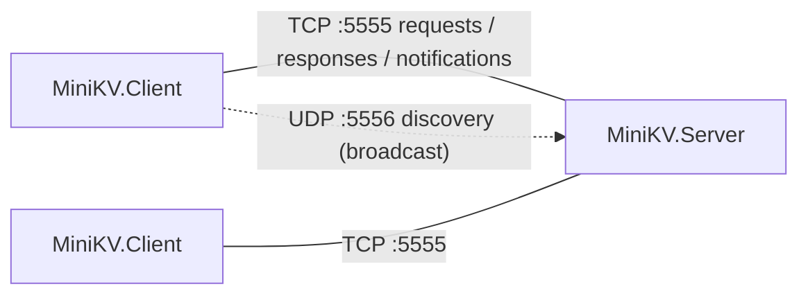

## Tutorial 9: Networking and Serialization

The scope of this laboratory covers communication between processes over the network: serialization of objects to JSON and to a custom binary format, TCP connections (`TcpListener`, `TcpClient`, `NetworkStream`), splitting a byte stream into messages (framing), serving many clients at once with asynchronous code, sending data from the server without a request (server push), and UDP datagrams with broadcast.

In C++ you would write such programs against the BSD sockets API (or Winsock, Boost.Asio). .NET wraps the operating system sockets in classes from the `System.Net` and `System.Net.Sockets` namespaces, and a TCP connection is exposed as an ordinary `Stream` – everything you know about [streams]() (`ReadAsync`, `WriteAsync`, decorators, adapters) applies to network communication as well. More details can be found in the lectures: [Network](), [TCP](), [Serialization]() and [Asynchronous programming]().

### Sockets in .NET

The most important networking types and their counterparts in the C sockets API:

| .NET | Role | C/C++ counterpart |
|------|------|-------------------|
| `IPAddress`, `IPEndPoint` | IP address; IP address + port | `in_addr`, `sockaddr_in` |
| `TcpListener` | TCP server: waits for connections | `socket` + `bind` + `listen` + `accept` |
| `TcpClient` | one TCP connection | `socket` + `connect` |
| `NetworkStream` | `Stream` over a connected socket | `send` / `recv` |
| `UdpClient` | sending and receiving datagrams | `sendto` / `recvfrom` |
| `Socket` | low-level socket; the classes above are built on it | `socket` |

A client connects to a server in two lines; the host name is resolved by DNS automatically:

```csharp
using var client = new TcpClient();
await client.ConnectAsync("localhost", 5555);
NetworkStream stream = client.GetStream(); // a regular Stream: ReadAsync, WriteAsync, ...
```

**TCP** is connection-oriented and reliable: bytes arrive complete, in order and without duplicates, or the connection breaks and you get an exception. **UDP** sends independent datagrams: there is no connection, a datagram may get lost, duplicated or reordered, but it is cheap and can be sent to all machines in the local network at once (broadcast). An application chooses a port number (0–65535) to tell its traffic apart from other programs on the same machine; on Linux ports below 1024 require administrator rights, so we will use 5555 (TCP) and 5556 (UDP).

### TCP Is a Byte Stream

TCP guarantees the order of bytes but knows nothing about *messages*. The data written by several `WriteAsync` calls may be delivered by a single `ReadAsync`, and one large write may arrive in several pieces:

```csharp
// sender and receiver: two TcpClients connected to each other
NetworkStream output = sender.GetStream();
await output.WriteAsync("set a 1\n"u8.ToArray());   // three separate writes...
await output.WriteAsync("set b 2\n"u8.ToArray());
await output.WriteAsync("get a\n"u8.ToArray());
await Task.Delay(100);

byte[] buffer = new byte[1024];
int n = await receiver.GetStream().ReadAsync(buffer); // ...but one read returns them all
Console.WriteLine($"Read {n} bytes: {Encoding.UTF8.GetString(buffer, 0, n).ReplaceLineEndings("\\n")}");
// Read 22 bytes: set a 1\nset b 2\nget a\n
```

It is therefore the application protocol that has to mark where one message ends and the next begins. This is called **framing**. There are two common approaches:

- **Delimiter** – every message ends with a special character, e.g. a newline. Easy to read with `StreamReader.ReadLine` (the [TCP lecture]() does exactly that), but the delimiter must never appear inside a message.
- **Length prefix** – every message is preceded by a fixed-size header containing the length of the payload. The receiver reads the header, then reads exactly that many bytes. Any payload (also binary) can be sent this way. We will use this approach.

As in C++, where `recv` may return fewer bytes than requested and you have to call it in a loop, `Stream.ReadAsync` returns *at most* `buffer.Length` bytes. .NET has helpers that loop for you: `ReadExactlyAsync(buffer)` fills the whole buffer (or throws `EndOfStreamException`), and `ReadAtLeastAsync(buffer, minimumBytes, throwOnEndOfStream: false)` returns how many bytes were actually read before the stream ended.

### Serialization with System.Text.Json

Serialization converts an object to a form that can be stored in a file or sent over the network; deserialization recreates the object. The static class `JsonSerializer` uses reflection to find the public properties of a type, and works well with records – positional records are deserialized through their constructor:

```csharp
string json = JsonSerializer.Serialize(new Point(1, 2));
Console.WriteLine(json);    // {"X":1,"Y":2}
Point? p = JsonSerializer.Deserialize<Point>(json);
Console.WriteLine(p);       // Point { X = 1, Y = 2 }

public record Point(int X, int Y);
```

The behavior can be adjusted with a `JsonSerializerOptions` object (naming policy, indentation, converters…) and with attributes such as `[JsonPropertyName]` or `[JsonIgnore]`. JSON is a text format: readable and self-describing, but verbose. Binary formats are compact and fast, but the byte layout has to be defined precisely – including the byte order of numbers (*endianness*). In this tutorial we will use both: JSON for the TCP messages and a hand-made binary format for the UDP datagrams.

### Asynchronous I/O and Cancellation

A classic C++ server creates one thread per client and blocks it in `recv`. With thousands of clients, most of these threads just wait. In .NET, network operations have `…Async` versions: while `await stream.ReadAsync(...)` waits for data, the thread returns to the thread pool, so a handful of threads can serve many connections.

Every asynchronous network method accepts a `CancellationToken`. When the token is cancelled (`CancellationTokenSource.Cancel()`), the pending operation ends with `OperationCanceledException` – this is how we will stop the server gracefully.

## Task 1 - MiniKV: A Networked Key-Value Store

In this task you will build **MiniKV**, a tiny key-value database inspired by [Redis](https://redis.io/). The server keeps `string → string` pairs in memory and saves them to a JSON file on shutdown; clients connect over TCP and send commands such as `set user:1 Ala` or `get user:1`. Later, clients will be able to *watch* keys and get notified about their changes, and to find the server in the local network with UDP broadcast.

The solution consists of three projects:

- `MiniKV.Protocol` – a class library shared by both sides: message types, serialization settings, framing.
- `MiniKV.Server` – a console application: the store, the TCP server and the UDP discovery responder.
- `MiniKV.Client` – a console application: an interactive command line (REPL) connected to the server.



### Stage 1: Protocol Messages and JSON Serialization

We start without any network: we define the messages of our protocol, the store and the request handler, and we test them by serializing every message to JSON and back.

Create the solution (see [Tutorial 2]() if you need a reminder):

```bash
dotnet new sln -n MiniKV
dotnet new classlib -n MiniKV.Protocol
dotnet new console -n MiniKV.Server
dotnet sln add MiniKV.Protocol MiniKV.Server
dotnet add MiniKV.Server reference MiniKV.Protocol
```

> [!IMPORTANT]
> #### Polymorphic Serialization
>
> The server receives different kinds of requests, but reads them from the stream as one type – the abstract base class. To recreate the right derived object, the JSON must contain the information about the type: a **type discriminator**. In `System.Text.Json` you declare it with attributes on the base type:
> ```csharp
> [JsonPolymorphic(TypeDiscriminatorPropertyName = "type")]
> [JsonDerivedType(typeof(GetRequest), "get")]
> [JsonDerivedType(typeof(SetRequest), "set")]
> public abstract record Message;
> ```
> Serializing a `GetRequest` *as `Message`* produces `{"type":"get","key":"user:1"}`, and `JsonSerializer.Deserialize<Message>(json)` creates a `GetRequest` again. Only types registered with `[JsonDerivedType]` can be (de)serialized this way.

#### Messages

In `MiniKV.Protocol`, create `Messages.cs` and define (as [records]()):

1. The abstract record `Message` – the base of everything sent over the wire – with the attributes shown above, registering all the derived types below.
2. The abstract record `Request : Message` and its derived positional records:

   | Record | Discriminator | Meaning |
   |--------|---------------|---------|
   | `GetRequest(string Key)` | `get` | read a value |
   | `SetRequest(string Key, string Value)` | `set` | create or overwrite a value |
   | `DeleteRequest(string Key)` | `del` | delete a key |
   | `KeysRequest` | `keys` | list all keys |

3. The enum `Status` with values `Ok`, `NotFound`, `Error`.
4. The record `Response(Status Status, string? Value = null, IReadOnlyList<string>? Keys = null, string? Error = null) : Message` with the discriminator `response`, and static factory methods `Ok(string? value = null)`, `WithKeys(IReadOnlyList<string> keys)`, `NotFound()` and `Fail(string error)`.

#### Serialization Settings

Create `KvProtocol.cs` with a static class `KvProtocol` that holds everything both sides must agree on: the constant `DefaultPort = 5555` and the shared `JsonSerializerOptions`:

```csharp
public static JsonSerializerOptions JsonOptions { get; } = new()
{
    // "Key" -> "key"
    PropertyNamingPolicy = JsonNamingPolicy.CamelCase,
    // Status.NotFound -> "notFound" instead of 1
    Converters = { new JsonStringEnumConverter(JsonNamingPolicy.CamelCase) },
    // Do not send "value": null, "keys": null, ...
    DefaultIgnoreCondition = JsonIgnoreCondition.WhenWritingNull,
    // Reject messages with missing or null non-nullable members, e.g. {"type":"get"}
    RespectNullableAnnotations = true,
    RespectRequiredConstructorParameters = true,
};
```

Add two helpers: `string Serialize(Message message)` and `Message? Deserialize(string json)`, calling `JsonSerializer` with these options.

> [!WARNING]
> The polymorphic information is used only when the **static type** passed to the serializer is `Message`. The generic parameter of `JsonSerializer.Serialize<T>` is inferred from the variable type:
> ```csharp
> Request r = new GetRequest("a");
> Console.WriteLine(JsonSerializer.Serialize(r));          // {}
> Console.WriteLine(JsonSerializer.Serialize<Message>(r)); // {"type":"get","Key":"a"}
> ```
> `Request` itself has no `[JsonPolymorphic]` attribute and no properties, so nothing is written. That is why our helpers take a `Message` parameter. Note also that by default the discriminator must be the **first** property of the JSON object when deserializing (unless you set `AllowOutOfOrderMetadataProperties = true`).

#### Store and Request Handler

In `MiniKV.Server`, create the class `KeyValueStore` (`KeyValueStore.cs`) wrapping a private `Dictionary<string, string>`:

1. Methods `bool TryGet(string key, [MaybeNullWhen(false)] out string value)`, `void Set(string key, string value)`, `bool Delete(string key)`, `IReadOnlyList<string> Keys()` (sorted) and the property `int Count`. The attribute `[MaybeNullWhen(false)]` (`System.Diagnostics.CodeAnalysis`) tells the compiler that `value` is not `null` when the method returns `true` – exactly like in `Dictionary.TryGetValue`.
2. `Task SaveAsync(string path)` – writes a snapshot of the store to a file. Define a private record `Snapshot(DateTime SavedAtUtc, SortedDictionary<string, string> Entries)`, open the file with `File.Create` and use `JsonSerializer.SerializeAsync(stream, snapshot, options)` with a copy of `KvProtocol.JsonOptions` that has `WriteIndented = true` (store it in a `static readonly` field – options objects should be reused, not created per call).
3. `static Task<KeyValueStore> LoadAsync(string path)` – returns an empty store if the file does not exist, otherwise deserializes the snapshot with `JsonSerializer.DeserializeAsync<Snapshot>`.

Then create `RequestHandler` – a class with the primary constructor `RequestHandler(KeyValueStore store)` and the method `Response Handle(Request request)`. Use a `switch` with [positional patterns]() to deconstruct the records:

```csharp
switch (request)
{
    case SetRequest(var key, var value):
        store.Set(key, value);
        return Response.Ok();
    // ...
}
```

`get` returns `Ok(value)` or `NotFound()`, `del` returns `Ok()` or `NotFound()`, `keys` returns `WithKeys(...)`, and an unknown request returns `Fail(...)`.

#### Testing

In `Program.cs` of the server, simulate the network: create an array of requests (`set user:1 Ala`, `set user:2 Bob`, `set greeting Hello, world!`, `get user:1`, `del user:2`, `get user:2`, `keys`) and for each one serialize it to JSON, deserialize it back to `Message`, pass it to the handler and serialize the response. Print both JSON strings, the deserialized record and whether it is equal to the original one (records have value equality). Finally save the store to `minikv.json`, load it back and print the file. Expected output (`dotnet run --project MiniKV.Server`):

```text
>> {"type":"set","key":"user:1","value":"Ala"}
   SetRequest { Key = user:1, Value = Ala } (equal to original: True)
<< {"type":"response","status":"ok"}
>> {"type":"set","key":"user:2","value":"Bob"}
   SetRequest { Key = user:2, Value = Bob } (equal to original: True)
<< {"type":"response","status":"ok"}
>> {"type":"set","key":"greeting","value":"Hello, world!"}
   SetRequest { Key = greeting, Value = Hello, world! } (equal to original: True)
<< {"type":"response","status":"ok"}
>> {"type":"get","key":"user:1"}
   GetRequest { Key = user:1 } (equal to original: True)
<< {"type":"response","status":"ok","value":"Ala"}
>> {"type":"del","key":"user:2"}
   DeleteRequest { Key = user:2 } (equal to original: True)
<< {"type":"response","status":"ok"}
>> {"type":"get","key":"user:2"}
   GetRequest { Key = user:2 } (equal to original: True)
<< {"type":"response","status":"notFound"}
>> {"type":"keys"}
   KeysRequest { } (equal to original: True)
<< {"type":"response","status":"ok","keys":["greeting","user:1"]}

Snapshot 'minikv.json' loaded back: 2 key(s) [greeting, user:1]
{
  "savedAtUtc": "2026-10-29T17:45:45.648543Z",
  "entries": {
    "greeting": "Hello, world!",
    "user:1": "Ala"
  }
}
```

> [!TIP]
> Thanks to `RespectNullableAnnotations` and `RespectRequiredConstructorParameters`, an incomplete message such as `{"type":"get"}` does not create a `GetRequest` with `Key == null`, but throws `JsonException` (*JSON deserialization for type 'GetRequest' was missing required properties including: 'key'*). Data coming from the network must never be trusted.

> [!NOTE]
> #### Stage 1
> 

### Stage 2: Framing and the TCP Server

Now we put the messages on the wire. Every message is sent as a **frame**: a 4-byte header with the payload length, followed by the payload – the message serialized to UTF-8 JSON:

```text
+----------------------------+--------------------------------------------+
| length (int32, big-endian) | payload: UTF-8 JSON, <length> bytes        |
+----------------------------+--------------------------------------------+
  00 00 00 2B                  {"type":"set","key":"user:1","value":"Ala"}
```

> [!IMPORTANT]
> #### Byte Order and `BinaryPrimitives`
>
> A multi-byte number can be stored starting from the most significant byte (*big-endian*, the traditional *network byte order*) or from the least significant one (*little-endian*, used by x86 and most ARM CPUs). Both sides of a protocol must use the same order. In C you would call `htonl`/`ntohl`; in .NET use the static class `BinaryPrimitives` (`System.Buffers.Binary`), which reads and writes numbers in an explicitly given order to/from a `Span<byte>`:
> ```csharp
> byte[] header = new byte[4];
> BinaryPrimitives.WriteInt32BigEndian(header, 300);
> Console.WriteLine(BitConverter.ToString(header));                 // 00-00-01-2C
> Console.WriteLine(BitConverter.ToString(BitConverter.GetBytes(300))); // 2C-01-00-00 on little-endian CPUs
> ```
> `BitConverter` always uses the byte order of the machine it runs on.

#### Message Stream

In `MiniKV.Protocol`, add the constant `MaxMessageSize = 64 * 1024` to `KvProtocol`, and create the class `MessageStream` with the primary constructor `MessageStream(Stream stream)`:

1. `Task WriteAsync(Message message, CancellationToken ct = default)`:
   - serialize the message with `JsonSerializer.SerializeToUtf8Bytes(message, KvProtocol.JsonOptions)` (the parameter type is `Message`, so the discriminator is written);
   - if the payload is longer than `MaxMessageSize`, throw `InvalidDataException`;
   - build **one** array `header + payload` (write the length with `BinaryPrimitives.WriteInt32BigEndian`) and send it with a single `WriteAsync` call, then call `FlushAsync`.
2. `Task<Message?> ReadAsync(CancellationToken ct = default)`:
   - read the 4-byte header with `ReadAtLeastAsync(header, 4, throwOnEndOfStream: false, ct)`. If 0 bytes were read, the other side closed the connection between messages – return `null`. If 1–3 bytes were read, throw `EndOfStreamException`;
   - decode the length; if it is not in `(0, MaxMessageSize]`, throw `InvalidDataException` – never allocate a buffer of a size received from the network without checking it;
   - read the payload with `ReadExactlyAsync` and deserialize it to `Message`. Wrap `JsonException` and `NotSupportedException` (thrown when the discriminator is missing) in `InvalidDataException`.

> [!TIP]
> Writing the header and the payload with two separate `WriteAsync` calls also works, but the header may then be sent in a separate tiny TCP packet. Building the whole frame first is simpler and more efficient.

> [!IMPORTANT]
> #### Concurrent Collections
>
> From now on, every client is served by its own task, and those tasks run in parallel on the thread pool. `Dictionary<TKey, TValue>` is not thread-safe – concurrent writes can corrupt it. Replace it in `KeyValueStore` with `ConcurrentDictionary<string, string>` (`System.Collections.Concurrent`), which synchronizes access internally (see the [Concurrent Collections lecture]()). `Remove` becomes `TryRemove(key, out _)`; the other methods stay the same.

#### TCP Server

In `MiniKV.Server`, create the class `KvServer(IPEndPoint endPoint, RequestHandler handler)` with the method `Task RunAsync(CancellationToken ct)`:

1. Create a `TcpListener` for the endpoint, call `Start()` and print the address you listen on.
2. In a loop, accept clients with `await listener.AcceptTcpClientAsync(ct)`. Do **not** await the client handling – start `HandleClientAsync(client, ct)`, store the returned `Task` in a list and immediately wait for the next client (remove completed tasks from the list from time to time):
   ```csharp
   TcpClient client = await listener.AcceptTcpClientAsync(ct);
   clients.Add(HandleClientAsync(client, ct));
   clients.RemoveAll(task => task.IsCompleted);
   ```
3. When the token is cancelled, `AcceptTcpClientAsync` throws `OperationCanceledException`. Catch it, stop the listener and wait for all client tasks with `Task.WhenAll`.

Implement `private async Task HandleClientAsync(TcpClient client, CancellationToken ct)`:

1. Print `[<remote endpoint>] connected` (`client.Client.RemoteEndPoint`).
2. Wrap `client.GetStream()` in a `MessageStream` and read messages in a loop until `ReadAsync` returns `null`. Print every message (the record's `ToString()` is good enough), pass requests to the handler and write the response back.
3. Catch `OperationCanceledException` (server shutdown), `IOException` (the connection broke, e.g. *Connection reset by peer*) and `InvalidDataException` (protocol error). A broken client must never crash the server. Dispose the `TcpClient` in every case and print `[...] disconnected`.

#### Starting and Stopping the Server

In `Program.cs` of the server:

1. Read the optional port from `args` (default `KvProtocol.DefaultPort`); the snapshot file is `minikv-{port}.json`, so that two servers on one machine do not overwrite each other's data.
2. Create a `CancellationTokenSource` and cancel it on Ctrl+C:
   ```csharp
   Console.CancelKeyPress += (_, e) =>
   {
       e.Cancel = true; // do not kill the process - shut down gracefully instead
       cts.Cancel();
   };
   ```
3. Load the store with `KeyValueStore.LoadAsync`, run `KvServer` on `new IPEndPoint(IPAddress.Any, port)` and, after `RunAsync` returns, save the store.

`IPAddress.Any` (`0.0.0.0`) means *all network interfaces* – other computers can connect too. Use `IPAddress.Loopback` (`127.0.0.1`) to accept only local connections.

#### A One-Shot Client

To test the server, add a third project and reference the protocol library:

```bash
dotnet new console -n MiniKV.Client
dotnet sln add MiniKV.Client
dotnet add MiniKV.Client reference MiniKV.Protocol
```

1. Create the static class `CommandParser` with the method `Request Parse(string line)`. Split the line into at most 3 parts, so that a value may contain spaces, and match the parts with [list patterns]():
   ```csharp
   string[] parts = line.Split(' ', 3, StringSplitOptions.RemoveEmptyEntries | StringSplitOptions.TrimEntries);
   return parts switch
   {
       ["get", var key] => new GetRequest(key),
       ["set", var key, var value] => new SetRequest(key, value),
       // del <key>, keys
       _ => throw new FormatException($"Invalid command: '{line}'. {Usage}"),
   };
   ```
2. Create the static class `ResponseFormatter` with the method `string Format(Response response)` returning `OK`, the value in quotes (`"Ala"`), a numbered list of keys (`1) greeting`), `(empty)`, `(not found)` or `(error) <message>`. [Property patterns]() such as `{ Status: Status.Ok, Value: { } value }` make it a single `switch` expression.
3. In `Program.cs`: parse `string.Join(' ', args)` (print the error and return `1` on `FormatException`), connect a `TcpClient` to `localhost:5555`, send the request with `MessageStream`, read one message and print the formatted response.

Run the server in one terminal and the client in another one:

```text
$ dotnet run --project MiniKV.Client -- set user:1 Ala
OK
$ dotnet run --project MiniKV.Client -- set greeting Hello, world!
OK
$ dotnet run --project MiniKV.Client -- get user:1
"Ala"
$ dotnet run --project MiniKV.Client -- keys
1) greeting
2) user:1
$ dotnet run --project MiniKV.Client -- del user:1
OK
$ dotnet run --project MiniKV.Client -- del user:1
(not found)
$ dotnet run --project MiniKV.Client -- remove user:1
Invalid command: 'remove user:1'. Commands: get <key> | set <key> <value> | del <key> | keys
```

Server output (the client ports are chosen by the operating system and will differ); at the end, the server was stopped with Ctrl+C:

```text
$ dotnet run --project MiniKV.Server
Loaded 0 key(s) from 'minikv-5555.json'
Listening on 0.0.0.0:5555. Press Ctrl+C to stop.
[127.0.0.1:36464] connected
[127.0.0.1:36464] SetRequest { Key = user:1, Value = Ala }
[127.0.0.1:36464] disconnected
[127.0.0.1:36480] connected
[127.0.0.1:36480] SetRequest { Key = greeting, Value = Hello, world! }
[127.0.0.1:36480] disconnected
...
[127.0.0.1:38420] connected
[127.0.0.1:38420] DeleteRequest { Key = user:1 }
[127.0.0.1:38420] disconnected
[127.0.0.1:38422] connected
[127.0.0.1:38422] protocol error: Invalid message length: 1751477356
[127.0.0.1:38422] disconnected
^C
Saved 1 key(s) to 'minikv-5555.json'. Bye!
```

The `protocol error` line comes from connecting with a raw TCP tool and sending text that does not follow our framing: `printf 'hello\n' | nc localhost 5555`. The first four bytes `hell` (`68 65 6C 6C`) were interpreted as the length 1751477356 – thanks to the size check, the server just closes the connection instead of trying to allocate 1.6 GB. After a restart, the server prints `Loaded 1 key(s) from 'minikv-5555.json'` and `keys` returns `1) greeting`.

> [!WARNING]
> On Windows, the firewall may ask whether to allow the server to accept connections – allow it for private networks. On Linux, a firewall (if enabled, e.g. `firewalld` on Fedora) may block connections from other machines, but not from `localhost`.

> [!NOTE]
> #### Stage 2
> 

### Stage 3: Interactive Client

Opening a new connection for every command is wasteful. In this stage, the client keeps one connection open and reads commands in a loop (REPL – *read-eval-print loop*). We also handle everything that can go wrong on the client side.

> [!IMPORTANT]
> #### When the Network Fails
>
> - **Connecting:** `ConnectAsync` throws `SocketException` when the server refuses the connection (nobody listens on the port – `SocketErrorCode == ConnectionRefused`) or the host name cannot be resolved (`HostNotFound`). If the server does not answer at all (e.g. a firewall drops the packets), `ConnectAsync` may wait for a long time (on Linux over two minutes) – set your own timeout with a `CancellationTokenSource(timeout)`.
> - **During communication:** when the other side closes the connection, a read returns 0 bytes (our `ReadAsync` returns `null`). When the connection breaks abruptly, reads and writes throw `IOException`. Writing to a closed connection may succeed at first – the data only goes to the operating system's buffer – and the error shows up during the next read or write.

#### KvConnection

In `MiniKV.Client`, create the class `KvConnection : IDisposable` that hides the `TcpClient` and the `MessageStream`:

1. A private constructor taking a connected `TcpClient`.
2. A static factory method `Task<KvConnection> ConnectAsync(string host, int port, TimeSpan timeout)`:
   ```csharp
   var client = new TcpClient();
   using var cts = new CancellationTokenSource(timeout);
   try
   {
       await client.ConnectAsync(host, port, cts.Token);
       return new KvConnection(client);
   }
   catch (OperationCanceledException)
   {
       client.Dispose();
       throw new TimeoutException($"No answer within {timeout.TotalSeconds} s");
   }
   ```
   Dispose the client also when `ConnectAsync` throws another exception, and rethrow it.
3. `Task<Response> SendAsync(Request request, CancellationToken ct = default)` – writes the request and reads the next message. If it is a `Response`, return it; if `ReadAsync` returned `null`, throw `IOException("The server closed the connection")`; any other message is a protocol error (`InvalidDataException`).
4. `Dispose()` disposes the `TcpClient`.

#### The REPL

Rewrite `Program.cs` of the client:

1. Read the optional arguments `[host] [port]` (defaults: `localhost`, `KvProtocol.DefaultPort`).
2. Connect with a 3-second timeout. On `SocketException` or `TimeoutException`, print `Cannot connect to <host>:<port>: <message>` and return `1`.
3. In a loop, print the prompt `> `, read a line and trim it. Stop on `quit` or when `Console.ReadLine()` returns `null` (end of input – Ctrl+D on Linux, Ctrl+Z on Windows). Ignore empty lines.
4. Parse the line, send the request and print the formatted response. On `FormatException`, print the message and continue. On `IOException` or `InvalidDataException`, print `Connection lost: <message>` and return `1`.

The server does not change in this stage. Expected behavior when something is wrong:

```text
$ dotnet run --project MiniKV.Client
Cannot connect to localhost:5555: Connection refused
$ dotnet run --project MiniKV.Client -- 10.255.255.1
Cannot connect to 10.255.255.1:5555: No answer within 3 s
$ dotnet run --project MiniKV.Client -- no-such-host.invalid
Cannot connect to no-such-host.invalid:5555: Name or service not known
```

(The messages come from the operating system – on Windows, a refused connection reads *No connection could be made because the target machine actively refused it*.)

A session of client A. Between its first and second `keys`, another client connected, read `greeting` (`"Hello, world!"`) and deleted it. Before the last command, the server was stopped with Ctrl+C:

```text
$ dotnet run --project MiniKV.Client
Connected to localhost:5555. Commands: get <key> | set <key> <value> | del <key> | keys | quit
> set user:1 Ala
OK
> set greeting Hello, world!
OK
> get user:1
"Ala"
> get user:2
(not found)
> keys
1) greeting
2) user:1
> remove user:1
Invalid command: 'remove user:1'. Commands: get <key> | set <key> <value> | del <key> | keys
> 
> keys
1) user:1
> get user:1
Connection lost: The server closed the connection
```

Server output:

```text
$ dotnet run --project MiniKV.Server
Loaded 0 key(s) from 'minikv-5555.json'
Listening on 0.0.0.0:5555. Press Ctrl+C to stop.
[127.0.0.1:49108] connected
[127.0.0.1:49108] SetRequest { Key = user:1, Value = Ala }
...
[127.0.0.1:49108] KeysRequest { }
[127.0.0.1:36702] connected
[127.0.0.1:36702] GetRequest { Key = greeting }
[127.0.0.1:36702] DeleteRequest { Key = greeting }
[127.0.0.1:36702] disconnected
[127.0.0.1:49108] KeysRequest { }
^C
[127.0.0.1:49108] disconnected
Saved 1 key(s) to 'minikv-5555.json'. Bye!
```

> [!NOTE]
> #### Stage 3
> 

### Stage 4: Watching Keys – Server Push

So far, the server only ever *answers*. Now a client will be able to `watch` a key, and the server will send it a `KeyChanged` notification whenever another client (or the same one) changes or deletes that key – at any moment, without a request. The connection becomes truly **full-duplex**, which has consequences on both sides:

- **Client:** it cannot read from the socket only after sending a request – a notification may arrive while the user is typing. A background **receive loop** has to read all incoming messages and route them: responses to the code waiting for them, notifications to the screen.
- **Server:** one client's stream is now written by many tasks – its own handler (responses) and the handlers of other clients (notifications). Two overlapping writes could interleave the bytes of two frames and desynchronize the stream.

> [!WARNING]
> `NetworkStream` supports one reading and one writing operation at the same time (e.g. a receive loop and a sending loop). It does **not** support two concurrent writes, or two concurrent reads. The same holds for our `MessageStream`.

> [!IMPORTANT]
> #### Channels – an Asynchronous Producer-Consumer Queue
>
> `Channel<T>` (`System.Threading.Channels`) is a thread-safe queue designed for `async` code. Any number of producers add items through `channel.Writer` (`TryWrite`, `WriteAsync`), and consumers take them through `channel.Reader` – most conveniently with `await foreach (var item in channel.Reader.ReadAllAsync(ct))`, which waits without blocking a thread when the queue is empty. `Writer.Complete()` (or `TryComplete()`) marks the end: the loop ends after the remaining items are consumed, and `Reader.ReadAsync` throws `ChannelClosedException`.
>
> We give every client an **outbox** channel and exactly one task that takes messages from it and writes them to the socket. Whoever wants to send something to a client just puts it in the outbox – the writes can never overlap, and a slow client does not slow down the sender.
>
> An alternative is to guard writes with an asynchronous lock. You cannot `await` inside a `lock` statement (error CS1996), but you can use `SemaphoreSlim` (see the [Non-exclusive Locking lecture]()):
> ```csharp
> await _writeLock.WaitAsync(ct); // like lock, but can be awaited
> try
> {
>     await _messages.WriteAsync(message, ct);
> }
> finally
> {
>     _writeLock.Release();
> }
> ```

#### Protocol

In `Messages.cs`, add (and register with `[JsonDerivedType]`):

1. `WatchRequest(string Key) : Request` (`watch`) and `UnwatchRequest(string Key) : Request` (`unwatch`).
2. `KeyChanged(string Key, string? Value = null) : Message` (`keyChanged`) – sent by the server, `Value == null` means the key was deleted. The default value `= null` makes the parameter optional, so `RespectRequiredConstructorParameters` accepts a JSON without `"value"`.

#### Server

1. Create `ClientSession(TcpClient client)` (`ClientSession.cs`), which represents one connected client:
   - fields: a `MessageStream` over the client's stream and an outbox `Channel<Message>` created with `Channel.CreateUnbounded<Message>()`; a property `RemoteEndPoint`;
   - `void Send(Message message)` – `_outbox.Writer.TryWrite(message)`; thread-safe and never blocks;
   - `Task RunAsync(RequestHandler handler, CancellationToken ct)` – starts the writer loop (without awaiting it), then reads requests in a loop (as `HandleClientAsync` did before) and **sends responses through `Send`**. In `finally`, complete the outbox and await the writer loop:
     ```csharp
     Task writer = WriteLoopAsync(ct);
     try
     {
         // read loop: Send(handler.Handle(request, this)) ...
     }
     finally
     {
         _outbox.Writer.TryComplete(); // no more messages - the writer loop ends after sending the rest
         await writer;
     }
     ```
   - `private Task WriteLoopAsync(CancellationToken ct)` – `await foreach` over `_outbox.Reader.ReadAllAsync(ct)`, writing every message with `_messages.WriteAsync`. Catch `OperationCanceledException` and `IOException` – when the client is gone, the read loop finds out as well.
2. Create `WatchRegistry` (`WatchRegistry.cs`) holding `Dictionary<string, HashSet<ClientSession>>` – who watches which key. It is used by many client tasks at once, so guard every access with `lock` on a `System.Threading.Lock` object:
   - `void Watch(string key, ClientSession session)`, `bool Unwatch(string key, ClientSession session)` (remove the key from the dictionary when its set becomes empty);
   - `void RemoveSession(ClientSession session)` – removes the session from all sets (called when the client disconnects);
   - `void Notify(string key, string? value)` – under the lock, copy the watchers of the key to an array (`[.. sessions]`); **after** leaving the lock, call `Send(new KeyChanged(key, value))` on each of them. Never call foreign code while holding a lock if you do not have to.
3. In `RequestHandler`, add a private `WatchRegistry` and change the signature to `Response Handle(Request request, ClientSession session)`. After `Set`, call `Notify(key, value)`; after a successful `Delete`, `Notify(key, null)`. Handle `WatchRequest` (`Ok`) and `UnwatchRequest` (`Ok` or `NotFound`). Add `void ClientDisconnected(ClientSession session)` calling `RemoveSession`.
4. In `KvServer.HandleClientAsync`, create a `ClientSession` and `await session.RunAsync(handler, ct)` instead of the old read loop; in `finally`, call `handler.ClientDisconnected(session)`.

#### Client

1. In `KvConnection`:
   - add a `Channel<Response>` for responses and the event `public event Action<KeyChanged>? NotificationReceived;`;
   - at the end of the constructor, start the receive loop: `_ = ReceiveLoopAsync();` (`_ =` discards the task on purpose – the loop runs until the connection is closed);
   - `ReceiveLoopAsync` reads messages until `null` and routes them with `switch`: a `Response` goes to the channel (`await _responses.Writer.WriteAsync(response)`), a `KeyChanged` raises the event. Catch `IOException`, `InvalidDataException` and `ObjectDisposedException` (the socket closed by `Dispose`), and in `finally` complete the channel;
   - `SendAsync` now only writes the request and then waits for the response from the channel: `await _responses.Reader.ReadAsync(ct)`. Convert `ChannelClosedException` to `IOException("The server closed the connection")`.
2. Add `watch <key>` and `unwatch <key>` to `CommandParser` (and to `Usage`).
3. In `Program.cs`, subscribe to the event before the loop and print `[watch] 'key' = "value"` or `[watch] 'key' was deleted`. The handler runs on a background thread (the receive loop) – see the [Events lecture]().

Two clients: client A watches two keys, while client B executes `set counter 1`, `set counter 2`, `set user:1 Ala`, `del counter` and – after A's `unwatch counter` – `set counter 3` (each answered with `OK`). Client A sees:

```text
$ dotnet run --project MiniKV.Client
Connected to localhost:5555. Commands: get <key> | set <key> <value> | del <key> | keys | watch <key> | unwatch <key> | quit
> watch counter
OK
> watch user:1
OK
> [watch] 'counter' = "1"
[watch] 'counter' = "2"
[watch] 'user:1' = "Ala"
[watch] 'counter' was deleted
unwatch counter
OK
> set user:1 Ola
[watch] 'user:1' = "Ola"
OK
> unwatch nothing
(not found)
```

Client A did not get a notification for `set counter 3` – it had stopped watching `counter`. When client A itself sets a watched key, the notification arrives *before* the `OK`: the server queues the notification in `Notify`, before the response is queued.

> [!TIP]
> Notice `> [watch] 'counter' = "1"` above: the notification was printed while the main thread was waiting in `Console.ReadLine()` after the prompt. Two threads writing to the console interleave their output; real terminal applications solve this with libraries that redraw the input line.

> [!NOTE]
> #### Stage 4
> 

### Stage 5: Finding the Server with UDP

Typing the server address is inconvenient. In the last stage, a client started without arguments will **discover** servers in the local network: it broadcasts a small UDP *probe*, and every MiniKV server answers with an *announcement* containing its name, TCP port and number of keys.

> [!IMPORTANT]
> #### UDP in .NET
>
> UDP is connectionless: there is no `Listener`, no `Accept` and no stream. `UdpClient` sends and receives whole **datagrams**:
> ```csharp
> using var udp = new UdpClient(new IPEndPoint(IPAddress.Any, 5556)); // bound to a port: can receive
> UdpReceiveResult result = await udp.ReceiveAsync(ct);               // one whole datagram
> await udp.SendAsync(reply, result.RemoteEndPoint, ct);              // answer to the sender
> ```
> - **Message boundaries are preserved:** one `SendAsync` = one datagram = one `ReceiveAsync` (up to 65,507 bytes over IPv4) – no framing needed.
> - **Unreliable:** a datagram may be lost (and nobody tells you), duplicated or reordered. Protocols over UDP use **timeouts and retries**.
> - **Broadcast:** a datagram sent to `255.255.255.255` (`IPAddress.Broadcast`) is delivered to all machines in the local network segment (routers do not forward it). Broadcasting must be allowed on the socket: `UdpClient` does it automatically for `IPAddress.Broadcast`, but for a subnet broadcast address such as `192.168.0.255` you must set `EnableBroadcast = true` (otherwise: *Permission denied*).
> - `ReceiveAsync` also tells you who sent the datagram (`result.RemoteEndPoint`), so the server's address does not have to be part of the message.

> [!IMPORTANT]
> #### Binary Serialization by Hand
>
> The discovery datagrams use a compact binary format. When you design one, write down the exact layout: the order, size and byte order of each field. Variable-length data (strings) must be preceded by their length. The C# 11 UTF-8 literal `"MKV?"u8` gives the bytes of a string as `ReadOnlySpan<byte>` without any allocation, and `Span<byte>` slicing (`span[4..]`) replaces pointer arithmetic from C.

#### Protocol

Add `DiscoveryPort = 5556` to `KvProtocol` and create `Discovery.cs` with the record `ServerAnnouncement(string Name, int TcpPort, int KeyCount)` and the static class `Discovery`. The datagrams look as follows (numbers are big-endian):

| Datagram | Offset | Size | Content |
|----------|--------|------|---------|
| probe | 0 | 4 | `MKV?` (ASCII) |
| announcement | 0 | 4 | `MKV!` (ASCII) |
| | 4 | 2 | TCP port (`uint16`) |
| | 6 | 4 | number of keys (`int32`) |
| | 10 | 1 | name length *n* in bytes (`uint8`) |
| | 11 | *n* | server name (UTF-8) |

For example, the announcement of server `lab-pc` on port 5555 with 2 keys is `4D-4B-56-21-15-B3-00-00-00-02-06-6C-61-62-2D-70-63`.

Implement in `Discovery`:

1. `byte[] CreateProbe()` and `bool IsProbe(ReadOnlySpan<byte> datagram)` (`SequenceEqual` compares spans).
2. `byte[] Encode(ServerAnnouncement announcement)` – encode the name with `Encoding.UTF8.GetBytes` (throw `ArgumentException` when it is longer than 255 bytes), allocate the array, then fill it through a `Span<byte>`:
   ```csharp
   Span<byte> span = datagram;
   AnnouncementMagic.CopyTo(span);
   BinaryPrimitives.WriteUInt16BigEndian(span[4..], (ushort)announcement.TcpPort);
   // key count, name length, name...
   ```
3. `ServerAnnouncement? TryDecode(ReadOnlySpan<byte> datagram)` – return `null` for anything that is not a valid announcement: too short, wrong magic bytes, or a length that does not match the name length. Anybody can send you a datagram.

#### Server

1. Create `DiscoveryResponder(string name, int tcpPort, KeyValueStore store)` with the method `Task RunAsync(CancellationToken ct)`:
   - create a `UdpClient` bound to `new IPEndPoint(IPAddress.Any, KvProtocol.DiscoveryPort)`. If it throws `SocketException` (e.g. another server on this machine already uses the port), print `Discovery disabled: <message>` and return – the TCP server keeps working;
   - in a loop until cancellation: receive a datagram, ignore it if it is not a probe, otherwise print `[udp] probe from <endpoint>` and send `Discovery.Encode(...)` back to `result.RemoteEndPoint`;
   - catch `OperationCanceledException` (Ctrl+C) and `SocketException` *inside* the loop – one bad datagram must not stop the responder. (On Windows, `ReceiveAsync` throws `SocketException` when an earlier datagram was answered by ICMP *port unreachable*.)
2. In `Program.cs`, add an optional second argument – the server name (default `Environment.MachineName`) – and run both servers concurrently:
   ```csharp
   var discovery = new DiscoveryResponder(name, port, store);
   await Task.WhenAll(server.RunAsync(cts.Token), discovery.RunAsync(cts.Token));
   ```

#### Client

1. Create the record `DiscoveredServer(IPEndPoint EndPoint, ServerAnnouncement Info)` and the static class `ServerDiscovery` with the method `Task<List<DiscoveredServer>> DiscoverAsync(IPAddress target, TimeSpan timeout, int attempts = 3)`:
   - create `new UdpClient(AddressFamily.InterNetwork) { EnableBroadcast = true }` – not bound to any port; the system assigns a free one on the first send;
   - repeat up to `attempts` times, until something is found: send a probe to `(target, DiscoveryPort)`, then receive answers until `timeout` passes (`CancellationTokenSource(timeout)`). Several servers may answer, so keep receiving until the timeout instead of stopping at the first answer;
   - for each valid announcement, the server's TCP endpoint is `new IPEndPoint(result.RemoteEndPoint.Address, info.TcpPort)`. Store results in a `Dictionary` keyed by the endpoint – the same server may answer more than once;
   - if sending fails with `SocketException` (e.g. *Network is unreachable* – a broadcast without any network), print it and return an empty list. Ignore `SocketException` from `ReceiveAsync` (Windows, see above).
2. In `Program.cs`: when the client is started without arguments, call a local function `FindServerAsync()` that tries `IPAddress.Broadcast` first and `IPAddress.Loopback` as a fallback (500 ms timeout), prints the servers found and returns the first one (or `null`). If no server is found, print a hint how to pass the address explicitly and return `1`.

Discovering a server in the LAN (the server runs on a machine named `lab-pc`):

```text
$ dotnet run --project MiniKV.Client
Looking for servers via 255.255.255.255...
  found 'lab-pc' at 192.168.0.104:5555 (0 key(s))
Connected to 192.168.0.104:5555. Commands: get <key> | set <key> <value> | del <key> | keys | watch <key> | unwatch <key> | quit
> set user:1 Ala
OK
> keys
1) user:1
> quit
Bye!
```

```text
$ dotnet run --project MiniKV.Server
Loaded 0 key(s) from 'minikv-5555.json'
Listening on 0.0.0.0:5555. Press Ctrl+C to stop.
Answering discovery probes on UDP port 5556 as 'lab-pc'
[udp] probe from 192.168.0.104:53709
[192.168.0.104:52014] connected
[192.168.0.104:52014] SetRequest { Key = user:1, Value = Ala }
[192.168.0.104:52014] KeysRequest { }
...
```

A second server started on the same machine (on another TCP port) cannot bind the UDP port 5556 – it works, but cannot be discovered:

```text
$ dotnet run --project MiniKV.Server -- 5557
Loaded 0 key(s) from 'minikv-5557.json'
Listening on 0.0.0.0:5557. Press Ctrl+C to stop.
Discovery disabled: Address already in use
```

Here the broadcast was also delivered to the sending machine itself, so the server answered from its LAN address (`192.168.0.104`), not from `127.0.0.1`. On a machine without a network, sending the broadcast fails and the loopback fallback is used:

```text
$ dotnet run --project MiniKV.Client
Looking for servers via 255.255.255.255...
Cannot send a probe to 255.255.255.255: Network is unreachable
Looking for servers via 127.0.0.1...
  found 'lab-pc' at 127.0.0.1:5555 (0 key(s))
Connected to 127.0.0.1:5555. Commands: get <key> | set <key> <value> | del <key> | keys | watch <key> | unwatch <key> | quit
> keys
(empty)
> quit
Bye!
```

When no server is running at all, the client gives up after 3 attempts × 500 ms per address and prints `No server found. Start one or pass its address: MiniKV.Client <host> [port]`.

> [!TIP]
> Work in pairs: start the server on one computer and discover it from another one in the same network. If nothing is found, a firewall probably blocks the UDP port 5556 or the TCP port 5555 – you can still connect with an explicit address (`dotnet run --project MiniKV.Client -- 192.168.0.104`). You can check your IP address with `ip a` (Linux) or `ipconfig` (Windows).

> [!NOTE]
> #### Stage 5
> 

### Next Steps and Further Enhancements

- **Request identifiers and pipelining:** Our client sends one request and waits for its response. If every request carried an `Id` copied into its response, the client could send many requests without waiting and match the responses (e.g. with a `Dictionary<int, TaskCompletionSource<Response>>`).
- **Key expiration:** `set session:42 abc ex 60` – keys that disappear after a given time, implemented with a background task and a `PriorityQueue` ordered by expiration time.
- **Safer persistence:** write the snapshot to a temporary file and replace the old one with `File.Move(tmp, path, overwrite: true)`, so that a crash during saving does not destroy the data; or append every change to a log file and replay it on startup (like Redis AOF).
- **Slow clients:** an unbounded outbox of a client that does not read grows forever. `Channel.CreateBounded` with `BoundedChannelFullMode.DropOldest`, or disconnecting such clients, protects the server's memory.
- **Security:** everything travels in plain text. Wrap the `NetworkStream` in `SslStream` for TLS encryption and add authentication.
- **Other serialization formats:** JSON source generation (`JsonSerializerContext`) avoids reflection and works with Native AOT; binary formats such as MessagePack or Protocol Buffers are smaller and faster.
- **Multicast instead of broadcast:** datagrams sent to a multicast group (`UdpClient.JoinMulticastGroup`) reach only the hosts that joined it and can be forwarded by routers between networks.

## Example Tasks

Complete an example task from previous years. If you are able to finish it within 90 minutes, you are well-prepared for class.

- [Task 1]()
- [Task 2]()
