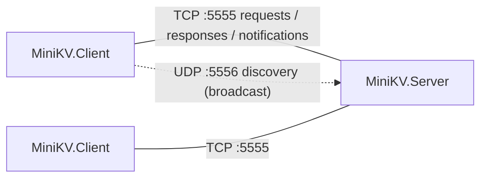

## Tutorial 9: Sieć i serializacja

Zakres tego laboratorium obejmuje komunikację między procesami przez sieć: serializację obiektów do formatu JSON oraz do własnego formatu binarnego, połączenia TCP (`TcpListener`, `TcpClient`, `NetworkStream`), dzielenie strumienia bajtów na wiadomości (ang. *framing*), obsługę wielu klientów jednocześnie za pomocą kodu asynchronicznego, wysyłanie danych przez serwer bez żądania klienta (ang. *server push*) oraz datagramy UDP z rozgłaszaniem.

W C++ takie programy pisze się z użyciem API gniazd BSD (lub Winsock, Boost.Asio). .NET opakowuje gniazda systemu operacyjnego w klasy z przestrzeni nazw `System.Net` i `System.Net.Sockets`, a połączenie TCP jest udostępniane jako zwykły `Stream` – wszystko, co wiesz o [strumieniach]() (`ReadAsync`, `WriteAsync`, dekoratory, adaptery), ma zastosowanie również w komunikacji sieciowej. Więcej szczegółów znajdziesz w wykładach: [Sieć](), [TCP](), [Serializacja]() oraz [Programowanie asynchroniczne]().

### Gniazda w .NET

Najważniejsze typy sieciowe i ich odpowiedniki w API gniazd języka C:

| .NET | Rola | Odpowiednik w C/C++ |
|------|------|---------------------|
| `IPAddress`, `IPEndPoint` | adres IP; adres IP + port | `in_addr`, `sockaddr_in` |
| `TcpListener` | serwer TCP: oczekuje na połączenia | `socket` + `bind` + `listen` + `accept` |
| `TcpClient` | pojedyncze połączenie TCP | `socket` + `connect` |
| `NetworkStream` | `Stream` nad połączonym gniazdem | `send` / `recv` |
| `UdpClient` | wysyłanie i odbieranie datagramów | `sendto` / `recvfrom` |
| `Socket` | niskopoziomowe gniazdo; na nim zbudowane są powyższe klasy | `socket` |

Klient łączy się z serwerem w dwóch linijkach; nazwa hosta jest automatycznie tłumaczona na adres przez DNS:

```csharp
using var client = new TcpClient();
await client.ConnectAsync("localhost", 5555);
NetworkStream stream = client.GetStream(); // a regular Stream: ReadAsync, WriteAsync, ...
```

**TCP** jest protokołem połączeniowym i niezawodnym: bajty docierają w całości, w kolejności i bez duplikatów, albo połączenie zostaje zerwane i otrzymujesz wyjątek. **UDP** wysyła niezależne datagramy: nie ma połączenia, datagram może zginąć, zostać zduplikowany lub dotrzeć w innej kolejności, ale jest to tanie i pozwala wysłać dane naraz do wszystkich komputerów w sieci lokalnej (rozgłaszanie, ang. *broadcast*). Aplikacja wybiera numer portu (0–65535), aby odróżnić swój ruch od innych programów na tym samym komputerze; w Linuksie porty poniżej 1024 wymagają uprawnień administratora, dlatego użyjemy portów 5555 (TCP) i 5556 (UDP).

### TCP to strumień bajtów

TCP gwarantuje kolejność bajtów, ale nic nie wie o *wiadomościach*. Dane zapisane kilkoma wywołaniami `WriteAsync` mogą zostać odebrane jednym `ReadAsync`, a jeden duży zapis może dotrzeć w kilku kawałkach:

```csharp
// sender and receiver: two TcpClients connected to each other
NetworkStream output = sender.GetStream();
await output.WriteAsync("set a 1\n"u8.ToArray());   // three separate writes...
await output.WriteAsync("set b 2\n"u8.ToArray());
await output.WriteAsync("get a\n"u8.ToArray());
await Task.Delay(100);

byte[] buffer = new byte[1024];
int n = await receiver.GetStream().ReadAsync(buffer); // ...but one read returns them all
Console.WriteLine($"Read {n} bytes: {Encoding.UTF8.GetString(buffer, 0, n).ReplaceLineEndings("\\n")}");
// Read 22 bytes: set a 1\nset b 2\nget a\n
```

To protokół aplikacji musi więc określać, gdzie kończy się jedna wiadomość, a zaczyna następna. Nazywamy to **ramkowaniem** (ang. *framing*). Stosuje się dwa popularne podejścia:

- **Separator** – każda wiadomość kończy się specjalnym znakiem, np. znakiem nowej linii. Łatwo ją odczytać za pomocą `StreamReader.ReadLine` (tak robi przykład z [wykładu o TCP]()), ale separator nie może nigdy wystąpić wewnątrz wiadomości.
- **Prefiks długości** – każdą wiadomość poprzedza nagłówek o stałym rozmiarze, zawierający długość treści. Odbiorca odczytuje nagłówek, a potem dokładnie tyle bajtów, ile w nim podano. W ten sposób można przesłać dowolną treść (również binarną). Tego podejścia użyjemy.

Podobnie jak w C++, gdzie `recv` może zwrócić mniej bajtów, niż żądano, i trzeba go wywoływać w pętli, `Stream.ReadAsync` zwraca *co najwyżej* `buffer.Length` bajtów. .NET ma metody pomocnicze, które wykonują tę pętlę za Ciebie: `ReadExactlyAsync(buffer)` wypełnia cały bufor (albo rzuca `EndOfStreamException`), a `ReadAtLeastAsync(buffer, minimumBytes, throwOnEndOfStream: false)` zwraca liczbę bajtów faktycznie odczytanych przed końcem strumienia.

### Serializacja z System.Text.Json

Serializacja zamienia obiekt na postać, którą można zapisać w pliku lub przesłać przez sieć; deserializacja odtwarza obiekt. Statyczna klasa `JsonSerializer` za pomocą refleksji odnajduje publiczne właściwości typu i dobrze współpracuje z rekordami – rekordy pozycyjne są deserializowane przez swój konstruktor:

```csharp
string json = JsonSerializer.Serialize(new Point(1, 2));
Console.WriteLine(json);    // {"X":1,"Y":2}
Point? p = JsonSerializer.Deserialize<Point>(json);
Console.WriteLine(p);       // Point { X = 1, Y = 2 }

public record Point(int X, int Y);
```

Zachowanie serializatora można dostosować obiektem `JsonSerializerOptions` (konwencja nazewnicza, wcięcia, konwertery…) oraz atrybutami, takimi jak `[JsonPropertyName]` czy `[JsonIgnore]`. JSON jest formatem tekstowym: czytelnym i samoopisującym się, ale rozwlekłym. Formaty binarne są zwięzłe i szybkie, ale układ bajtów trzeba precyzyjnie zdefiniować – łącznie z kolejnością bajtów w liczbach (ang. *endianness*). W tym tutorialu użyjemy obu: JSON-a dla wiadomości TCP oraz własnego formatu binarnego dla datagramów UDP.

### Asynchroniczne wejście/wyjście i anulowanie

Klasyczny serwer w C++ tworzy po jednym wątku na klienta i blokuje go w `recv`. Przy tysiącach klientów większość tych wątków po prostu czeka. W .NET operacje sieciowe mają wersje `…Async`: kiedy `await stream.ReadAsync(...)` czeka na dane, wątek wraca do puli wątków, więc garstka wątków może obsłużyć wiele połączeń.

Każda asynchroniczna metoda sieciowa przyjmuje `CancellationToken`. Gdy token zostanie anulowany (`CancellationTokenSource.Cancel()`), oczekująca operacja kończy się wyjątkiem `OperationCanceledException` – w ten sposób zatrzymamy serwer w kontrolowany sposób.

## Zadanie 1 - MiniKV: sieciowa baza klucz-wartość

W ramach tego zadania zbudujesz **MiniKV** – maleńką bazę danych typu klucz-wartość wzorowaną na [Redisie](https://redis.io/). Serwer przechowuje w pamięci pary `string → string` i przy zamknięciu zapisuje je do pliku JSON; klienci łączą się przez TCP i wysyłają polecenia, takie jak `set user:1 Ala` czy `get user:1`. W kolejnych etapach klienci będą mogli *obserwować* klucze i otrzymywać powiadomienia o ich zmianach, a także odnajdywać serwer w sieci lokalnej za pomocą rozgłaszania UDP.

Rozwiązanie składa się z trzech projektów:

- `MiniKV.Protocol` – biblioteka klas współdzielona przez obie strony: typy wiadomości, ustawienia serializacji, ramkowanie.
- `MiniKV.Server` – aplikacja konsolowa: magazyn danych, serwer TCP i obsługa wykrywania przez UDP.
- `MiniKV.Client` – aplikacja konsolowa: interaktywny wiersz poleceń (REPL) połączony z serwerem.



### Etap 1: Wiadomości protokołu i serializacja JSON

Zaczynamy bez sieci: definiujemy wiadomości naszego protokołu, magazyn danych i obsługę żądań, a następnie testujemy je, serializując każdą wiadomość do JSON-a i z powrotem.

Utwórz rozwiązanie (jeśli potrzebujesz przypomnienia, zajrzyj do [Tutorialu 2]()):

```bash
dotnet new sln -n MiniKV
dotnet new classlib -n MiniKV.Protocol
dotnet new console -n MiniKV.Server
dotnet sln add MiniKV.Protocol MiniKV.Server
dotnet add MiniKV.Server reference MiniKV.Protocol
```

> [!IMPORTANT]
> #### Serializacja polimorficzna
>
> Serwer otrzymuje różne rodzaje żądań, ale odczytuje je ze strumienia jako jeden typ – abstrakcyjną klasę bazową. Aby odtworzyć właściwy obiekt pochodny, JSON musi zawierać informację o typie: **dyskryminator typu** (ang. *type discriminator*). W `System.Text.Json` deklaruje się go atrybutami na typie bazowym:
> ```csharp
> [JsonPolymorphic(TypeDiscriminatorPropertyName = "type")]
> [JsonDerivedType(typeof(GetRequest), "get")]
> [JsonDerivedType(typeof(SetRequest), "set")]
> public abstract record Message;
> ```
> Serializacja obiektu `GetRequest` *jako `Message`* daje `{"type":"get","key":"user:1"}`, a `JsonSerializer.Deserialize<Message>(json)` ponownie tworzy `GetRequest`. W ten sposób można (de)serializować tylko typy zarejestrowane atrybutem `[JsonDerivedType]`.

#### Wiadomości

W projekcie `MiniKV.Protocol` utwórz plik `Messages.cs` i zdefiniuj (jako [rekordy]()):

1. Abstrakcyjny rekord `Message` – bazę wszystkiego, co jest przesyłane przez sieć – z atrybutami pokazanymi powyżej, rejestrującymi wszystkie poniższe typy pochodne.
2. Abstrakcyjny rekord `Request : Message` i dziedziczące po nim rekordy pozycyjne:

   | Rekord | Dyskryminator | Znaczenie |
   |--------|---------------|-----------|
   | `GetRequest(string Key)` | `get` | odczyt wartości |
   | `SetRequest(string Key, string Value)` | `set` | utworzenie lub nadpisanie wartości |
   | `DeleteRequest(string Key)` | `del` | usunięcie klucza |
   | `KeysRequest` | `keys` | lista wszystkich kluczy |

3. Typ wyliczeniowy `Status` z wartościami `Ok`, `NotFound`, `Error`.
4. Rekord `Response(Status Status, string? Value = null, IReadOnlyList<string>? Keys = null, string? Error = null) : Message` z dyskryminatorem `response` oraz statycznymi metodami fabrykującymi `Ok(string? value = null)`, `WithKeys(IReadOnlyList<string> keys)`, `NotFound()` i `Fail(string error)`.

#### Ustawienia serializacji

Utwórz plik `KvProtocol.cs` ze statyczną klasą `KvProtocol`, która przechowuje wszystko, co obie strony muszą mieć wspólne: stałą `DefaultPort = 5555` oraz współdzielone `JsonSerializerOptions`:

```csharp
public static JsonSerializerOptions JsonOptions { get; } = new()
{
    // "Key" -> "key"
    PropertyNamingPolicy = JsonNamingPolicy.CamelCase,
    // Status.NotFound -> "notFound" instead of 1
    Converters = { new JsonStringEnumConverter(JsonNamingPolicy.CamelCase) },
    // Do not send "value": null, "keys": null, ...
    DefaultIgnoreCondition = JsonIgnoreCondition.WhenWritingNull,
    // Reject messages with missing or null non-nullable members, e.g. {"type":"get"}
    RespectNullableAnnotations = true,
    RespectRequiredConstructorParameters = true,
};
```

Dodaj dwie metody pomocnicze: `string Serialize(Message message)` oraz `Message? Deserialize(string json)`, wywołujące `JsonSerializer` z tymi ustawieniami.

> [!WARNING]
> Informacja o polimorfizmie jest używana tylko wtedy, gdy **statycznym typem** przekazanym do serializatora jest `Message`. Parametr generyczny `JsonSerializer.Serialize<T>` jest wnioskowany z typu zmiennej:
> ```csharp
> Request r = new GetRequest("a");
> Console.WriteLine(JsonSerializer.Serialize(r));          // {}
> Console.WriteLine(JsonSerializer.Serialize<Message>(r)); // {"type":"get","Key":"a"}
> ```
> Sam `Request` nie ma atrybutu `[JsonPolymorphic]` ani żadnych właściwości, więc nic nie zostaje zapisane. Dlatego nasze metody pomocnicze przyjmują parametr typu `Message`. Zwróć też uwagę, że domyślnie przy deserializacji dyskryminator musi być **pierwszą** właściwością obiektu JSON (chyba że ustawisz `AllowOutOfOrderMetadataProperties = true`).

#### Magazyn danych i obsługa żądań

W projekcie `MiniKV.Server` utwórz klasę `KeyValueStore` (plik `KeyValueStore.cs`) opakowującą prywatny słownik `Dictionary<string, string>`:

1. Metody `bool TryGet(string key, [MaybeNullWhen(false)] out string value)`, `void Set(string key, string value)`, `bool Delete(string key)`, `IReadOnlyList<string> Keys()` (posortowane klucze) oraz właściwość `int Count`. Atrybut `[MaybeNullWhen(false)]` (`System.Diagnostics.CodeAnalysis`) informuje kompilator, że `value` nie jest `null`, gdy metoda zwraca `true` – dokładnie tak jak w `Dictionary.TryGetValue`.
2. `Task SaveAsync(string path)` – zapisuje zrzut (ang. *snapshot*) zawartości magazynu do pliku. Zdefiniuj prywatny rekord `Snapshot(DateTime SavedAtUtc, SortedDictionary<string, string> Entries)`, otwórz plik metodą `File.Create` i użyj `JsonSerializer.SerializeAsync(stream, snapshot, options)` z kopią `KvProtocol.JsonOptions`, w której `WriteIndented = true` (zapamiętaj ją w polu `static readonly` – obiekty ustawień należy używać wielokrotnie, a nie tworzyć przy każdym wywołaniu).
3. `static Task<KeyValueStore> LoadAsync(string path)` – zwraca pusty magazyn, jeśli plik nie istnieje, a w przeciwnym razie deserializuje zrzut za pomocą `JsonSerializer.DeserializeAsync<Snapshot>`.

Następnie utwórz klasę `RequestHandler` z konstruktorem głównym `RequestHandler(KeyValueStore store)` i metodą `Response Handle(Request request)`. Użyj instrukcji `switch` ze [wzorcami pozycyjnymi](), aby dekonstruować rekordy:

```csharp
switch (request)
{
    case SetRequest(var key, var value):
        store.Set(key, value);
        return Response.Ok();
    // ...
}
```

`get` zwraca `Ok(value)` lub `NotFound()`, `del` zwraca `Ok()` lub `NotFound()`, `keys` zwraca `WithKeys(...)`, a nieznane żądanie – `Fail(...)`.

#### Testowanie

W pliku `Program.cs` serwera zasymuluj sieć: utwórz tablicę żądań (`set user:1 Ala`, `set user:2 Bob`, `set greeting Hello, world!`, `get user:1`, `del user:2`, `get user:2`, `keys`) i każde z nich zserializuj do JSON-a, zdeserializuj z powrotem do `Message`, przekaż do obsługi i zserializuj odpowiedź. Wypisz oba JSON-y, zdeserializowany rekord oraz informację, czy jest równy oryginałowi (rekordy mają semantykę równości wartościowej). Na koniec zapisz magazyn do pliku `minikv.json`, wczytaj go z powrotem i wypisz zawartość pliku. Oczekiwany wynik (`dotnet run --project MiniKV.Server`):

```text
>> {"type":"set","key":"user:1","value":"Ala"}
   SetRequest { Key = user:1, Value = Ala } (equal to original: True)
<< {"type":"response","status":"ok"}
>> {"type":"set","key":"user:2","value":"Bob"}
   SetRequest { Key = user:2, Value = Bob } (equal to original: True)
<< {"type":"response","status":"ok"}
>> {"type":"set","key":"greeting","value":"Hello, world!"}
   SetRequest { Key = greeting, Value = Hello, world! } (equal to original: True)
<< {"type":"response","status":"ok"}
>> {"type":"get","key":"user:1"}
   GetRequest { Key = user:1 } (equal to original: True)
<< {"type":"response","status":"ok","value":"Ala"}
>> {"type":"del","key":"user:2"}
   DeleteRequest { Key = user:2 } (equal to original: True)
<< {"type":"response","status":"ok"}
>> {"type":"get","key":"user:2"}
   GetRequest { Key = user:2 } (equal to original: True)
<< {"type":"response","status":"notFound"}
>> {"type":"keys"}
   KeysRequest { } (equal to original: True)
<< {"type":"response","status":"ok","keys":["greeting","user:1"]}

Snapshot 'minikv.json' loaded back: 2 key(s) [greeting, user:1]
{
  "savedAtUtc": "2026-10-29T17:45:45.648543Z",
  "entries": {
    "greeting": "Hello, world!",
    "user:1": "Ala"
  }
}
```

> [!TIP]
> Dzięki `RespectNullableAnnotations` i `RespectRequiredConstructorParameters` niekompletna wiadomość, taka jak `{"type":"get"}`, nie tworzy obiektu `GetRequest` z `Key == null`, tylko powoduje wyjątek `JsonException` (*JSON deserialization for type 'GetRequest' was missing required properties including: 'key'*). Danym przychodzącym z sieci nigdy nie należy ufać.

> [!NOTE]
> #### Etap 1
> 

### Etap 2: Ramkowanie i serwer TCP

Teraz wysyłamy wiadomości przez sieć. Każda wiadomość jest przesyłana jako **ramka**: 4-bajtowy nagłówek z długością treści, a po nim treść – wiadomość zserializowana do JSON-a w kodowaniu UTF-8:

```text
+----------------------------+--------------------------------------------+
| length (int32, big-endian) | payload: UTF-8 JSON, <length> bytes        |
+----------------------------+--------------------------------------------+
  00 00 00 2B                  {"type":"set","key":"user:1","value":"Ala"}
```

> [!IMPORTANT]
> #### Kolejność bajtów i `BinaryPrimitives`
>
> Liczbę wielobajtową można zapisać, zaczynając od najbardziej znaczącego bajtu (*big-endian*, tradycyjna *sieciowa kolejność bajtów*) albo od najmniej znaczącego (*little-endian*, stosowana przez procesory x86 i większość procesorów ARM). Obie strony protokołu muszą używać tej samej kolejności. W C wywołałbyś `htonl`/`ntohl`; w .NET użyj statycznej klasy `BinaryPrimitives` (`System.Buffers.Binary`), która odczytuje i zapisuje liczby w jawnie podanej kolejności z/do `Span<byte>`:
> ```csharp
> byte[] header = new byte[4];
> BinaryPrimitives.WriteInt32BigEndian(header, 300);
> Console.WriteLine(BitConverter.ToString(header));                 // 00-00-01-2C
> Console.WriteLine(BitConverter.ToString(BitConverter.GetBytes(300))); // 2C-01-00-00 on little-endian CPUs
> ```
> `BitConverter` zawsze używa kolejności bajtów maszyny, na której działa.

#### Strumień wiadomości

W projekcie `MiniKV.Protocol` dodaj do klasy `KvProtocol` stałą `MaxMessageSize = 64 * 1024` i utwórz klasę `MessageStream` z konstruktorem głównym `MessageStream(Stream stream)`:

1. `Task WriteAsync(Message message, CancellationToken ct = default)`:
   - zserializuj wiadomość metodą `JsonSerializer.SerializeToUtf8Bytes(message, KvProtocol.JsonOptions)` (parametr ma typ `Message`, więc dyskryminator zostanie zapisany);
   - jeśli treść jest dłuższa niż `MaxMessageSize`, rzuć `InvalidDataException`;
   - zbuduj **jedną** tablicę `nagłówek + treść` (długość zapisz za pomocą `BinaryPrimitives.WriteInt32BigEndian`) i wyślij ją jednym wywołaniem `WriteAsync`, a następnie wywołaj `FlushAsync`.
2. `Task<Message?> ReadAsync(CancellationToken ct = default)`:
   - odczytaj 4-bajtowy nagłówek za pomocą `ReadAtLeastAsync(header, 4, throwOnEndOfStream: false, ct)`. Jeśli odczytano 0 bajtów, druga strona zamknęła połączenie między wiadomościami – zwróć `null`. Jeśli odczytano od 1 do 3 bajtów, rzuć `EndOfStreamException`;
   - zdekoduj długość; jeśli nie należy do przedziału `(0, MaxMessageSize]`, rzuć `InvalidDataException` – nigdy nie alokuj bufora o rozmiarze otrzymanym z sieci bez sprawdzenia go;
   - odczytaj treść metodą `ReadExactlyAsync` i zdeserializuj ją do `Message`. Wyjątki `JsonException` i `NotSupportedException` (rzucany, gdy brakuje dyskryminatora) opakuj w `InvalidDataException`.

> [!TIP]
> Zapisanie nagłówka i treści dwoma osobnymi wywołaniami `WriteAsync` również działa, ale nagłówek może wtedy zostać wysłany w osobnym, malutkim pakiecie TCP. Zbudowanie najpierw całej ramki jest prostsze i wydajniejsze.

> [!IMPORTANT]
> #### Kolekcje współbieżne
>
> Od teraz każdy klient jest obsługiwany przez osobne zadanie, a zadania te działają równolegle w puli wątków. `Dictionary<TKey, TValue>` nie jest bezpieczny wielowątkowo – współbieżne zapisy mogą uszkodzić jego strukturę. Zastąp go w `KeyValueStore` klasą `ConcurrentDictionary<string, string>` (`System.Collections.Concurrent`), która wewnętrznie synchronizuje dostęp (zobacz wykład [Kolekcje współbieżne]()). `Remove` zamienia się na `TryRemove(key, out _)`; pozostałe metody się nie zmieniają.

#### Serwer TCP

W projekcie `MiniKV.Server` utwórz klasę `KvServer(IPEndPoint endPoint, RequestHandler handler)` z metodą `Task RunAsync(CancellationToken ct)`:

1. Utwórz `TcpListener` dla podanego punktu końcowego, wywołaj `Start()` i wypisz adres, na którym nasłuchujesz.
2. W pętli przyjmuj klientów za pomocą `await listener.AcceptTcpClientAsync(ct)`. **Nie** czekaj na zakończenie obsługi klienta – uruchom `HandleClientAsync(client, ct)`, zapamiętaj zwrócony `Task` na liście i od razu czekaj na kolejnego klienta (co jakiś czas usuwaj z listy zakończone zadania):
   ```csharp
   TcpClient client = await listener.AcceptTcpClientAsync(ct);
   clients.Add(HandleClientAsync(client, ct));
   clients.RemoveAll(task => task.IsCompleted);
   ```
3. Gdy token zostanie anulowany, `AcceptTcpClientAsync` rzuci `OperationCanceledException`. Przechwyć go, zatrzymaj nasłuchiwanie i poczekaj na wszystkie zadania klientów za pomocą `Task.WhenAll`.

Zaimplementuj `private async Task HandleClientAsync(TcpClient client, CancellationToken ct)`:

1. Wypisz `[<zdalny punkt końcowy>] connected` (`client.Client.RemoteEndPoint`).
2. Opakuj `client.GetStream()` w `MessageStream` i w pętli odczytuj wiadomości, dopóki `ReadAsync` nie zwróci `null`. Wypisuj każdą wiadomość (wystarczy `ToString()` rekordu), przekazuj żądania do obsługi i odsyłaj odpowiedź.
3. Przechwyć `OperationCanceledException` (zamykanie serwera), `IOException` (zerwane połączenie, np. *Connection reset by peer*) oraz `InvalidDataException` (błąd protokołu). Wadliwy klient nigdy nie może spowodować awarii serwera. W każdym przypadku zwolnij `TcpClient` i wypisz `[...] disconnected`.

#### Uruchamianie i zatrzymywanie serwera

W pliku `Program.cs` serwera:

1. Odczytaj z `args` opcjonalny numer portu (domyślnie `KvProtocol.DefaultPort`); plik zrzutu to `minikv-{port}.json`, dzięki czemu dwa serwery na jednym komputerze nie nadpisują sobie nawzajem danych.
2. Utwórz `CancellationTokenSource` i anuluj go po naciśnięciu Ctrl+C:
   ```csharp
   Console.CancelKeyPress += (_, e) =>
   {
       e.Cancel = true; // do not kill the process - shut down gracefully instead
       cts.Cancel();
   };
   ```
3. Wczytaj magazyn metodą `KeyValueStore.LoadAsync`, uruchom `KvServer` na `new IPEndPoint(IPAddress.Any, port)` i po powrocie z `RunAsync` zapisz magazyn.

`IPAddress.Any` (`0.0.0.0`) oznacza *wszystkie interfejsy sieciowe* – połączyć się mogą także inne komputery. Użyj `IPAddress.Loopback` (`127.0.0.1`), aby przyjmować wyłącznie połączenia lokalne.

#### Jednorazowy klient

Aby przetestować serwer, dodaj trzeci projekt z referencją do biblioteki protokołu:

```bash
dotnet new console -n MiniKV.Client
dotnet sln add MiniKV.Client
dotnet add MiniKV.Client reference MiniKV.Protocol
```

1. Utwórz statyczną klasę `CommandParser` z metodą `Request Parse(string line)`. Podziel linię na co najwyżej 3 części, aby wartość mogła zawierać spacje, i dopasuj części za pomocą [wzorców listy]():
   ```csharp
   string[] parts = line.Split(' ', 3, StringSplitOptions.RemoveEmptyEntries | StringSplitOptions.TrimEntries);
   return parts switch
   {
       ["get", var key] => new GetRequest(key),
       ["set", var key, var value] => new SetRequest(key, value),
       // del <key>, keys
       _ => throw new FormatException($"Invalid command: '{line}'. {Usage}"),
   };
   ```
2. Utwórz statyczną klasę `ResponseFormatter` z metodą `string Format(Response response)`, zwracającą `OK`, wartość w cudzysłowie (`"Ala"`), ponumerowaną listę kluczy (`1) greeting`), `(empty)`, `(not found)` albo `(error) <komunikat>`. Dzięki [wzorcom właściwości](), takim jak `{ Status: Status.Ok, Value: { } value }`, wystarczy jedno wyrażenie `switch`.
3. W pliku `Program.cs`: sparsuj `string.Join(' ', args)` (w razie `FormatException` wypisz komunikat i zwróć `1`), połącz `TcpClient` z `localhost:5555`, wyślij żądanie za pomocą `MessageStream`, odczytaj jedną wiadomość i wypisz sformatowaną odpowiedź.

Uruchom serwer w jednym terminalu, a klienta w drugim:

```text
$ dotnet run --project MiniKV.Client -- set user:1 Ala
OK
$ dotnet run --project MiniKV.Client -- set greeting Hello, world!
OK
$ dotnet run --project MiniKV.Client -- get user:1
"Ala"
$ dotnet run --project MiniKV.Client -- keys
1) greeting
2) user:1
$ dotnet run --project MiniKV.Client -- del user:1
OK
$ dotnet run --project MiniKV.Client -- del user:1
(not found)
$ dotnet run --project MiniKV.Client -- remove user:1
Invalid command: 'remove user:1'. Commands: get <key> | set <key> <value> | del <key> | keys
```

Wyjście serwera (porty klientów wybiera system operacyjny, więc u Ciebie będą inne); na koniec serwer został zatrzymany klawiszami Ctrl+C:

```text
$ dotnet run --project MiniKV.Server
Loaded 0 key(s) from 'minikv-5555.json'
Listening on 0.0.0.0:5555. Press Ctrl+C to stop.
[127.0.0.1:36464] connected
[127.0.0.1:36464] SetRequest { Key = user:1, Value = Ala }
[127.0.0.1:36464] disconnected
[127.0.0.1:36480] connected
[127.0.0.1:36480] SetRequest { Key = greeting, Value = Hello, world! }
[127.0.0.1:36480] disconnected
...
[127.0.0.1:38420] connected
[127.0.0.1:38420] DeleteRequest { Key = user:1 }
[127.0.0.1:38420] disconnected
[127.0.0.1:38422] connected
[127.0.0.1:38422] protocol error: Invalid message length: 1751477356
[127.0.0.1:38422] disconnected
^C
Saved 1 key(s) to 'minikv-5555.json'. Bye!
```

Linia `protocol error` pochodzi z połączenia za pomocą zwykłego narzędzia TCP i wysłania tekstu, który nie stosuje się do naszego ramkowania: `printf 'hello\n' | nc localhost 5555`. Pierwsze cztery bajty `hell` (`68 65 6C 6C`) zostały zinterpretowane jako długość 1751477356 – dzięki sprawdzeniu rozmiaru serwer po prostu zamyka połączenie, zamiast próbować zaalokować 1,6 GB. Po ponownym uruchomieniu serwer wypisuje `Loaded 1 key(s) from 'minikv-5555.json'`, a `keys` zwraca `1) greeting`.

> [!WARNING]
> W systemie Windows zapora sieciowa może zapytać, czy zezwolić serwerowi na przyjmowanie połączeń – zezwól na to w sieciach prywatnych. W Linuksie zapora (jeśli jest włączona, np. `firewalld` w Fedorze) może blokować połączenia z innych komputerów, ale nie z `localhost`.

> [!NOTE]
> #### Etap 2
> 

### Etap 3: Interaktywny klient

Otwieranie nowego połączenia dla każdego polecenia to marnotrawstwo. W tym etapie klient utrzymuje jedno otwarte połączenie i odczytuje polecenia w pętli (REPL – ang. *read-eval-print loop*). Obsłużymy też wszystko, co może pójść nie tak po stronie klienta.

> [!IMPORTANT]
> #### Gdy sieć zawodzi
>
> - **Nawiązywanie połączenia:** `ConnectAsync` rzuca `SocketException`, gdy serwer odrzuci połączenie (nikt nie nasłuchuje na porcie – `SocketErrorCode == ConnectionRefused`) albo nie da się przetłumaczyć nazwy hosta (`HostNotFound`). Jeśli serwer w ogóle nie odpowiada (np. zapora odrzuca pakiety), `ConnectAsync` może czekać bardzo długo (w Linuksie ponad dwie minuty) – ustaw własny limit czasu za pomocą `CancellationTokenSource(timeout)`.
> - **W trakcie komunikacji:** gdy druga strona zamknie połączenie, odczyt zwraca 0 bajtów (nasze `ReadAsync` zwraca `null`). Gdy połączenie zostanie nagle zerwane, odczyty i zapisy rzucają `IOException`. Zapis do zamkniętego połączenia może się początkowo udać – dane trafiają tylko do bufora systemu operacyjnego – a błąd ujawnia się przy kolejnym odczycie lub zapisie.

#### KvConnection

W projekcie `MiniKV.Client` utwórz klasę `KvConnection : IDisposable`, która ukrywa `TcpClient` oraz `MessageStream`:

1. Prywatny konstruktor przyjmujący połączony `TcpClient`.
2. Statyczną metodę fabrykującą `Task<KvConnection> ConnectAsync(string host, int port, TimeSpan timeout)`:
   ```csharp
   var client = new TcpClient();
   using var cts = new CancellationTokenSource(timeout);
   try
   {
       await client.ConnectAsync(host, port, cts.Token);
       return new KvConnection(client);
   }
   catch (OperationCanceledException)
   {
       client.Dispose();
       throw new TimeoutException($"No answer within {timeout.TotalSeconds} s");
   }
   ```
   Zwolnij klienta także wtedy, gdy `ConnectAsync` rzuci inny wyjątek, i rzuć go ponownie.
3. `Task<Response> SendAsync(Request request, CancellationToken ct = default)` – zapisuje żądanie i odczytuje kolejną wiadomość. Jeśli jest to `Response`, zwróć ją; jeśli `ReadAsync` zwróciło `null`, rzuć `IOException("The server closed the connection")`; każda inna wiadomość to błąd protokołu (`InvalidDataException`).
4. `Dispose()` zwalnia `TcpClient`.

#### Pętla REPL

Przepisz plik `Program.cs` klienta:

1. Odczytaj opcjonalne argumenty `[host] [port]` (domyślnie: `localhost`, `KvProtocol.DefaultPort`).
2. Połącz się z 3-sekundowym limitem czasu. W razie `SocketException` lub `TimeoutException` wypisz `Cannot connect to <host>:<port>: <komunikat>` i zwróć `1`.
3. W pętli wypisuj znak zachęty `> `, wczytuj linię i usuwaj z niej białe znaki z początku i końca. Zakończ po poleceniu `quit` lub gdy `Console.ReadLine()` zwróci `null` (koniec wejścia – Ctrl+D w Linuksie, Ctrl+Z w Windowsie). Ignoruj puste linie.
4. Sparsuj linię, wyślij żądanie i wypisz sformatowaną odpowiedź. W razie `FormatException` wypisz komunikat i kontynuuj. W razie `IOException` lub `InvalidDataException` wypisz `Connection lost: <komunikat>` i zwróć `1`.

Serwer w tym etapie się nie zmienia. Oczekiwane zachowanie, gdy coś jest nie tak:

```text
$ dotnet run --project MiniKV.Client
Cannot connect to localhost:5555: Connection refused
$ dotnet run --project MiniKV.Client -- 10.255.255.1
Cannot connect to 10.255.255.1:5555: No answer within 3 s
$ dotnet run --project MiniKV.Client -- no-such-host.invalid
Cannot connect to no-such-host.invalid:5555: Name or service not known
```

(Komunikaty pochodzą z systemu operacyjnego – w Windowsie odrzucone połączenie zgłaszane jest jako *No connection could be made because the target machine actively refused it*.)

Sesja klienta A. Między jego pierwszym a drugim poleceniem `keys` inny klient połączył się, odczytał `greeting` (`"Hello, world!"`) i usunął ten klucz. Przed ostatnim poleceniem serwer został zatrzymany klawiszami Ctrl+C:

```text
$ dotnet run --project MiniKV.Client
Connected to localhost:5555. Commands: get <key> | set <key> <value> | del <key> | keys | quit
> set user:1 Ala
OK
> set greeting Hello, world!
OK
> get user:1
"Ala"
> get user:2
(not found)
> keys
1) greeting
2) user:1
> remove user:1
Invalid command: 'remove user:1'. Commands: get <key> | set <key> <value> | del <key> | keys
> 
> keys
1) user:1
> get user:1
Connection lost: The server closed the connection
```

Wyjście serwera:

```text
$ dotnet run --project MiniKV.Server
Loaded 0 key(s) from 'minikv-5555.json'
Listening on 0.0.0.0:5555. Press Ctrl+C to stop.
[127.0.0.1:49108] connected
[127.0.0.1:49108] SetRequest { Key = user:1, Value = Ala }
...
[127.0.0.1:49108] KeysRequest { }
[127.0.0.1:36702] connected
[127.0.0.1:36702] GetRequest { Key = greeting }
[127.0.0.1:36702] DeleteRequest { Key = greeting }
[127.0.0.1:36702] disconnected
[127.0.0.1:49108] KeysRequest { }
^C
[127.0.0.1:49108] disconnected
Saved 1 key(s) to 'minikv-5555.json'. Bye!
```

> [!NOTE]
> #### Etap 3
> 

### Etap 4: Obserwowanie kluczy – powiadomienia od serwera

Do tej pory serwer wyłącznie *odpowiadał*. Teraz klient będzie mógł obserwować klucz poleceniem `watch`, a serwer będzie mu wysyłał powiadomienie `KeyChanged` za każdym razem, gdy inny klient (lub ten sam) zmieni lub usunie ten klucz – w dowolnym momencie, bez żądania. Połączenie staje się w pełni **dwukierunkowe** (ang. *full-duplex*), co ma konsekwencje po obu stronach:

- **Klient:** nie może czytać z gniazda tylko po wysłaniu żądania – powiadomienie może nadejść, gdy użytkownik pisze polecenie. Działająca w tle **pętla odbierająca** musi odczytywać wszystkie przychodzące wiadomości i je rozdzielać: odpowiedzi do kodu, który na nie czeka, a powiadomienia na ekran.
- **Serwer:** do strumienia jednego klienta pisze teraz wiele zadań – jego własna obsługa (odpowiedzi) oraz obsługa innych klientów (powiadomienia). Dwa nakładające się zapisy mogłyby przepleść bajty dwóch ramek i rozsynchronizować strumień.

> [!WARNING]
> `NetworkStream` pozwala na jednoczesne wykonywanie jednej operacji odczytu i jednej operacji zapisu (np. pętli odbierającej i pętli wysyłającej). **Nie** pozwala na dwa współbieżne zapisy ani na dwa współbieżne odczyty. To samo dotyczy naszego `MessageStream`.

> [!IMPORTANT]
> #### Kanały – asynchroniczna kolejka producent-konsument
>
> `Channel<T>` (`System.Threading.Channels`) to bezpieczna wielowątkowo kolejka zaprojektowana dla kodu `async`. Dowolna liczba producentów dodaje elementy przez `channel.Writer` (`TryWrite`, `WriteAsync`), a konsumenci pobierają je przez `channel.Reader` – najwygodniej pętlą `await foreach (var item in channel.Reader.ReadAllAsync(ct))`, która czeka na elementy bez blokowania wątku, gdy kolejka jest pusta. `Writer.Complete()` (lub `TryComplete()`) oznacza koniec: pętla kończy się po pobraniu pozostałych elementów, a `Reader.ReadAsync` rzuca `ChannelClosedException`.
>
> Każdemu klientowi dajemy **kolejkę wychodzącą** (ang. *outbox*) oraz dokładnie jedno zadanie, które pobiera z niej wiadomości i zapisuje je do gniazda. Kto chce coś wysłać do klienta, po prostu wkłada wiadomość do kolejki – zapisy nigdy się nie nakładają, a wolny klient nie spowalnia nadawcy.
>
> Alternatywą jest ochrona zapisów asynchroniczną blokadą. Wewnątrz instrukcji `lock` nie można użyć `await` (błąd CS1996), ale można użyć `SemaphoreSlim` (zobacz wykład [Blokowanie współdzielone]()):
> ```csharp
> await _writeLock.WaitAsync(ct); // like lock, but can be awaited
> try
> {
>     await _messages.WriteAsync(message, ct);
> }
> finally
> {
>     _writeLock.Release();
> }
> ```

#### Protokół

W pliku `Messages.cs` dodaj (i zarejestruj atrybutem `[JsonDerivedType]`):

1. `WatchRequest(string Key) : Request` (`watch`) oraz `UnwatchRequest(string Key) : Request` (`unwatch`).
2. `KeyChanged(string Key, string? Value = null) : Message` (`keyChanged`) – wysyłany przez serwer; `Value == null` oznacza, że klucz został usunięty. Wartość domyślna `= null` czyni parametr opcjonalnym, więc `RespectRequiredConstructorParameters` akceptuje JSON bez właściwości `"value"`.

#### Serwer

1. Utwórz klasę `ClientSession(TcpClient client)` (plik `ClientSession.cs`), reprezentującą jednego połączonego klienta:
   - pola: `MessageStream` nad strumieniem klienta oraz kolejka wychodząca `Channel<Message>` utworzona metodą `Channel.CreateUnbounded<Message>()`; właściwość `RemoteEndPoint`;
   - `void Send(Message message)` – `_outbox.Writer.TryWrite(message)`; bezpieczna wielowątkowo i nigdy nie blokuje;
   - `Task RunAsync(RequestHandler handler, CancellationToken ct)` – uruchamia pętlę zapisującą (bez czekania na nią), a następnie w pętli odczytuje żądania (tak jak wcześniej `HandleClientAsync`) i **wysyła odpowiedzi przez `Send`**. W bloku `finally` zamyka kolejkę i czeka na zakończenie pętli zapisującej:
     ```csharp
     Task writer = WriteLoopAsync(ct);
     try
     {
         // read loop: Send(handler.Handle(request, this)) ...
     }
     finally
     {
         _outbox.Writer.TryComplete(); // no more messages - the writer loop ends after sending the rest
         await writer;
     }
     ```
   - `private Task WriteLoopAsync(CancellationToken ct)` – `await foreach` po `_outbox.Reader.ReadAllAsync(ct)`, zapisujące każdą wiadomość metodą `_messages.WriteAsync`. Przechwyć `OperationCanceledException` i `IOException` – gdy klient zniknie, pętla odczytu również to wykryje.
2. Utwórz klasę `WatchRegistry` (plik `WatchRegistry.cs`) przechowującą słownik `Dictionary<string, HashSet<ClientSession>>` – kto obserwuje który klucz. Korzysta z niej jednocześnie wiele zadań klientów, więc każdy dostęp chroń instrukcją `lock` na obiekcie `System.Threading.Lock`:
   - `void Watch(string key, ClientSession session)`, `bool Unwatch(string key, ClientSession session)` (usuń klucz ze słownika, gdy jego zbiór stanie się pusty);
   - `void RemoveSession(ClientSession session)` – usuwa sesję ze wszystkich zbiorów (wywoływana po rozłączeniu klienta);
   - `void Notify(string key, string? value)` – pod blokadą skopiuj obserwatorów klucza do tablicy (`[.. sessions]`); **po** zwolnieniu blokady wywołaj na każdym z nich `Send(new KeyChanged(key, value))`. Jeśli nie musisz, nigdy nie wywołuj obcego kodu, trzymając blokadę.
3. W klasie `RequestHandler` dodaj prywatne pole `WatchRegistry` i zmień sygnaturę na `Response Handle(Request request, ClientSession session)`. Po `Set` wywołaj `Notify(key, value)`; po udanym `Delete` – `Notify(key, null)`. Obsłuż `WatchRequest` (`Ok`) i `UnwatchRequest` (`Ok` lub `NotFound`). Dodaj metodę `void ClientDisconnected(ClientSession session)`, wywołującą `RemoveSession`.
4. W `KvServer.HandleClientAsync` zamiast dotychczasowej pętli odczytu utwórz `ClientSession` i wykonaj `await session.RunAsync(handler, ct)`; w bloku `finally` wywołaj `handler.ClientDisconnected(session)`.

#### Klient

1. W klasie `KvConnection`:
   - dodaj `Channel<Response>` na odpowiedzi oraz zdarzenie `public event Action<KeyChanged>? NotificationReceived;`;
   - na końcu konstruktora uruchom pętlę odbierającą: `_ = ReceiveLoopAsync();` (`_ =` celowo odrzuca zadanie – pętla działa aż do zamknięcia połączenia);
   - `ReceiveLoopAsync` odczytuje wiadomości aż do `null` i rozdziela je instrukcją `switch`: `Response` trafia do kanału (`await _responses.Writer.WriteAsync(response)`), a `KeyChanged` wywołuje zdarzenie. Przechwyć `IOException`, `InvalidDataException` oraz `ObjectDisposedException` (gniazdo zamknięte przez `Dispose`), a w bloku `finally` zamknij kanał;
   - `SendAsync` teraz tylko zapisuje żądanie, a następnie czeka na odpowiedź z kanału: `await _responses.Reader.ReadAsync(ct)`. Zamień `ChannelClosedException` na `IOException("The server closed the connection")`.
2. Dodaj polecenia `watch <key>` i `unwatch <key>` do `CommandParser` (oraz do `Usage`).
3. W pliku `Program.cs` przed pętlą zasubskrybuj zdarzenie i wypisuj `[watch] 'key' = "value"` albo `[watch] 'key' was deleted`. Metoda obsługi działa w wątku w tle (w pętli odbierającej) – zobacz wykład o [zdarzeniach]().

Dwóch klientów: klient A obserwuje dwa klucze, a klient B wykonuje `set counter 1`, `set counter 2`, `set user:1 Ala`, `del counter` oraz – po poleceniu `unwatch counter` klienta A – `set counter 3` (każde z odpowiedzią `OK`). Klient A widzi:

```text
$ dotnet run --project MiniKV.Client
Connected to localhost:5555. Commands: get <key> | set <key> <value> | del <key> | keys | watch <key> | unwatch <key> | quit
> watch counter
OK
> watch user:1
OK
> [watch] 'counter' = "1"
[watch] 'counter' = "2"
[watch] 'user:1' = "Ala"
[watch] 'counter' was deleted
unwatch counter
OK
> set user:1 Ola
[watch] 'user:1' = "Ola"
OK
> unwatch nothing
(not found)
```

Klient A nie otrzymał powiadomienia o `set counter 3` – przestał już obserwować `counter`. Gdy klient A sam zmienia obserwowany klucz, powiadomienie przychodzi *przed* `OK`: serwer umieszcza powiadomienie w kolejce w metodzie `Notify`, zanim trafi tam odpowiedź.

> [!TIP]
> Zwróć uwagę na linię `> [watch] 'counter' = "1"` powyżej: powiadomienie zostało wypisane, gdy główny wątek czekał w `Console.ReadLine()` po wypisaniu znaku zachęty. Dwa wątki piszące na konsolę przeplatają swoje wyjście; prawdziwe aplikacje terminalowe rozwiązują to bibliotekami, które przerysowują linię wejściową.

> [!NOTE]
> #### Etap 4
> 

### Etap 5: Wyszukiwanie serwera przez UDP

Wpisywanie adresu serwera jest niewygodne. W ostatnim etapie klient uruchomiony bez argumentów sam **wykryje** serwery w sieci lokalnej: rozgłosi mały datagram UDP – *zapytanie* (ang. *probe*), a każdy serwer MiniKV odpowie *ogłoszeniem* (ang. *announcement*) zawierającym swoją nazwę, port TCP i liczbę kluczy.

> [!IMPORTANT]
> #### UDP w .NET
>
> UDP jest bezpołączeniowy: nie ma `Listener`, nie ma `Accept` ani strumienia. `UdpClient` wysyła i odbiera całe **datagramy**:
> ```csharp
> using var udp = new UdpClient(new IPEndPoint(IPAddress.Any, 5556)); // bound to a port: can receive
> UdpReceiveResult result = await udp.ReceiveAsync(ct);               // one whole datagram
> await udp.SendAsync(reply, result.RemoteEndPoint, ct);              // answer to the sender
> ```
> - **Granice wiadomości są zachowane:** jedno `SendAsync` = jeden datagram = jedno `ReceiveAsync` (do 65 507 bajtów w IPv4) – ramkowanie nie jest potrzebne.
> - **Brak niezawodności:** datagram może zginąć (i nikt Cię o tym nie poinformuje), zostać zduplikowany lub dotrzeć w innej kolejności. Protokoły oparte na UDP stosują **limity czasu i ponowienia**.
> - **Rozgłaszanie:** datagram wysłany na adres `255.255.255.255` (`IPAddress.Broadcast`) trafia do wszystkich komputerów w danym segmencie sieci lokalnej (routery go nie przekazują). Rozgłaszanie musi być dozwolone na gnieździe: `UdpClient` włącza je automatycznie dla `IPAddress.Broadcast`, ale dla adresu rozgłoszeniowego podsieci, np. `192.168.0.255`, musisz ustawić `EnableBroadcast = true` (w przeciwnym razie: *Permission denied*).
> - `ReceiveAsync` informuje też, kto wysłał datagram (`result.RemoteEndPoint`), więc adres serwera nie musi być częścią wiadomości.

> [!IMPORTANT]
> #### Ręczna serializacja binarna
>
> Datagramy wykrywania używają zwięzłego formatu binarnego. Projektując taki format, zapisz dokładny układ: kolejność, rozmiar i kolejność bajtów każdego pola. Dane o zmiennej długości (napisy) muszą być poprzedzone swoją długością. Literał UTF-8 z C# 11 `"MKV?"u8` zwraca bajty napisu jako `ReadOnlySpan<byte>` bez żadnej alokacji, a wycinki `Span<byte>` (`span[4..]`) zastępują arytmetykę wskaźników znaną z C.

#### Protokół

Dodaj do klasy `KvProtocol` stałą `DiscoveryPort = 5556` i utwórz plik `Discovery.cs` z rekordem `ServerAnnouncement(string Name, int TcpPort, int KeyCount)` oraz statyczną klasą `Discovery`. Datagramy wyglądają następująco (liczby w kolejności big-endian):

| Datagram | Przesunięcie | Rozmiar | Zawartość |
|----------|--------------|---------|-----------|
| zapytanie | 0 | 4 | `MKV?` (ASCII) |
| ogłoszenie | 0 | 4 | `MKV!` (ASCII) |
| | 4 | 2 | port TCP (`uint16`) |
| | 6 | 4 | liczba kluczy (`int32`) |
| | 10 | 1 | długość nazwy *n* w bajtach (`uint8`) |
| | 11 | *n* | nazwa serwera (UTF-8) |

Na przykład ogłoszenie serwera `lab-pc` na porcie 5555 z 2 kluczami to `4D-4B-56-21-15-B3-00-00-00-02-06-6C-61-62-2D-70-63`.

Zaimplementuj w klasie `Discovery`:

1. `byte[] CreateProbe()` oraz `bool IsProbe(ReadOnlySpan<byte> datagram)` (`SequenceEqual` porównuje wycinki).
2. `byte[] Encode(ServerAnnouncement announcement)` – zakoduj nazwę metodą `Encoding.UTF8.GetBytes` (rzuć `ArgumentException`, gdy jest dłuższa niż 255 bajtów), zaalokuj tablicę, a następnie wypełnij ją przez `Span<byte>`:
   ```csharp
   Span<byte> span = datagram;
   AnnouncementMagic.CopyTo(span);
   BinaryPrimitives.WriteUInt16BigEndian(span[4..], (ushort)announcement.TcpPort);
   // key count, name length, name...
   ```
3. `ServerAnnouncement? TryDecode(ReadOnlySpan<byte> datagram)` – zwróć `null` dla wszystkiego, co nie jest poprawnym ogłoszeniem: zbyt krótkiego datagramu, błędnych bajtów magicznych lub długości niezgodnej z długością nazwy. Datagram może Ci wysłać ktokolwiek.

#### Serwer

1. Utwórz klasę `DiscoveryResponder(string name, int tcpPort, KeyValueStore store)` z metodą `Task RunAsync(CancellationToken ct)`:
   - utwórz `UdpClient` związany z `new IPEndPoint(IPAddress.Any, KvProtocol.DiscoveryPort)`. Jeśli rzuci `SocketException` (np. inny serwer na tym komputerze już używa tego portu), wypisz `Discovery disabled: <komunikat>` i zakończ metodę – serwer TCP działa dalej;
   - w pętli aż do anulowania: odbierz datagram, zignoruj go, jeśli nie jest zapytaniem, a w przeciwnym razie wypisz `[udp] probe from <punkt końcowy>` i odeślij `Discovery.Encode(...)` na adres `result.RemoteEndPoint`;
   - przechwytuj `OperationCanceledException` (Ctrl+C) oraz `SocketException` *wewnątrz* pętli – jeden wadliwy datagram nie może zatrzymać obsługi wykrywania. (W Windowsie `ReceiveAsync` rzuca `SocketException`, gdy na wcześniej wysłany datagram nadeszła odpowiedź ICMP *port unreachable*).
2. W pliku `Program.cs` dodaj opcjonalny drugi argument – nazwę serwera (domyślnie `Environment.MachineName`) – i uruchom oba serwery współbieżnie:
   ```csharp
   var discovery = new DiscoveryResponder(name, port, store);
   await Task.WhenAll(server.RunAsync(cts.Token), discovery.RunAsync(cts.Token));
   ```

#### Klient

1. Utwórz rekord `DiscoveredServer(IPEndPoint EndPoint, ServerAnnouncement Info)` oraz statyczną klasę `ServerDiscovery` z metodą `Task<List<DiscoveredServer>> DiscoverAsync(IPAddress target, TimeSpan timeout, int attempts = 3)`:
   - utwórz `new UdpClient(AddressFamily.InterNetwork) { EnableBroadcast = true }` – niezwiązany z żadnym portem; system przydzieli wolny port przy pierwszym wysłaniu;
   - powtarzaj maksymalnie `attempts` razy, dopóki czegoś nie znajdziesz: wyślij zapytanie na `(target, DiscoveryPort)`, a następnie odbieraj odpowiedzi, aż upłynie `timeout` (`CancellationTokenSource(timeout)`). Odpowiedzieć może kilka serwerów, więc odbieraj aż do upływu limitu czasu, zamiast kończyć po pierwszej odpowiedzi;
   - dla każdego poprawnego ogłoszenia punkt końcowy TCP serwera to `new IPEndPoint(result.RemoteEndPoint.Address, info.TcpPort)`. Zapisuj wyniki w słowniku `Dictionary` z punktem końcowym jako kluczem – ten sam serwer może odpowiedzieć więcej niż raz;
   - jeśli wysłanie zakończy się wyjątkiem `SocketException` (np. *Network is unreachable* – rozgłaszanie bez żadnej sieci), wypisz go i zwróć pustą listę. Ignoruj `SocketException` z `ReceiveAsync` (Windows, patrz wyżej).
2. W pliku `Program.cs`: gdy klient zostanie uruchomiony bez argumentów, wywołaj funkcję lokalną `FindServerAsync()`, która próbuje najpierw `IPAddress.Broadcast`, a awaryjnie `IPAddress.Loopback` (limit czasu 500 ms), wypisuje znalezione serwery i zwraca pierwszy z nich (lub `null`). Jeśli nie znaleziono żadnego serwera, wypisz podpowiedź, jak jawnie podać adres, i zwróć `1`.

Wykrywanie serwera w sieci lokalnej (serwer działa na komputerze o nazwie `lab-pc`):

```text
$ dotnet run --project MiniKV.Client
Looking for servers via 255.255.255.255...
  found 'lab-pc' at 192.168.1.20:5555 (0 key(s))
Connected to 192.168.1.20:5555. Commands: get <key> | set <key> <value> | del <key> | keys | watch <key> | unwatch <key> | quit
> set user:1 Ala
OK
> keys
1) user:1
> quit
Bye!
```

```text
$ dotnet run --project MiniKV.Server
Loaded 0 key(s) from 'minikv-5555.json'
Listening on 0.0.0.0:5555. Press Ctrl+C to stop.
Answering discovery probes on UDP port 5556 as 'lab-pc'
[udp] probe from 192.168.1.20:53709
[192.168.1.20:52014] connected
[192.168.1.20:52014] SetRequest { Key = user:1, Value = Ala }
[192.168.1.20:52014] KeysRequest { }
...
```

Drugi serwer uruchomiony na tym samym komputerze (na innym porcie TCP) nie może związać portu UDP 5556 – działa, ale nie da się go wykryć:

```text
$ dotnet run --project MiniKV.Server -- 5557
Loaded 0 key(s) from 'minikv-5557.json'
Listening on 0.0.0.0:5557. Press Ctrl+C to stop.
Discovery disabled: Address already in use
```

W tym przypadku rozgłoszenie dotarło także do komputera, który je wysłał, więc serwer odpowiedział ze swojego adresu w sieci lokalnej (`192.168.1.20`), a nie z `127.0.0.1`. Na komputerze bez sieci wysłanie rozgłoszenia się nie udaje i używany jest awaryjny adres pętli zwrotnej:

```text
$ dotnet run --project MiniKV.Client
Looking for servers via 255.255.255.255...
Cannot send a probe to 255.255.255.255: Network is unreachable
Looking for servers via 127.0.0.1...
  found 'lab-pc' at 127.0.0.1:5555 (0 key(s))
Connected to 127.0.0.1:5555. Commands: get <key> | set <key> <value> | del <key> | keys | watch <key> | unwatch <key> | quit
> keys
(empty)
> quit
Bye!
```

Gdy nie działa żaden serwer, klient poddaje się po 3 próbach × 500 ms dla każdego adresu i wypisuje `No server found. Start one or pass its address: MiniKV.Client <host> [port]`.

> [!TIP]
> Spróbuj w parze z kolegą: uruchom serwer na jednym komputerze i wykryj go z innego komputera w tej samej sieci. Jeśli nic nie zostanie znalezione, prawdopodobnie zapora sieciowa blokuje port UDP 5556 lub port TCP 5555 – nadal możesz połączyć się, podając adres jawnie (`dotnet run --project MiniKV.Client -- 192.168.1.20`). Swój adres IP sprawdzisz poleceniem `ip a` (Linux) lub `ipconfig` (Windows).

> [!NOTE]
> #### Etap 5
> 

### Kierunki dalszego rozwoju

- **Identyfikatory żądań i potokowanie:** Nasz klient wysyła jedno żądanie i czeka na odpowiedź. Gdyby każde żądanie zawierało `Id` kopiowany do odpowiedzi, klient mógłby wysłać wiele żądań bez czekania i dopasowywać do nich odpowiedzi (np. za pomocą `Dictionary<int, TaskCompletionSource<Response>>`).
- **Wygasanie kluczy:** `set session:42 abc ex 60` – klucze znikające po zadanym czasie, zrealizowane za pomocą zadania działającego w tle i kolejki `PriorityQueue` uporządkowanej według czasu wygaśnięcia.
- **Bezpieczniejsza trwałość danych:** zapisuj zrzut do pliku tymczasowego i zastępuj nim stary plik metodą `File.Move(tmp, path, overwrite: true)`, aby awaria podczas zapisu nie zniszczyła danych; albo dopisuj każdą zmianę do pliku dziennika i odtwarzaj go przy starcie (jak Redis AOF).
- **Wolni klienci:** nieograniczona kolejka wychodząca klienta, który nie czyta, rośnie w nieskończoność. `Channel.CreateBounded` z `BoundedChannelFullMode.DropOldest` albo rozłączanie takich klientów chroni pamięć serwera.
- **Bezpieczeństwo:** wszystko jest przesyłane otwartym tekstem. Opakuj `NetworkStream` w `SslStream`, aby szyfrować połączenie protokołem TLS, i dodaj uwierzytelnianie.
- **Inne formaty serializacji:** generowanie kodu serializacji JSON (`JsonSerializerContext`) eliminuje refleksję i działa z Native AOT; formaty binarne, takie jak MessagePack czy Protocol Buffers, są mniejsze i szybsze.
- **Multicast zamiast rozgłaszania:** datagramy wysyłane do grupy multicastowej (`UdpClient.JoinMulticastGroup`) docierają tylko do hostów, które do niej dołączyły, i mogą być przekazywane przez routery między sieciami.

## Przykładowe zadania

Wykonaj przykładowe zadanie z poprzedniego roku. Jeżeli jesteś w stanie je wykonać w przeciągu 90 minut, oznacza to, że jesteś dobrze przygotowany do zajęć.

- [Zadanie 1]()
- [Zadanie 2]()
