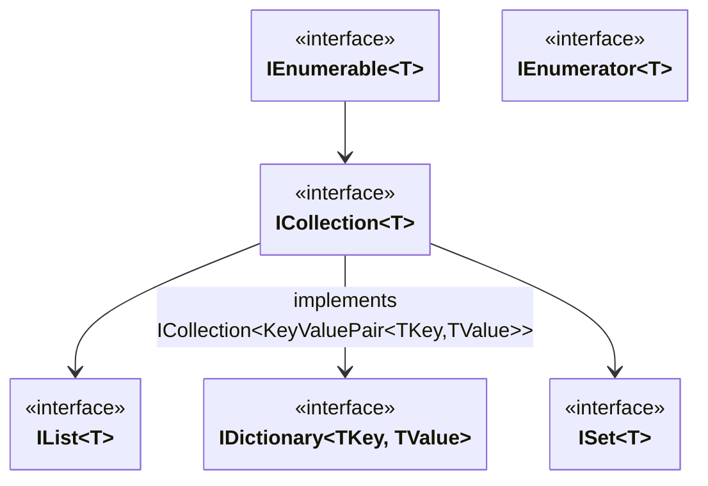

# Kolekcje

Kolekcje wbudowane w bibliotekę standardową C# są posegregowane w różnych przestrzeniach nazw:

* **System.Collections** - zawiera niegeneryczne kolekcje, używające typu `object` do przechowywania obiektów
* **System.Collections.Generic** - najczęściej używane, generyczne kolekcje, nimi będziemy się zajmować
* **System.Collections.Concurrent** - generyczne kolekcje, bezpieczne wielowątkowo
* **System.Collections.Immutable** - generyczne kolekcje, nie pozwalające na modyfikację
* **System.Collections.ObjectModel** - dostarcza szablony dla własnych kolekcji

## Hierarchia kolekcji

Bazą dla wszystkich kolekcji jest interfejs `IEnumerable<T>`, który jedynie gwarantuje, że po obiekcie można się przeiterować. Może to być nieskończona sekwencja, na bieżąco generowanych elementów.

`ICollection<T>` rozszerza `IEnumerable<T>` i reprezentuje modyfikowalną skończoną kolekcję.

Dalej w hierarchii mamy już tylko wyspecjalizowane kolekcje: listy (`IList<T>`), słowniki (`IDictionary<TKey, TValue>`) i zbiory (`ISet<T>`).



### Interfejs ICollection<T>

`ICollection<T>` reprezentuje modyfikowalną skończoną kolekcję, w której można dodawać i usuwać elementy. Rozszerza możliwość iteracji o podstawowe operacje dodawania i usuwania elementów, sprawdzania ich liczby (`Count`) oraz czy dany element znajduje się w kolekcji (`Contains`).

```csharp
public interface ICollection<T> : IEnumerable<T>
{
    int Count { get; }
    bool IsReadOnly { get; }
    void Add(T item);
    bool Remove(T item);
    bool Contains(T item);
    void Clear();
    void CopyTo(T[] array, int arrayIndex);
}
```

### Interfejs IList<T>

Interfejs listy dodatkowo wprowadza możliwość odwoływania się do elementów za pomocą indeksu.

```csharp
public interface IList<T> : ICollection<T>
{
    T this [int index] { get; set; }
    int IndexOf(T item);
    void Insert(int index, T item);
    void RemoveAt(int index);
}
```

#### Klasa List<T>

Najpopularniejszą konkretną implementacją tego interfejsu jest `List<T>`. Pod spodem jest to dynamicznie rozszerzana tablica, podobnie jak typ `std::vector` z C++. Klasa `List<T>` dodatkowo dostarcza kilka przydatnych metod: `Sort`, `BinarySearch`, `Find`.

```csharp
var planets = new List<string> { "Mercury", "Earth", "Mars" };
Console.WriteLine("Initial list:");
planets.ForEach(p => Console.WriteLine($"- {p}"));

planets.Insert(1, "Venus");

var gasGiants = new List<string> { "Jupiter", "Saturn", "Uranus", "Neptune" };
planets.AddRange(gasGiants);

planets.RemoveAt(planets.Count - 1);

bool hasMars = planets.Contains("Mars");
Console.WriteLine($"\nDoes the list contain Mars? {hasMars}");

string? sPlanet = planets.Find(p => p.StartsWith("S"));
Console.WriteLine($"Found planet starting with 'S': {sPlanet}");

int indexOfEarth = planets.IndexOf("Earth");
Console.WriteLine($"Index of Earth in the list: {indexOfEarth}");

planets.Sort();

Console.WriteLine("\nFinal list of planets (sorted):");
foreach (var planet in planets)
{
    Console.WriteLine($"- {planet}");
}

planets.Clear();
Console.WriteLine($"\nNumber of planets after clearing: {planets.Count}");
```

> `Array` również implementuje interfejs `IList<T>`. Metody `Add`, `Remove`, `Insert` i `RemoveAt` rzucają wyjątkiem `NotSupportedException`, jako że są to operacje które zmieniają rozmiar kolekcji.

### Interfejs IDictionary<TKey, TValue>

Słowniki są kolekcjami par klucz-wartość, w których klucze są unikalne. Interfejs słownika dostarcza dwóch właściwości, które pozwalają na dostęp do kolekcji tylko kluczy `Keys` lub tylko wartości `Values`. Najczęściej praca ze słownikiem polega na używaniu indeksatora. Możemy go używać zarówno do dodawania nowych wartości, aktualizowania obecnych oraz pobierania już istniejących wartości. Dostęp do wartości, której nie ma w słowniku, rzuca wyjątkiem `KeyNotFoundException`, dlatego jeżeli nie jesteśmy pewni czy wartość istnieje lepiej użyć metody `TryGetValue`. Wstawianie nowej lub aktualizacja wartości za pomocą indeksatora zawsze się udaje. Metoda `Add` z kolei, jeżeli wartość już jest w słowniku, to rzuca wyjątkiem `ArgumentException`.

```csharp
public interface IDictionary<TKey, TValue> : ICollection<KeyValuePair<TKey, TValue>>
{
    TValue this[TKey key] { get; set; }
    ICollection<TKey> Keys { get; }
    ICollection<TValue> Values { get; }
    void Add(TKey key, TValue value);
    bool Remove(TKey key);
    bool ContainsKey(TKey key);
    bool TryGetValue(TKey key, out TValue value);
}
```

#### Klasa Dictionary<TKey, TValue>

Najczęściej używaną implementacją słownika jest `Dictionary<TKey, TValue>`. Jego wewnętrzną implementacją jest tablica mieszająca (*hash table*), co odpowiadałoby typowi `std::unordered_map` z C++. W C# każdy obiekt posiada metodę `Equals` i `GetHashCode`, dzięki czemu jest kandydatem na bycie kluczem w takim słowniku. Oczywiście te metody muszą być odpowiednio zaimplementowane, żeby `Dictionary<TKey, TValue>` działał poprawnie. 

- **Jeśli dwa obiekty są równe (według `Equals()`), to muszą zwracać ten sam hash (z `GetHashCode()`)**. 
  - Odwrotna zasada nie musi być spełniona.
- `GetHashCode` i `Equals` powinny być implementowane razem
- `GetHashCode` i `Equals` powinny używać tych samych pól
- Hash klucza nie może się zmieniać, pola, których używa `GetHashCode` powinny być niezmienne.

Przykład poprawnej implementacji `GetHashCode` i `Equals`:

```csharp
public sealed class BookId : IEquatable<BookId>
{
    public string Isbn { get; }
    public string Format { get; }

    public BookId(string isbn, string format)
    {
        Isbn = isbn;
        Format = format;
    }

    public bool Equals(BookId? other)
    {
        if (other is null) return false;
        if (ReferenceEquals(this, other)) return true;

        return Isbn == other.Isbn && Format == other.Format;
    }

    public override bool Equals(object? obj)
    {
        return obj is BookId other && Equals(other);
    }

    public override int GetHashCode()
    {
        return HashCode.Combine(Isbn, Format);
    }
}
```

Przykładowe użycie implementacji `Dictionary<TKey, TValue>`:

```csharp
var openWith = new Dictionary<string, string>();

openWith.Add("txt", "notepad.exe");
openWith.Add("bmp", "paint.exe");
openWith.Add("dib", "paint.exe");
openWith.Add("rtf", "wordpad.exe");

try
{
    openWith.Add("txt", "vim.exe");
}
catch (ArgumentException)
{
    Console.WriteLine("An element with Key = \"txt\" already exists.");
}

Console.WriteLine($"Initial value for 'rtf': {openWith["rtf"]}");
openWith["rtf"] = "winword.exe"; // This updates the value.
Console.WriteLine($"New value for 'rtf': {openWith["rtf"]}");

openWith["doc"] = "winword.exe"; // This adds a new value.

if (openWith.TryGetValue("tif", out string? tifProgram))
{
    Console.WriteLine($"Value for 'tif': {tifProgram}");
}
else
{
    Console.WriteLine("Key 'tif' is not found.");
}

if (!openWith.ContainsKey("ht"))
{
    openWith.Add("ht", "hypertrm.exe");
    Console.WriteLine($"Value added for key 'ht': {openWith["ht"]}");
}

Console.WriteLine("\n--- Dictionary Contents ---");
foreach (var pair in openWith)
{
    Console.WriteLine($"Key: {pair.Key}, Value: {pair.Value}");
}

Console.WriteLine("\n--- Just Values ---");
foreach (var value in openWith.Values)
{
    Console.WriteLine($"Value: {value}");
}

Console.WriteLine("\n--- Just Keys ---");
foreach (var key in openWith.Keys)
{
    Console.WriteLine($"Key: {key}");
}

Console.WriteLine("\nRemoving 'doc'...");
if (openWith.Remove("doc"))
{
    Console.WriteLine("Key 'doc' removed from the dictionary.");
}
```

> Jeżeli zależy nam, żeby słownik był posortowany po kluczach, to istnieje również implementacja `SortedDictionary<TKey, TValue>`, która nam to zapewnia. To odpowiednik `std::map` z C++, wewnętrznie używający drzew czerwono-czarnych, więc wyszukiwanie, wstawianie i usuwanie zajmują czas O(log n). Podobna kolekcja, `SortedList<TKey, TValue>`, przechowuje pary w posortowanych tablicach - zużywa mniej pamięci, ale wstawianie i usuwanie zajmują czas O(n).

##### Klasa `OrderedDictionary<TKey, TValue>` (.NET 9)

Od .NET 9 dostępny jest także `OrderedDictionary<TKey, TValue>` - słownik, który zachowuje kolejność dodawania elementów i dodatkowo pozwala na dostęp do nich po indeksie (`GetAt`, `SetAt`, `Insert`, `IndexOf`, `RemoveAt`). Wcześniej dostępny był tylko niegeneryczny `System.Collections.Specialized.OrderedDictionary`.

```csharp
var steps = new OrderedDictionary<string, int>
{
    ["one"] = 1,
    ["two"] = 2
};
steps.Insert(0, "zero", 0);
steps.Add("three", 3);
// steps contains [zero, 0], [one, 1], [two, 2], [three, 3] - in this order

KeyValuePair<string, int> second = steps.GetAt(1); // [one, 1]
int index = steps.IndexOf("two"); // 2
```

##### Alternatywne wyszukiwanie (.NET 9)

`Dictionary<string, TValue>` (lub `HashSet<string>`) można przeszukiwać także za pomocą klucza innego typu - najczęściej `ReadOnlySpan<char>`, co pozwala uniknąć alokacji nowego stringa przy każdym wyszukiwaniu (string jest tworzony dopiero przy dodawaniu nowego klucza). Taki widok kolekcji uzyskujemy metodą `GetAlternateLookup<TAlternateKey>()`. Wymaga ona komparatora, który obsługuje alternatywny typ klucza - obsługują go domyślny komparator stringów oraz `StringComparer.Ordinal`/`StringComparer.OrdinalIgnoreCase`.

```csharp
var counts = new Dictionary<string, int>();
var lookup = counts.GetAlternateLookup<ReadOnlySpan<char>>();

ReadOnlySpan<char> text = "to be or not to be";
foreach (Range range in text.Split(' '))
{
    ReadOnlySpan<char> word = text[range]; // no string allocation
    lookup[word] = lookup.TryGetValue(word, out int count) ? count + 1 : 1;
}
// counts contains [to, 2], [be, 2], [or, 1], [not, 1]
```

### Interfejs ISet<T>

Interfejs `ISet<T>` reprezentuje zbiór w matematycznym sensie. Przechowuje on wyłącznie unikalne elementy - duplikaty są automatycznie ignorowane. Metoda `Add` zwraca `true`, jeśli element został dodany, a `false`, jeśli element już istniał w zbiorze. Reszta metod w zbiorze to operacje mnogościowe lub sprawdzające relacje między zbiorami.

```csharp
public interface ISet<T> : ICollection<T>
{
    bool Add(T item);
    void UnionWith(IEnumerable<T> other);
    void IntersectWith(IEnumerable<T> other);
    void ExceptWith(IEnumerable<T> other);
    void SymmetricExceptWith(IEnumerable<T> other);
    bool IsSubsetOf(IEnumerable<T> other);
    bool IsSupersetOf(IEnumerable<T> other);
    bool IsProperSupersetOf(IEnumerable<T> other);
    bool IsProperSubsetOf(IEnumerable<T> other);
    bool Overlaps(IEnumerable<T> other);
    bool SetEquals(IEnumerable<T> other);
}
```

Najpopularniejszą implementacją tego interfejsu jest klasa `HashSet<T>`, działająca w oparciu o tablicę mieszającą (tak jak `Dictionary`) i `SortedSet<T>`, działająca w oparciu o drzewa czerwono-czarne (tak jak `SortedDictionary`).

### Inne kolekcje

Poza głównymi gałęziami hierarchii, istnieją inne ważne kolekcje, które **bezpośrednio implementują `ICollection<T>`**, nie będąc listą, słownikiem ani zbiorem:

- `LinkedList<T>` - Generyczna lista dwukierunkowa. W przeciwieństwie do `List<T>`, jest zoptymalizowana pod kątem częstego dodawania i usuwania elementów w dowolnym miejscu listy, ponieważ nie wymaga to przesuwania kolejnych elementów.
- `Queue<T>` - Implementuje kolejkę **FIFO** (First-In, First-Out), wewnętrznie używając **dynamicznie rozszerzanej tablicy**. Główne metody to `Enqueue` (dodaje na końcu) i `Dequeue` (pobiera z początku).
- `Stack<T>` - Implementuje stos **LIFO** (Last-In, First-Out), również wewnętrznie używając **dynamicznie rozszerzanej tablicy**. Główne metody to `Push` (dodaje na wierzch) i `Pop` (pobiera z wierzchu).
- `PriorityQueue<TElement, TPriority>` - Implementuje kolejkę priorytetową, w której elementy są pobierane na podstawie przypisanego priorytetu, a nie w kolejności FIFO. Główne metody to `Enqueue` i `Dequeue`.

> Warto również wspomnieć o `BitArray` z przestrzeni nazw `System.Collections`. Jest to specjalistyczna, **niegeneryczna** kolekcja, która pozwala na efektywne przechowywanie i manipulowanie tablicą bitów (wartości `true`/`false`), używając tylko jednego bitu na każdą wartość.

Od .NET 9 `PriorityQueue<TElement, TPriority>` ma także metodę `Remove`, która usuwa wskazany element (wyszukiwany w czasie O(n)) i zwraca go wraz z jego priorytetem. Ponieważ kolejka nie pozwala na zmianę priorytetu elementu w miejscu, można to zrobić, usuwając element i dodając go ponownie:

```csharp
var tasks = new PriorityQueue<string, int>();
tasks.Enqueue("write report", 2);
tasks.Enqueue("fix bug", 1);
tasks.Enqueue("drink coffee", 3);

// The report has become urgent - change its priority.
if (tasks.Remove("write report", out _, out _))
{
    tasks.Enqueue("write report", 0);
}

while (tasks.TryDequeue(out string? task, out int priority))
{
    Console.WriteLine($"{priority}: {task}");
}
// 0: write report
// 1: fix bug
// 3: drink coffee
```

### Kolekcje tylko do odczytu i kolekcje zamrożone

Obok interfejsów kolekcji modyfikowalnych istnieją interfejsy tylko do odczytu: `IReadOnlyCollection<T>` (`Count`), `IReadOnlyList<T>` (indeksator tylko do odczytu), `IReadOnlyDictionary<TKey, TValue>` oraz, od .NET 5, `IReadOnlySet<T>` (`Contains` i metody sprawdzające relacje między zbiorami). Implementują je standardowe kolekcje (`List<T>`, `Dictionary<TKey, TValue>`, `HashSet<T>`, ...), dlatego dobrze sprawdzają się jako typy parametrów i wartości zwracanych, gdy kod ma kolekcję jedynie odczytywać.

Przestrzeń nazw `System.Collections.ObjectModel` dostarcza implementujące te interfejsy opakowania: `ReadOnlyCollection<T>` (zwracane np. przez `List<T>.AsReadOnly()`), `ReadOnlyDictionary<TKey, TValue>` oraz, od .NET 9, `ReadOnlySet<T>`. Takie opakowanie jest jedynie **widokiem** tylko do odczytu: nie kopiuje elementów, więc zmiany wprowadzone w kolekcji źródłowej są przez nie widoczne.

```csharp
using System.Collections.ObjectModel;

var set = new HashSet<int> { 1, 2 };
var readOnlySet = new ReadOnlySet<int>(set);
// readOnlySet.Add(3); // Compilation error: ReadOnlySet<T> has no Add method
set.Add(3);
Console.WriteLine(readOnlySet.Count); // 3 - the change is visible through the view
```

Naprawdę niemodyfikowalne kolekcje dostarcza przestrzeń nazw `System.Collections.Immutable` (`ImmutableList<T>`, `ImmutableDictionary<TKey, TValue>`, ... - operacje „modyfikujące” zwracają nową kolekcję) oraz, od .NET 8, `System.Collections.Frozen`: `FrozenDictionary<TKey, TValue>` i `FrozenSet<T>`. Kolekcje zamrożone tworzy się jednorazowo z istniejących danych (`ToFrozenDictionary()`, `ToFrozenSet()`). Ich tworzenie jest stosunkowo kosztowne, bo wewnętrzna struktura jest optymalizowana pod konkretny zbiór kluczy, za to wyszukiwanie jest potem zazwyczaj szybsze niż w `Dictionary<TKey, TValue>` i `HashSet<T>`. Dobrze nadają się do danych tworzonych raz (np. przy starcie aplikacji) i wielokrotnie potem odczytywanych.

```csharp
using System.Collections.Frozen;

FrozenSet<string> keywords = new[] { "if", "else", "while", "for" }.ToFrozenSet();
FrozenDictionary<string, int> httpCodes = new Dictionary<string, int>
{
    ["OK"] = 200,
    ["Not Found"] = 404
}.ToFrozenDictionary();

Console.WriteLine(keywords.Contains("while")); // True
Console.WriteLine(httpCodes["Not Found"]); // 404
```

### Inicjalizatory kolekcji

Ta składnia, dostępna od dawna, wymaga użycia `new` oraz nawiasów klamrowych `{...}`. Kompilator tłumaczy ją na serię wywołań metody `Add` lub wstawiania za pomocą indeksatora (od C# 6.0).

```csharp
var numbers = new List<int> { 1, 2, 3 };

var cityPopulations = new Dictionary<string, int>
{
    { "Tokyo", 37_000_000 },
    { "Delhi", 32_000_000 }
};

// For types defining an indexer (C# 6.0):
var cityPopulationsByIndexer = new Dictionary<string, int>
{
    ["Shanghai"] = 28_000_000,
    ["London"] = 9_000_000
};
```

### Wyrażenia Kolekcji (C# 12)

Począwszy od C# 12, wprowadzono nową, jeszcze bardziej zwięzłą składnię znaną jako **wyrażenia kolekcji**. Jest to cukier składniowy używający nawiasów kwadratowych `[...]`, który pozwala na przypisanie elementów do kolekcji w prosty sposób. Kompilator sam domyśla się jak wstawić podane elementy do kolekcji.

```csharp
List<int> numbers1 = [1, 2, 3, 4, 5];

int[] numbers2 = [4, 5, 6, 7, 8];

// Spread operator `..` to concatenate collections.
SortedSet<int> combined = [9, ..numbers1, ..numbers2, 10];
// 'combined' contains { 1, 2, 3, 4, 5, 6, 7, 8, 9, 10 } in order without repetitions
```

Typem docelowym może być także interfejs (np. `IEnumerable<T>`, `IReadOnlyList<T>`) - kompilator wybiera wtedy odpowiednią implementację - lub span. Wyrażenie kolekcji nie ma jednak własnego typu, więc typ docelowy musi być znany:

```csharp
IEnumerable<int> sequence = [1, 2, 3];
ReadOnlySpan<char> vowels = ['a', 'e', 'i', 'o', 'u'];
List<string> empty = [];
// var numbers3 = [1, 2, 3]; // Compilation error: there is no target type for the collection expression
```
