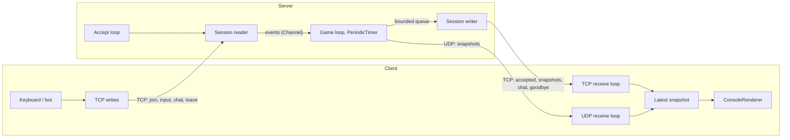

# Snake Arena – Networked Multiplayer Snake

**Total Points:** 8

> [!NOTE]
> ## Starting code
> 

## 1. Overview
In this assignment, you will build a networked multiplayer version of the classic Snake game, played in the console on Windows, Linux and macOS. The game uses an **authoritative server**: only the server simulates the game. Clients send their players' inputs and draw the state snapshots that the server broadcasts after every tick (10 ticks per second by default). Clients connect over TCP. In Part 4, they also find servers in the local network and receive snapshots over UDP.

You are provided with:
*   `SnakeArena.Shared/Game` – the complete, deterministic game rules (`GameState`). `GameState.Tick(inputs)` advances the game by one tick and `GameState.ToSnapshot()` returns the `StateSnapshot` message to broadcast. You do not implement any game logic.
*   `SnakeArena.Shared/Protocol` – the message and datagram records (`Messages.cs`, `Datagrams.cs`), `ProtocolConstants` and `ProtocolException`.
*   `SnakeArena.Client` – a console renderer (`ConsoleRenderer`), a computer player (`SnakeBot`) and the command-line handling of the client. The command-line handling of the server is in `SnakeArena.Server`.
*   `SnakeArena.Tests` – xUnit tests for everything you implement. They compile against the starting code but fail until you implement the corresponding parts. Only `GameStateTests`, which document the provided rules, pass from the start.

Your goal is to implement the protocol (`MessageCodec`, `Framing`, `DatagramCodec`), the server (`GameServer`) and the client (`GameClient`, `LanDiscovery`).



### Game rules (provided)
The board has `Width` × `Height` cells (default 30 × 16); `(0, 0)` is the top-left corner. Every tick, all snakes move one cell in their direction (a request to reverse is ignored). A snake that reaches food grows by one segment and gets 1 point. A snake crashes when its head leaves the board or enters a cell occupied by any snake (including itself) or by another head. Every second segment of a crashed snake turns into food, and the player respawns after 20 ticks with a snake of length 3. The score is kept after a crash.

Useful lectures: [Network](), [TCP](), [Serialization](), [Tasks](), [Asynchronous Programming](), [Concurrent Collections](), [Exclusive Locking]().

## 2. Requirements

General rules for all parts:
*   All network I/O is asynchronous (`async`/`await`); no busy waiting (the client may poll the keyboard with a short delay).
*   A remote peer must never crash a program: malformed data, timeouts and disconnects only end the affected connection.
*   Do not change the game rules, the records in `Messages.cs`/`Datagrams.cs`, the tests, or the public members used by the tests. You may add your own classes, files and members.
*   All tests must pass (`dotnet test`).

### Part 1: Protocol & Serialization [2 Points]
**Files:** `SnakeArena.Shared/Protocol/MessageCodec.cs`, `SnakeArena.Shared/Protocol/Framing.cs`\
**Tests:** `MessageCodecTests`, `FramingTests`

Implement the binary protocol used over TCP. It is defined as follows.

**Data types.** All integers are **little-endian** (the byte order of `BinaryWriter`, `BinaryReader` and `BinaryPrimitives.*LittleEndian`).

| Type | Size [B] | Encoding |
|---|---|---|
| `u8` | 1 | unsigned integer |
| `u16` | 2 | unsigned integer, little-endian |
| `u32` | 4 | unsigned integer, little-endian |
| `str` | 2 + n | `u16` n = number of **bytes**, then n bytes of UTF-8 (no BOM, no terminator) |
| `pos` | 2 | `u8 x`, `u8 y` |
| `dir` | 1 | `u8`: 0 = Up, 1 = Right, 2 = Down, 3 = Left |

> [!WARNING]
> `BinaryWriter.Write(string)` does **not** produce a `str`: it prefixes the string with a variable-length (7-bit encoded) length.

**Frames.** The TCP stream is a sequence of frames: `u32 length` followed by `length` bytes of *body*. The body is the message type (`u8`) followed by the payload. A valid length is 1–65 536 (`ProtocolConstants.MaxFrameLength`).

**Messages** (`C → S`: client to server, `S → C`: server to client):

| Type | Message | Direction | Payload |
|---|---|---|---|
| `0x01` | `JoinRequest` | C → S | `u16 protocolVersion`, `str name` |
| `0x02` | `PlayerInput` | C → S | `dir direction` |
| `0x03` | `ChatSend` | C → S | `str text` |
| `0x04` | `LeaveRequest` | C → S | (empty) |
| `0x81` | `JoinAccepted` | S → C | `u8 playerId`, `u8 width`, `u8 height`, `u16 tickIntervalMs`, `u32 sessionToken` |
| `0x82` | `JoinRejected` | S → C | `u8 reason` (1 = VersionMismatch, 2 = ServerFull, 3 = InvalidName, 4 = NameTaken), `str details` |
| `0x83` | `StateSnapshot` | S → C | `u32 tick`, `u8 playerCount`, *playerCount* × player, `u16 foodCount`, *foodCount* × `pos` |
| `0x84` | `ChatBroadcast` | S → C | `str sender`, `str text` |
| `0x85` | `ServerGoodbye` | S → C | `str reason` |

A player inside `StateSnapshot`: `u8 id`, `str name`, `u8 flags` (bit 0 = alive; the other bits are reserved – write 0, ignore when reading), `dir direction`, `u16 score`, `u16 segmentCount`, *segmentCount* × `pos` (head first; no segments for a crashed snake).

Example – the frame with `StateSnapshot(Tick: 7, Players: [#1 "A", alive, Right, score 2, body (2,1) (1,1)], Food: [(5,3)])`:

```text
18 00 00 00          frame length = 24
83                   type = StateSnapshot
07 00 00 00          tick = 7
01                   1 player:
  01                   id = 1
  01 00 41             name = "A"
  01                   flags = alive
  01                   direction = Right
  02 00                score = 2
  02 00 02 01 01 01    2 segments: (2,1) (1,1)
01 00 05 03          1 food item: (5,3)
```

Two more: `PlayerInput(Left)` is the frame `02 00 00 00 02 03`, and `JoinRequest(1, "Ala")` is `08 00 00 00 01 01 00 03 00 41 6C 61`.

1.  **Encoding:** `MessageCodec.Encode(Message)` returns the frame body of every message from `Messages.cs`, exactly as defined above. Values that cannot be represented (a string longer than 65 535 bytes in UTF-8, a coordinate outside 0–255, too many list items) cause an `ArgumentException` (or a derived exception).
2.  **Decoding:** `MessageCodec.Decode(ReadOnlySpan<byte>)` is the inverse operation: `Decode(Encode(m))` equals `m`.
3.  **Validation:** `Decode` treats the input as untrusted and throws `ProtocolException` – and no other exception – for an empty body, an unknown message type, a truncated payload, trailing bytes, invalid UTF-8 (decode strictly), a direction greater than 3 and an unknown reject reason. A count read from the data must not cause allocations larger than the remaining data can fill.
4.  **Writing frames:** `Framing.WriteFrameAsync` writes the length prefix and the body (preferably with a single `WriteAsync` call). An empty body or a body longer than `MaxFrameLength` causes an `ArgumentException`.
5.  **Reading frames:** `Framing.ReadFrameAsync` returns the body of exactly one frame, no matter how the stream splits the data (`ReadAsync` may return any number of bytes, even one). It returns `null` if the stream ends before the first byte of a frame, throws `EndOfStreamException` if it ends inside a frame and `ProtocolException` if the length is 0 or greater than `MaxFrameLength` (checked before the body is allocated). It supports cancellation.
6.  **Versioning:** the protocol version (`ProtocolConstants.Version` = 1) is sent in `JoinRequest` and in the discovery datagrams (Part 4). A peer speaking another version is rejected (Part 2).

### Part 2: Server [2 Points]
**Files:** `SnakeArena.Server/GameServer.cs` (and any new files in `SnakeArena.Server`)\
**Tests:** `ServerTests` (they start a real `GameServer` on the loopback interface and also rely on your Part 1)

The public API of `GameServer` is given; `Program.cs` already parses the options (`ServerOptions`) and cancels the token on Ctrl+C.

1.  **Listening:** `Start()` binds a `TcpListener` to `IPAddress.Any` and `options.Port` (0 = any free port; `LocalEndPoint` returns the actual endpoint). `RunAsync` runs the accept loop concurrently with the game loop and handles every connection with its own asynchronous tasks. Set `NoDelay = true` and `SendBufferSize = 32 KiB` on accepted sockets (otherwise the OS buffers megabytes for a client that does not read).
2.  **Handshake:** the first message of a connection must be a `JoinRequest`, received within `options.HandshakeTimeout`; otherwise the server closes the connection (optionally after a `ServerGoodbye`). The request is rejected with `JoinRejected`, after which the server closes the connection without sending anything else, if (checked in this order):
    *   the version differs from `ProtocolConstants.Version` – `VersionMismatch`;
    *   the name does not consist of 1–16 ASCII letters, digits, `_` or `-` – `InvalidName`;
    *   a connected player already uses the name (case-insensitive) – `NameTaken`;
    *   `options.MaxPlayers` players have already joined – `ServerFull`.

    Otherwise, the server assigns an unused `PlayerId` (1–255) and a random non-zero session token, adds the player to the game, sends `JoinAccepted` (board size and tick interval from the options) – always the first message the client receives after joining – and announces `ChatBroadcast("*", "<name> joined the game.")` to all players.
3.  **Receiving:** each connection has a receive loop that passes the received messages to the game loop through a `Channel<T>` (`System.Threading.Channels`). The game loop is the only code that accesses `GameState` and the list of players.
    *   `PlayerInput`: the server keeps a queue of at most 3 pending directions per player (further inputs are dropped) and uses at most one of them per tick.
    *   `ChatSend`: the text is trimmed, ignored if empty and shortened to 200 characters (`MaxChatLength`); then `ChatBroadcast(<name>, text)` goes to all players, including the sender.
    *   `LeaveRequest`: the player is removed and the connection closed.
    *   An unexpected message type or a malformed frame: the server sends `ServerGoodbye("Protocol error: …")` and closes this connection only.
4.  **Game loop:** driven by a `PeriodicTimer` with `options.TickIntervalMs`. Every tick, it processes the queued events, calls `GameState.Tick` with the inputs of this tick and broadcasts `GameState.ToSnapshot()` to all players. A snapshot is encoded once per tick, not once per player.
5.  **Sending and slow clients:** the game loop never waits for network I/O. Every connection has a bounded outgoing queue (`options.SendQueueCapacity` frames) and exactly one writer task, which is the only code writing to that connection's stream. If a player's queue is full when the game loop wants to add a frame, the client is too slow: the server removes the player and closes the connection at once. The other players must not notice anything.
6.  **Disconnects:** when a connection ends (end of stream, I/O error), the player is removed from the game (it disappears from the next snapshot), the others get the notice `"<name> left the game."` and the name can be used again.
7.  **Graceful shutdown:** when the token passed to `RunAsync` is cancelled, the server stops accepting connections, sends `ServerGoodbye` (e.g. `"The server is shutting down."`) to every client, closes all connections (also those that have not joined yet) and `RunAsync` completes within a few seconds, without unobserved exceptions.
8.  **Log:** one line per important event (connection, join, rejection, leave, disconnection with the reason) is written to the `TextWriter` passed to the constructor.

### Part 3: Client [2 Points]
**File:** `SnakeArena.Client/GameClient.cs` (and any new files in `SnakeArena.Client`)

`Program.cs` already parses the options (`ClientOptions`), cancels the token on Ctrl+C, and handles `--discover` using `LanDiscovery` (Part 4).

1.  **Joining:** the client connects to `--host`/`--port`, sends `JoinRequest` and waits for the answer (5 s timeout for each step). If it cannot connect or the request is rejected, it prints the reason and `RunAsync` returns 2.
2.  **Concurrency:** a receive loop reads the TCP stream concurrently with the main loop and stores the latest snapshot and the chat lines (thread-safely). The main loop reads the keyboard (`Console.KeyAvailable` + `Console.ReadKey(true)` every ~10 ms, or a dedicated thread) and draws with the provided `ConsoleRenderer` – from one thread only, and only when something has changed.
3.  **Controls:** arrows or WASD send `PlayerInput`; `Enter` starts typing a chat line (shown in the input line; `Backspace` deletes, `Enter` sends `ChatSend`, `Esc` cancels); `Esc` or `Q` leaves the game.
4.  **Display:** the board and the scoreboard (renderer), a status line (name, id, own score or "crashed", tick, numbers of snapshots received over TCP/UDP and dropped as stale), and the last chat lines including server notices.
5.  **Leaving:** on `Esc`/`Q` or Ctrl+C, the client sends `LeaveRequest`, waits (at most 1 s) until the server closes the connection, restores the console (`ConsoleRenderer.Restore`) and returns 0.
6.  **Server loss:** when the server closes the connection or the connection breaks (also when the server process is killed), the client restores the console, prints the reason (the `ServerGoodbye` text if one was received) and returns 1. It never hangs and never ends with an exception.
7.  **Bot mode (`--bot`):** no keyboard and no renderer (the output may be redirected). After every new snapshot, the client asks `SnakeBot.ChooseDirection` and sends `PlayerInput` if the result differs from the current direction. It prints a status line about once per second and the chat lines as they arrive. Ctrl+C leaves as in point 5.
8.  **`--stall-after <s>`** (debugging): after the given number of seconds, the receive loop stops reading from the TCP stream (and waits until cancelled). With this option, set `ReceiveBufferSize = 4096` before connecting. Together with `--bot --tcp-only` this simulates a slow client for Part 2.

### Part 4: LAN Discovery & UDP Snapshots [2 Points]
**Files:** `SnakeArena.Shared/Protocol/DatagramCodec.cs`, `SnakeArena.Client/LanDiscovery.cs`, `GameServer.cs`, `GameClient.cs`, `NOTES.md` (new, next to the `.slnx` file)\
**Tests:** `DatagramCodecTests`, `UdpTests`

UDP datagrams may be lost, duplicated or reordered, and anyone can send anything to a UDP port. Snapshots suit UDP well: a lost snapshot is replaced by the next one a tick later, whereas TCP would hold back all later snapshots until the lost data is retransmitted. Control messages (join, inputs, chat, leave, goodbye) stay on TCP.

Every datagram starts with the 4 ASCII bytes `SNAK` (`53 4E 41 4B`) and a `u8 kind`; the data types are those of Part 1:

| Kind | Datagram | Sent | Payload |
|---|---|---|---|
| `0x01` | `DiscoveryProbe` | client → broadcast, UDP port 47001 | `u16 protocolVersion`, `u32 nonce` |
| `0x02` | `DiscoveryReply` | server → source of the probe | `u16 protocolVersion`, `u32 nonce` (copied from the probe), `str serverName`, `u16 tcpPort`, `u8 playerCount`, `u8 maxPlayers` |
| `0x03` | `UdpHello` | client → server's UDP game port | `u8 playerId`, `u32 sessionToken` |
| `0x04` | `SnapshotDatagram` | server → client's UDP endpoint | `u32 sessionToken`, then the body of a `StateSnapshot` frame (starting with `0x83`) |

1.  **Codec:** `DatagramCodec.Encode` and `DatagramCodec.TryDecode`. `TryDecode` never throws; it returns `false` for anything that is not a valid datagram (wrong magic, unknown kind, truncated data, trailing bytes, invalid content – including an embedded body that is not a valid `StateSnapshot`).
2.  **Discovery – server:** if `options.EnableDiscovery` is set, `Start()` also binds a `UdpClient` to `IPAddress.Any` and `options.DiscoveryPort` (`DiscoveryEndPoint` returns its endpoint, otherwise `null`). The server answers every valid `DiscoveryProbe` with a `DiscoveryReply` (with the current number of players) sent to the source endpoint of the probe and ignores other datagrams.
3.  **Discovery – client:** `LanDiscovery.FindServersAsync(targets, timeout)` sends one probe with a random nonce to each target from a socket with `EnableBroadcast = true` and collects the replies with the same nonce and protocol version until the timeout expires (it returns after the timeout even if nothing arrives). The result contains one `DiscoveredServer` per address and TCP port: the address is the source address of the reply, the port is `tcpPort`. For `--discover`, `Program.cs` sends probes to `255.255.255.255` and `127.0.0.1`, so a server on the same computer may be listed twice (once per address).
4.  **UDP snapshots – server:** `Start()` binds another `UdpClient` to `IPAddress.Any` and the port number of the TCP listener. A valid `UdpHello` (existing player, matching token) registers the source endpoint of the datagram for that player: from the next tick on, its snapshots are sent only as `SnapshotDatagram`s to that endpoint, no longer over TCP. When no valid `UdpHello` has arrived from the player for `ProtocolConstants.UdpTimeout` (2 s), the server sends its snapshots over TCP again.
5.  **UDP snapshots – client:** unless `--tcp-only` is given, after joining the client sends `UdpHello` every `ProtocolConstants.UdpHelloInterval` (500 ms) from its own `UdpClient` to the server's address and TCP port number, and receives `SnapshotDatagram`s (ignoring those with another token). It stops sending hellos once no UDP snapshot has arrived for `UdpTimeout` – e.g. when a firewall blocks UDP – so that the server returns to TCP and the game goes on. Snapshots from TCP and UDP update the same "latest snapshot": a snapshot is used only if its tick is greater than the tick of the latest one; older and duplicate snapshots are dropped and counted.
6.  **Thread-safety note:** in `NOTES.md` (at most one page), describe the tasks/threads of the server and of the client, which data each of them owns, how data passes between them (channels, locks, `Volatile`/`Interlocked`, …) and why a slow or malicious client cannot block the game loop.

## 3. Build

```bash
dotnet build
dotnet test

# terminal 1: the server (Ctrl+C stops it)
dotnet run --project SnakeArena.Server
# terminals 2 and 3: players
dotnet run --project SnakeArena.Client -- --name Alice
dotnet run --project SnakeArena.Client -- --name Bob
# more players, and a player that finds the server in the LAN
dotnet run --project SnakeArena.Client -- --name Robo --bot
dotnet run --project SnakeArena.Client -- --name Carol --discover
```

`--help` lists all options of a program (e.g. `--tick`, `--width`, `--seed`, `--tcp-only`). The interactive client needs a console of at least 80 × 24 characters for the default board. To play over the LAN on Windows, allow the server through the firewall (TCP and UDP port 47000, UDP port 47001).

## 4. Hints

*   `Stream.ReadExactlyAsync` and `Stream.ReadAtLeastAsync(…, throwOnEndOfStream: false)` handle partial reads.
*   For encoding, a `BinaryWriter` over a `MemoryStream` is enough. For decoding, slice a `ReadOnlySpan<byte>` and use `BinaryPrimitives.ReadUInt16LittleEndian` etc. (or a `BinaryReader` over a `MemoryStream`, converting its `EndOfStreamException` into `ProtocolException`). Strict UTF-8: `new UTF8Encoding(false, throwOnInvalidBytes: true)`.
*   `Channel.CreateUnbounded<T>(new UnboundedChannelOptions { SingleReader = true })` suits the events of the game loop; `Channel.CreateBounded<byte[]>(capacity)` with `TryWrite` suits the outgoing queue.
*   `PeriodicTimer.WaitForNextTickAsync(token)` throws `OperationCanceledException` when the token is cancelled.
*   Closing a socket that still has unread incoming data makes the OS reset the connection, and the peer may lose the frames sent last (e.g. `ServerGoodbye`). Graceful close: `Socket.Shutdown(SocketShutdown.Send)` after the last frame, wait briefly until the peer closes its side, then dispose the socket.
*   `new TcpClient()` uses a dual-mode IPv6 socket, so `RemoteEndPoint` of a connection to an IPv4 server looks like `[::ffff:127.0.0.1]:47000`. Convert the address with `MapToIPv4()` before using it with an IPv4 `UdpClient`.
*   On Windows, after a datagram is sent to a port where nothing listens, the next `ReceiveAsync` on the same `UdpClient` may throw `SocketException` (`ConnectionReset`): ignore it and keep receiving.
*   Never `await` while holding a lock.

## 5. Defense

Besides the code and the passing tests, we will check:
*   a game of two interactive clients and a few bots (possibly on two computers);
*   killing a client (it disappears from the game) and stopping or killing the server (the clients end with a message);
*   a slow client: a server with `--tick 20`, four bots, and a client with `--bot --tcp-only --stall-after 3` – the server disconnects the slow client within about 30 s while the bots keep playing smoothly;
*   your explanation of the thread-safety decisions from `NOTES.md`.
