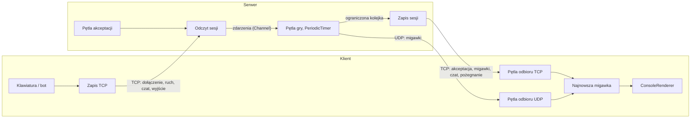

# Snake Arena – sieciowa gra w węża dla wielu graczy

**Suma punktów:** 8

> [!NOTE]
> ## Kod początkowy
> 

## 1. Przegląd
W tym zadaniu zbudujesz sieciową wersję klasycznej gry w węża dla wielu graczy, w którą gra się w konsoli na systemach Windows, Linux i macOS. Gra korzysta z **serwera autorytatywnego** (*authoritative server*): tylko serwer symuluje grę. Klienci wysyłają ruchy swoich graczy i rysują migawki stanu (*snapshots*), które serwer rozsyła po każdym kroku gry (*ticku*, domyślnie 10 na sekundę). Klienci łączą się z serwerem przez TCP. W części 4 dodatkowo wyszukują serwery w sieci lokalnej i odbierają migawki przez UDP.

Otrzymujesz:
*   `SnakeArena.Shared/Game` – kompletne, deterministyczne zasady gry (`GameState`). `GameState.Tick(inputs)` przesuwa grę o jeden tick, a `GameState.ToSnapshot()` zwraca wiadomość `StateSnapshot` do rozesłania. Nie implementujesz żadnej logiki gry.
*   `SnakeArena.Shared/Protocol` – rekordy wiadomości i datagramów (`Messages.cs`, `Datagrams.cs`), `ProtocolConstants` oraz `ProtocolException`.
*   `SnakeArena.Client` – renderer konsolowy (`ConsoleRenderer`), gracza komputerowego (`SnakeBot`) oraz obsługę wiersza poleceń klienta. Obsługa wiersza poleceń serwera znajduje się w `SnakeArena.Server`.
*   `SnakeArena.Tests` – testy xUnit do wszystkiego, co implementujesz. Kompilują się z kodem początkowym, ale nie przechodzą, dopóki nie zaimplementujesz odpowiednich części. Od początku przechodzą tylko `GameStateTests`, które dokumentują dostarczone zasady.

Twoim celem jest implementacja protokołu (`MessageCodec`, `Framing`, `DatagramCodec`), serwera (`GameServer`) oraz klienta (`GameClient`, `LanDiscovery`).



### Zasady gry (dostarczone)
Plansza ma `Width` × `Height` pól (domyślnie 30 × 16); `(0, 0)` to lewy górny róg. W każdym ticku wszystkie węże przesuwają się o jedno pole w swoim kierunku (żądanie zawrócenia jest ignorowane). Wąż, który dotrze do jedzenia, wydłuża się o jeden segment i dostaje 1 punkt. Wąż rozbija się, gdy jego głowa opuści planszę albo wejdzie na pole zajęte przez dowolnego węża (także przez niego samego) lub przez inną głowę. Co drugi segment rozbitego węża zamienia się w jedzenie, a gracz odradza się po 20 tickach z wężem o długości 3. Wynik nie przepada po rozbiciu.

Przydatne wykłady: [Sieć](), [TCP](), [Serializacja](), [Zadania](), [Programowanie asynchroniczne](), [Kolekcje współbieżne](), [Blokowanie wyłączne]().

## 2. Wymagania

Zasady ogólne dla wszystkich części:
*   Wszystkie operacje sieciowe są asynchroniczne (`async`/`await`); bez aktywnego czekania (klient może odpytywać klawiaturę z krótkim opóźnieniem).
*   Zdalna strona nigdy nie może doprowadzić do awarii programu: błędne dane, przekroczenia czasu i rozłączenia kończą tylko dane połączenie.
*   Nie zmieniaj zasad gry, rekordów w `Messages.cs`/`Datagrams.cs`, testów ani publicznych składowych używanych przez testy. Możesz dodawać własne klasy, pliki i składowe.
*   Wszystkie testy muszą przechodzić (`dotnet test`).

### Część 1: Protokół i serializacja [2 Punkty]
**Pliki:** `SnakeArena.Shared/Protocol/MessageCodec.cs`, `SnakeArena.Shared/Protocol/Framing.cs`\
**Testy:** `MessageCodecTests`, `FramingTests`

Zaimplementuj binarny protokół używany przez TCP. Jest on zdefiniowany następująco.

**Typy danych.** Wszystkie liczby całkowite są zapisywane w kolejności **little-endian** (najmniej znaczący bajt pierwszy – tak jak w `BinaryWriter`, `BinaryReader` i `BinaryPrimitives.*LittleEndian`).

| Typ | Rozmiar [B] | Kodowanie |
|---|---|---|
| `u8` | 1 | liczba całkowita bez znaku |
| `u16` | 2 | liczba całkowita bez znaku, little-endian |
| `u32` | 4 | liczba całkowita bez znaku, little-endian |
| `str` | 2 + n | `u16` n = liczba **bajtów**, a po niej n bajtów UTF-8 (bez BOM i bez terminatora) |
| `pos` | 2 | `u8 x`, `u8 y` |
| `dir` | 1 | `u8`: 0 = Up, 1 = Right, 2 = Down, 3 = Left |

> [!WARNING]
> `BinaryWriter.Write(string)` **nie** zapisuje typu `str`: poprzedza napis długością o zmiennej liczbie bajtów (kodowaną po 7 bitów).

**Ramki.** Strumień TCP to ciąg ramek: `u32 length`, a po nim `length` bajtów *treści*. Treść to typ wiadomości (`u8`), po którym następują jej dane. Poprawna długość to 1–65 536 (`ProtocolConstants.MaxFrameLength`).

**Wiadomości** (`C → S`: od klienta do serwera, `S → C`: od serwera do klienta):

| Typ | Wiadomość | Kierunek | Dane |
|---|---|---|---|
| `0x01` | `JoinRequest` | C → S | `u16 protocolVersion`, `str name` |
| `0x02` | `PlayerInput` | C → S | `dir direction` |
| `0x03` | `ChatSend` | C → S | `str text` |
| `0x04` | `LeaveRequest` | C → S | (brak) |
| `0x81` | `JoinAccepted` | S → C | `u8 playerId`, `u8 width`, `u8 height`, `u16 tickIntervalMs`, `u32 sessionToken` |
| `0x82` | `JoinRejected` | S → C | `u8 reason` (1 = VersionMismatch, 2 = ServerFull, 3 = InvalidName, 4 = NameTaken), `str details` |
| `0x83` | `StateSnapshot` | S → C | `u32 tick`, `u8 playerCount`, *playerCount* × gracz, `u16 foodCount`, *foodCount* × `pos` |
| `0x84` | `ChatBroadcast` | S → C | `str sender`, `str text` |
| `0x85` | `ServerGoodbye` | S → C | `str reason` |

Gracz wewnątrz `StateSnapshot`: `u8 id`, `str name`, `u8 flags` (bit 0 = żyje; pozostałe bity są zarezerwowane – zapisuj 0, ignoruj przy odczycie), `dir direction`, `u16 score`, `u16 segmentCount`, *segmentCount* × `pos` (najpierw głowa; rozbity wąż nie ma segmentów).

Przykład – ramka z `StateSnapshot(Tick: 7, Players: [#1 "A", alive, Right, score 2, body (2,1) (1,1)], Food: [(5,3)])`:

```text
18 00 00 00          frame length = 24
83                   type = StateSnapshot
07 00 00 00          tick = 7
01                   1 player:
  01                   id = 1
  01 00 41             name = "A"
  01                   flags = alive
  01                   direction = Right
  02 00                score = 2
  02 00 02 01 01 01    2 segments: (2,1) (1,1)
01 00 05 03          1 food item: (5,3)
```

Jeszcze dwa przykłady: `PlayerInput(Left)` to ramka `02 00 00 00 02 03`, a `JoinRequest(1, "Ala")` to `08 00 00 00 01 01 00 03 00 41 6C 61`.

1.  **Kodowanie:** `MessageCodec.Encode(Message)` zwraca treść ramki dla każdej wiadomości z `Messages.cs`, dokładnie według powyższej definicji. Wartości, których nie da się zapisać (napis dłuższy niż 65 535 bajtów w UTF-8, współrzędna spoza zakresu 0–255, zbyt wiele elementów listy), powodują `ArgumentException` (lub wyjątek pochodny).
2.  **Dekodowanie:** `MessageCodec.Decode(ReadOnlySpan<byte>)` jest operacją odwrotną: `Decode(Encode(m))` jest równe `m`.
3.  **Walidacja:** `Decode` traktuje dane wejściowe jako niezaufane i rzuca `ProtocolException` – i żaden inny wyjątek – dla pustej treści, nieznanego typu wiadomości, uciętych danych, nadmiarowych bajtów na końcu, niepoprawnego UTF-8 (dekoduj w trybie ścisłym), kierunku większego niż 3 oraz nieznanego powodu odrzucenia. Liczba elementów odczytana z danych nie może powodować alokacji większych, niż mogą wypełnić pozostałe dane.
4.  **Zapis ramek:** `Framing.WriteFrameAsync` zapisuje prefiks długości i treść (najlepiej jednym wywołaniem `WriteAsync`). Pusta treść lub treść dłuższa niż `MaxFrameLength` powoduje `ArgumentException`.
5.  **Odczyt ramek:** `Framing.ReadFrameAsync` zwraca treść dokładnie jednej ramki, niezależnie od tego, jak strumień podzieli dane (`ReadAsync` może zwrócić dowolną liczbę bajtów, nawet jeden). Zwraca `null`, jeśli strumień skończy się przed pierwszym bajtem ramki, rzuca `EndOfStreamException`, jeśli skończy się wewnątrz ramki, oraz `ProtocolException`, jeśli długość wynosi 0 lub jest większa niż `MaxFrameLength` (sprawdzane przed alokacją treści). Obsługuje anulowanie.
6.  **Wersjonowanie:** wersja protokołu (`ProtocolConstants.Version` = 1) jest przesyłana w `JoinRequest` i w datagramach wyszukiwania serwerów (część 4). Strona używająca innej wersji jest odrzucana (część 2).

### Część 2: Serwer [2 Punkty]
**Pliki:** `SnakeArena.Server/GameServer.cs` (oraz dowolne nowe pliki w `SnakeArena.Server`)\
**Testy:** `ServerTests` (uruchamiają prawdziwy `GameServer` na interfejsie pętli zwrotnej i korzystają też z Twojej części 1)

Publiczne API klasy `GameServer` jest dane; `Program.cs` już przetwarza opcje (`ServerOptions`) i anuluje token po naciśnięciu Ctrl+C.

1.  **Nasłuchiwanie:** `Start()` wiąże `TcpListener` z `IPAddress.Any` i portem `options.Port` (0 = dowolny wolny port; `LocalEndPoint` zwraca faktyczny punkt końcowy). `RunAsync` uruchamia pętlę akceptacji współbieżnie z pętlą gry i obsługuje każde połączenie osobnymi zadaniami asynchronicznymi. Dla zaakceptowanych gniazd ustaw `NoDelay = true` i `SendBufferSize = 32 KiB` (w przeciwnym razie system buforuje megabajty danych dla klienta, który nie czyta).
2.  **Uzgadnianie połączenia:** pierwszą wiadomością połączenia musi być `JoinRequest`, odebrana w czasie `options.HandshakeTimeout`; w przeciwnym razie serwer zamyka połączenie (opcjonalnie po wysłaniu `ServerGoodbye`). Żądanie jest odrzucane wiadomością `JoinRejected`, po której serwer zamyka połączenie, nie wysyłając nic więcej, jeśli (sprawdzane w tej kolejności):
    *   wersja jest różna od `ProtocolConstants.Version` – `VersionMismatch`;
    *   nazwa nie składa się z 1–16 liter ASCII, cyfr, `_` lub `-` – `InvalidName`;
    *   nazwy używa już połączony gracz (bez rozróżniania wielkości liter) – `NameTaken`;
    *   dołączyło już `options.MaxPlayers` graczy – `ServerFull`.

    W przeciwnym razie serwer przydziela nieużywany `PlayerId` (1–255) i losowy, niezerowy token sesji, dodaje gracza do gry, wysyła `JoinAccepted` (rozmiar planszy i odstęp między tickami z opcji) – zawsze jako pierwszą wiadomość, którą klient otrzymuje po dołączeniu – i ogłasza wszystkim graczom `ChatBroadcast("*", "<name> joined the game.")`.
3.  **Odbieranie:** każde połączenie ma pętlę odbioru, która przekazuje odebrane wiadomości do pętli gry przez `Channel<T>` (`System.Threading.Channels`). Pętla gry jest jedynym kodem, który korzysta z `GameState` i listy graczy.
    *   `PlayerInput`: serwer przechowuje dla każdego gracza kolejkę co najwyżej 3 oczekujących kierunków (kolejne są odrzucane) i w każdym ticku używa co najwyżej jednego z nich.
    *   `ChatSend`: tekst jest przycinany z obu stron, ignorowany, jeśli jest pusty, i skracany do 200 znaków (`MaxChatLength`); następnie `ChatBroadcast(<name>, text)` trafia do wszystkich graczy, łącznie z nadawcą.
    *   `LeaveRequest`: gracz jest usuwany, a połączenie zamykane.
    *   Nieoczekiwany typ wiadomości lub błędna ramka: serwer wysyła `ServerGoodbye("Protocol error: …")` i zamyka tylko to połączenie.
4.  **Pętla gry:** sterowana przez `PeriodicTimer` z odstępem `options.TickIntervalMs`. W każdym ticku przetwarza zdarzenia z kolejki, wywołuje `GameState.Tick` z ruchami z tego ticku i rozsyła `GameState.ToSnapshot()` do wszystkich graczy. Migawka jest kodowana raz na tick, a nie raz na gracza.
5.  **Wysyłanie i wolni klienci:** pętla gry nigdy nie czeka na operacje sieciowe. Każde połączenie ma ograniczoną kolejkę wychodzącą (`options.SendQueueCapacity` ramek) i dokładnie jedno zadanie zapisujące, które jest jedynym kodem piszącym do strumienia tego połączenia. Jeśli kolejka gracza jest pełna, gdy pętla gry chce dodać ramkę, klient jest zbyt wolny: serwer natychmiast usuwa gracza i zamyka połączenie. Pozostali gracze nie mogą tego odczuć.
6.  **Rozłączenia:** gdy połączenie się kończy (koniec strumienia, błąd wejścia-wyjścia), gracz jest usuwany z gry (znika z następnej migawki), pozostali dostają komunikat `"<name> left the game."`, a nazwa może być ponownie użyta.
7.  **Kontrolowane zamknięcie:** gdy token przekazany do `RunAsync` zostanie anulowany, serwer przestaje przyjmować połączenia, wysyła `ServerGoodbye` (np. `"The server is shutting down."`) do każdego klienta, zamyka wszystkie połączenia (także te, które jeszcze nie dołączyły do gry), a `RunAsync` kończy się w ciągu kilku sekund, bez nieobsłużonych wyjątków.
8.  **Dziennik:** jeden wiersz na każde istotne zdarzenie (połączenie, dołączenie, odrzucenie, wyjście, rozłączenie wraz z powodem) jest zapisywany do `TextWriter` przekazanego do konstruktora.

### Część 3: Klient [2 Punkty]
**Plik:** `SnakeArena.Client/GameClient.cs` (oraz dowolne nowe pliki w `SnakeArena.Client`)

`Program.cs` już przetwarza opcje (`ClientOptions`), anuluje token po naciśnięciu Ctrl+C i obsługuje `--discover` za pomocą `LanDiscovery` (część 4).

1.  **Dołączanie:** klient łączy się z `--host`/`--port`, wysyła `JoinRequest` i czeka na odpowiedź (limit 5 s na każdy krok). Jeśli nie może się połączyć lub żądanie zostanie odrzucone, wypisuje powód, a `RunAsync` zwraca 2.
2.  **Współbieżność:** pętla odbioru czyta strumień TCP współbieżnie z pętlą główną i zapisuje (w sposób bezpieczny wątkowo) najnowszą migawkę oraz wiersze czatu. Pętla główna odczytuje klawiaturę (`Console.KeyAvailable` + `Console.ReadKey(true)` co ok. 10 ms albo osobny wątek) i rysuje za pomocą dostarczonego `ConsoleRenderer` – tylko z jednego wątku i tylko wtedy, gdy coś się zmieniło.
3.  **Sterowanie:** strzałki lub WASD wysyłają `PlayerInput`; `Enter` rozpoczyna pisanie wiersza czatu (widocznego w wierszu wprowadzania; `Backspace` usuwa znak, `Enter` wysyła `ChatSend`, `Esc` anuluje); `Esc` lub `Q` kończy grę.
4.  **Wyświetlanie:** plansza i tabela wyników (renderer), wiersz stanu (nazwa, id, własny wynik lub informacja o rozbiciu, tick, liczba migawek odebranych przez TCP/UDP i odrzuconych jako nieaktualne) oraz ostatnie wiersze czatu, łącznie z komunikatami serwera.
5.  **Wyjście:** po `Esc`/`Q` lub Ctrl+C klient wysyła `LeaveRequest`, czeka (co najwyżej 1 s), aż serwer zamknie połączenie, przywraca konsolę (`ConsoleRenderer.Restore`) i zwraca 0.
6.  **Utrata serwera:** gdy serwer zamknie połączenie lub połączenie zostanie zerwane (także gdy proces serwera zostanie zabity), klient przywraca konsolę, wypisuje powód (tekst `ServerGoodbye`, jeśli go otrzymał) i zwraca 1. Nigdy się nie zawiesza i nigdy nie kończy się wyjątkiem.
7.  **Tryb bota (`--bot`):** bez klawiatury i bez renderera (wyjście może być przekierowane). Po każdej nowej migawce klient pyta `SnakeBot.ChooseDirection` i wysyła `PlayerInput`, jeśli wynik różni się od bieżącego kierunku. Mniej więcej raz na sekundę wypisuje wiersz stanu, a wiersze czatu – na bieżąco. Ctrl+C kończy grę jak w punkcie 5.
8.  **`--stall-after <s>`** (do debugowania): po podanej liczbie sekund pętla odbioru przestaje czytać strumień TCP (i czeka na anulowanie). Z tą opcją ustaw `ReceiveBufferSize = 4096` przed nawiązaniem połączenia. Razem z `--bot --tcp-only` symuluje to wolnego klienta na potrzeby części 2.

### Część 4: Wyszukiwanie serwerów w sieci lokalnej i migawki przez UDP [2 Punkty]
**Pliki:** `SnakeArena.Shared/Protocol/DatagramCodec.cs`, `SnakeArena.Client/LanDiscovery.cs`, `GameServer.cs`, `GameClient.cs`, `NOTES.md` (nowy, obok pliku `.slnx`)\
**Testy:** `DatagramCodecTests`, `UdpTests`

Datagramy UDP mogą zginąć, zostać zduplikowane lub dotrzeć w innej kolejności, a każdy może wysłać cokolwiek na port UDP. Migawki dobrze pasują do UDP: zgubioną migawkę zastępuje następna, tick później, podczas gdy TCP wstrzymałby wszystkie późniejsze migawki do czasu retransmisji zgubionych danych. Wiadomości sterujące (dołączenie, ruchy, czat, wyjście, pożegnanie) pozostają w TCP.

Każdy datagram zaczyna się od 4 bajtów ASCII `SNAK` (`53 4E 41 4B`) i `u8 kind`; typy danych są takie jak w części 1:

| Rodzaj | Datagram | Wysyłany | Dane |
|---|---|---|---|
| `0x01` | `DiscoveryProbe` | klient → rozgłoszenie, port UDP 47001 | `u16 protocolVersion`, `u32 nonce` |
| `0x02` | `DiscoveryReply` | serwer → nadawca zapytania | `u16 protocolVersion`, `u32 nonce` (skopiowany z zapytania), `str serverName`, `u16 tcpPort`, `u8 playerCount`, `u8 maxPlayers` |
| `0x03` | `UdpHello` | klient → port gry UDP serwera | `u8 playerId`, `u32 sessionToken` |
| `0x04` | `SnapshotDatagram` | serwer → punkt końcowy UDP klienta | `u32 sessionToken`, a po nim treść ramki `StateSnapshot` (zaczynająca się od `0x83`) |

1.  **Kodek:** `DatagramCodec.Encode` i `DatagramCodec.TryDecode`. `TryDecode` nigdy nie rzuca wyjątku; zwraca `false` dla wszystkiego, co nie jest poprawnym datagramem (zły znacznik, nieznany rodzaj, ucięte dane, nadmiarowe bajty, niepoprawna zawartość – w tym osadzona treść, która nie jest poprawną migawką `StateSnapshot`).
2.  **Wyszukiwanie – serwer:** jeśli ustawiono `options.EnableDiscovery`, `Start()` wiąże dodatkowo `UdpClient` z `IPAddress.Any` i portem `options.DiscoveryPort` (`DiscoveryEndPoint` zwraca jego punkt końcowy, w przeciwnym razie `null`). Serwer odpowiada na każde poprawne `DiscoveryProbe` datagramem `DiscoveryReply` (z bieżącą liczbą graczy) wysłanym na punkt końcowy nadawcy zapytania, a inne datagramy ignoruje.
3.  **Wyszukiwanie – klient:** `LanDiscovery.FindServersAsync(targets, timeout)` wysyła jedno zapytanie z losowym `nonce` do każdego celu z gniazda z `EnableBroadcast = true` i zbiera odpowiedzi z tym samym `nonce` i wersją protokołu aż do upływu limitu czasu (kończy się po tym czasie, nawet jeśli nic nie nadeszło). Wynik zawiera jeden `DiscoveredServer` na adres i port TCP: adres to adres nadawcy odpowiedzi, a port to `tcpPort`. Dla `--discover` `Program.cs` wysyła zapytania na `255.255.255.255` i `127.0.0.1`, więc serwer na tym samym komputerze może pojawić się na liście dwukrotnie (raz dla każdego adresu).
4.  **Migawki przez UDP – serwer:** `Start()` wiąże kolejny `UdpClient` z `IPAddress.Any` i numerem portu, na którym nasłuchuje TCP. Poprawny `UdpHello` (istniejący gracz, zgodny token) rejestruje dla tego gracza punkt końcowy nadawcy datagramu: od następnego ticku jego migawki są wysyłane wyłącznie jako `SnapshotDatagram` na ten punkt końcowy, a nie przez TCP. Jeśli od gracza nie nadszedł poprawny `UdpHello` przez `ProtocolConstants.UdpTimeout` (2 s), serwer znów wysyła mu migawki przez TCP.
5.  **Migawki przez UDP – klient:** o ile nie podano `--tcp-only`, po dołączeniu klient wysyła `UdpHello` co `ProtocolConstants.UdpHelloInterval` (500 ms) z własnego `UdpClient` na adres serwera i numer portu TCP oraz odbiera datagramy `SnapshotDatagram` (ignorując te z innym tokenem). Przestaje wysyłać `UdpHello`, gdy przez `UdpTimeout` nie nadeszła żadna migawka przez UDP – np. gdy zapora sieciowa blokuje UDP – dzięki czemu serwer wraca do TCP i gra toczy się dalej. Migawki z TCP i UDP aktualizują tę samą „najnowszą migawkę”: migawka jest używana tylko wtedy, gdy jej tick jest większy od ticku najnowszej; starsze i powtórzone są odrzucane i zliczane.
6.  **Notatka o bezpieczeństwie wątkowym:** w pliku `NOTES.md` (najwyżej jedna strona) opisz zadania/wątki serwera i klienta, do którego z nich należą jakie dane, jak dane są przekazywane między nimi (kanały, blokady, `Volatile`/`Interlocked`, …) oraz dlaczego wolny lub złośliwy klient nie może zablokować pętli gry.

## 3. Budowanie

```bash
dotnet build
dotnet test

# terminal 1: the server (Ctrl+C stops it)
dotnet run --project SnakeArena.Server
# terminals 2 and 3: players
dotnet run --project SnakeArena.Client -- --name Alice
dotnet run --project SnakeArena.Client -- --name Bob
# more players, and a player that finds the server in the LAN
dotnet run --project SnakeArena.Client -- --name Robo --bot
dotnet run --project SnakeArena.Client -- --name Carol --discover
```

`--help` wyświetla wszystkie opcje programu (np. `--tick`, `--width`, `--seed`, `--tcp-only`). Klient interaktywny potrzebuje konsoli o rozmiarze co najmniej 80 × 24 znaki dla domyślnej planszy. Aby grać w sieci lokalnej na Windowsie, zezwól serwerowi na komunikację w zaporze sieciowej (TCP i UDP na porcie 47000, UDP na porcie 47001).

## 4. Wskazówki

*   `Stream.ReadExactlyAsync` i `Stream.ReadAtLeastAsync(…, throwOnEndOfStream: false)` radzą sobie z częściowymi odczytami.
*   Do kodowania wystarczy `BinaryWriter` na `MemoryStream`. Do dekodowania wycinaj fragmenty `ReadOnlySpan<byte>` i używaj `BinaryPrimitives.ReadUInt16LittleEndian` itp. (albo `BinaryReader` na `MemoryStream`, zamieniając jego `EndOfStreamException` na `ProtocolException`). Ścisłe UTF-8: `new UTF8Encoding(false, throwOnInvalidBytes: true)`.
*   `Channel.CreateUnbounded<T>(new UnboundedChannelOptions { SingleReader = true })` nadaje się na zdarzenia pętli gry; `Channel.CreateBounded<byte[]>(capacity)` z `TryWrite` – na kolejkę wychodzącą.
*   `PeriodicTimer.WaitForNextTickAsync(token)` rzuca `OperationCanceledException`, gdy token zostanie anulowany.
*   Zamknięcie gniazda, w którym zostały nieodczytane dane przychodzące, powoduje zresetowanie połączenia przez system, a druga strona może stracić ostatnio wysłane ramki (np. `ServerGoodbye`). Kontrolowane zamknięcie: `Socket.Shutdown(SocketShutdown.Send)` po ostatniej ramce, krótkie oczekiwanie, aż druga strona zamknie swoją część, i dopiero wtedy zwolnienie gniazda.
*   `new TcpClient()` używa gniazda IPv6 w trybie dual-mode, więc `RemoteEndPoint` połączenia z serwerem IPv4 wygląda jak `[::ffff:127.0.0.1]:47000`. Przed użyciem adresu z `UdpClient` dla IPv4 przekształć go metodą `MapToIPv4()`.
*   Na Windowsie po wysłaniu datagramu na port, na którym nikt nie nasłuchuje, następne `ReceiveAsync` na tym samym `UdpClient` może rzucić `SocketException` (`ConnectionReset`): zignoruj go i odbieraj dalej.
*   Nigdy nie używaj `await` wewnątrz sekcji krytycznej (`lock`).

## 5. Obrona

Oprócz kodu i przechodzących testów sprawdzimy:
*   grę dwóch klientów interaktywnych i kilku botów (być może na dwóch komputerach);
*   zabicie klienta (znika z gry) oraz zatrzymanie lub zabicie serwera (klienci kończą działanie z komunikatem);
*   wolnego klienta: serwer z `--tick 20`, cztery boty i klient z `--bot --tcp-only --stall-after 3` – serwer rozłącza wolnego klienta w ciągu ok. 30 s, a boty grają dalej bez zakłóceń;
*   Twoje wyjaśnienie decyzji dotyczących bezpieczeństwa wątkowego z `NOTES.md`.
